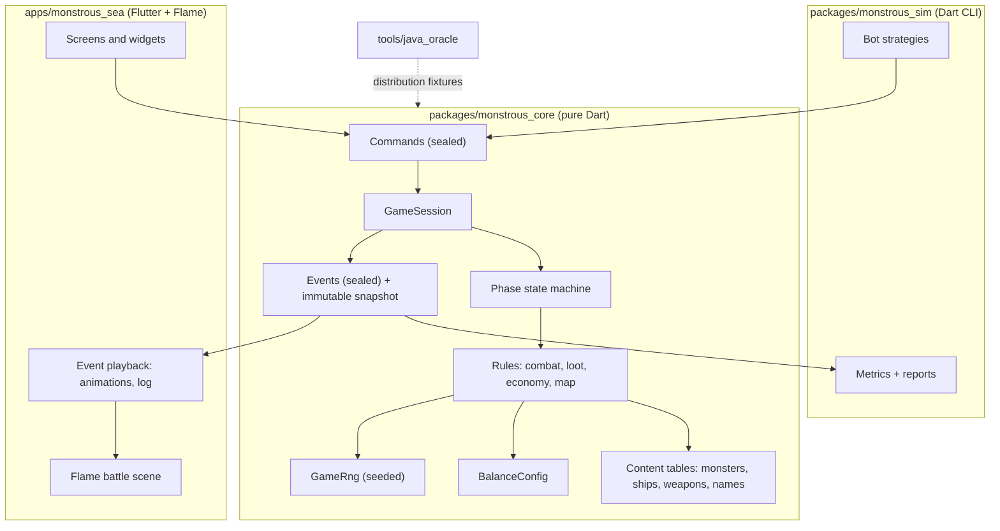
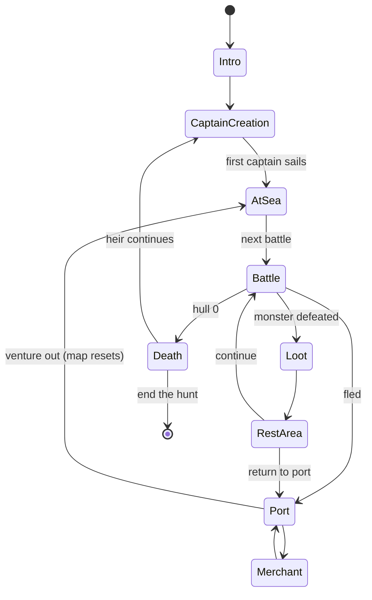
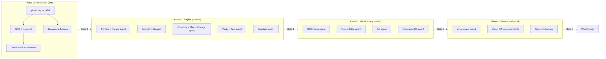

# The Monstrous Sea V2: Milestone 1 Implementation Plan

## Goal

Rebuild *The Monstrous Sea* as a **visual, hand-drawn "ink-and-parchment" game**. It should be a mostly faithful remake of the Java console game, with bugs fixed, on an architecture that makes expansion easy. Development is driven by **phased agent orchestration**: you approve each phase, and parallel agents work inside it.

**Milestone 1 = vertical slice:** a headless game engine, plus a playable **Battle screen**, **Port hub**, and the screens that connect them into a full voyage loop (name captain → port → sea → battle → loot → rest → … → death → heir). It also includes a first version of the **balance simulator**, which tests your original "infinitely scaling" endless-mode idea.

---

## Platform decision: Flutter + Flame (Dart)

I compared options by **how well an agent can verify its own work**, since that is what makes goal-driven agent work succeed.

| Capability | Flutter + Flame | TS Web (Phaser) | Java (JavaFX/libGDX) | Godot/Unity |
|---|---|---|---|---|
| Already installed & healthy | ✅ Flutter 3.47 / Dart 3.13, VS 2026 (Windows desktop), Chrome (web) | ✅ Node 22 | ✅ JDK 24 (no Gradle/Maven) | ❌ |
| Agent can run **headless engine tests** | ✅ `dart test` | ✅ | ✅ | ⚠️ |
| Agent can **see & drive the running UI** | ✅ Dart MCP: screenshots, widget tree, tap/enter text, runtime errors, hot reload | ⚠️ Needs Playwright setup | ❌ | ❌ |
| Agent skills available in this environment | ✅ Flutter/Dart skills (tests, integration tests, layout fixes, a11y review agent) | — | — | — |
| Targets | Windows, Web, Android, iOS | Web | Desktop | All |
| Language closeness to your Java | ✅ Very close (classes, sealed types, generics) | Medium | Same | C#/GDScript |

**Decision:** Flutter + Flame, with **Windows desktop as the primary target** and Web as a free bonus build. The game rules live in a **pure Dart package with zero Flutter dependency**, so the engine, simulator, and tests run anywhere in milliseconds.

---

## Status: ✅ APPROVED by user (2026-10-10). All decisions below are final.

## Resolved Decisions

> [!IMPORTANT]
> **Repository setup:** run `git init` at `TheMonstrousSeaV2/` and add a root `.gitignore`. `TheMonstrousSea_Original/` and `OriginalProjectIdeas&Planning/` stay **read-only references**; nothing in them is modified.

> [!IMPORTANT]
> **Faithful-remake bug fixes.** These change behavior compared with the original. Each fix gets a regression test and an entry in `docs/bugs.md`:
>
> | # | Bug | Fix |
> |---|---|---|
> | B1 | `dropVictoryLoot` re-rolls the loop bound each iteration | Roll the item count once (3–6) |
> | B2 | `playMonsterTurn` can loop forever if every weapon is on cooldown | Pick only from ready weapons; if none are ready, the monster uses its special action or skips its turn |
> | B3 | `flee()`: the comment says 40% at base, the code gives 35% at level 1 | **USER DECISION: match the comment.** 40% at level 1, −5% per level (`success = d100 > 60 + 5*(level-1)`), so 15% at level 6, then a flat 5% above level 6 (`d100 > 95`). Values live in `BalanceConfig` |
> | B4 | `randomItem` drop odds are 61/20/19 instead of 60/20/20 | Use the intended 60/20/20 |
> | B5 | Freighter heir message prints the ship object instead of its name | Cosmetic fix |
> | B6 | `BattleMap` / RNG are global statics, which blocks save/load and seeding | Instance state + injected seeded RNG |

> [!WARNING]
> **Deferred to Milestone 2** to keep the slice tight: Shipyard **buying/selling ships, drydock, ship switching, and ship upgrading**. The engine will model multiple ship classes, and new captains still choose a class at heir selection (as in the original). Repair *is* included in M1 and lives in the Port hub.

---

## Answered Questions (final)

1. **B3 flee chance:** match the **comment** (40% base). See the B3 row above.
2. **Davy Jones easter egg:** **keep** it as a hidden cheat. Naming a captain "Davy Jones" (case-insensitive) gives the overpowered *Flying Dutchman* Ironclad and jumps straight to the Kraken battle (map position [3][4]). Mirrors `GameController.runOPShipAgainstFinalBoss()`.
3. **Fonts:** free OFL nautical fonts are approved, e.g. *Pirata One* (titles) and *IM Fell English* (body). Bundle the font files in `apps/monstrous_sea/assets/fonts/` (don't fetch at runtime) and include their OFL license text.
4. **Audio:** **deferred** to a later milestone. Leave only a no-op `AudioService` interface/hook.
5. **Shipyard (buy/sell/drydock/switch/upgrade):** **deferred to M2.** Repair stays in M1 (Port hub).
6. **All bug fixes B1–B6:** **approved.**

---

## Architecture



### Core idea: commands in → events out
The UI never calls game rules directly, and the rules never print or block. This one design choice fixes all three blockers from the original (tangled I/O, global statics, string-only results) and lets the **UI, simulator, and tests share one engine**.

```dart
// packages/monstrous_core/lib/src/session/commands.dart
sealed class Command {}
final class NameCaptain extends Command { NameCaptain(this.name); final String name; }
final class ChooseShip extends Command { ChooseShip(this.index); final int index; }
final class FireWeaponType extends Command { FireWeaponType(this.type); final ShipWeaponType type; }
final class UseConsumable extends Command { UseConsumable(this.itemId); final ItemId itemId; }
final class Flee extends Command {}
final class ShipSpecialAction extends Command {}            // Fortify / Evasive Maneuvers
final class ContinueToNextBattle extends Command {}
final class ReturnToPort extends Command {}
final class BuyItem extends Command { BuyItem(this.itemId); final ItemId itemId; }
final class SellItem extends Command { SellItem(this.itemId); final ItemId itemId; }
final class SellAllTreasure extends Command {}
final class RepairShip extends Command { RepairShip(this.percent); final int percent; }
final class TakeLoot extends Command { TakeLoot(this.itemIds); final List<ItemId> itemIds; }
final class DropCargo extends Command { DropCargo(this.itemId); final ItemId itemId; }
final class EquipWeapon extends Command { /* ... */ }
final class ContinueLineage extends Command { ContinueLineage(this.heirName); final String heirName; }
// ...
```

```dart
// packages/monstrous_core/lib/src/session/events.dart
sealed class GameEvent {}
final class BattleStarted extends GameEvent { /* monster snapshot, difficulty, isBoss */ }
final class WeaponFired extends GameEvent { /* attacker, weaponName, roll, targetAc */ }
final class AttackHit extends GameEvent { /* target, damage, damageType */ }
final class AttackMissed extends GameEvent { /* target */ }
final class AttackEvaded extends GameEvent { /* corvette dodge, wasManeuver */ }
final class DamageReduced extends GameEvent { /* ironclad, amountNullified */ }
final class TentaclesSevered extends GameEvent { /* count, remaining */ }
final class InkCloudReleased extends GameEvent {}
final class StatusApplied extends GameEvent { /* target, effect */ }
final class StatusTicked extends GameEvent { /* target, effect, damage, woreOff */ }
final class CombatantDefeated extends GameEvent { /* who, flavor line */ }
final class LootDropped extends GameEvent { /* items */ }
final class GoldChanged extends GameEvent { /* delta, total */ }
final class PhaseChanged extends GameEvent { /* from, to */ }
final class CaptainLost extends GameEvent { /* captain record for the legacy log */ }
// ...
```

```dart
// packages/monstrous_core/lib/src/session/game_session.dart
class GameSession {
  GameSession({required GameRng rng, BalanceConfig config = BalanceConfig.standard});

  GameSnapshot get snapshot;                 // immutable view for UI and bots
  List<AvailableAction> get availableActions; // data-driven menus (like PlayerAction today)

  /// Validates and applies [command]. Returns the ordered events it produced.
  /// Throws [IllegalCommand] if the command is not valid in the current phase.
  List<GameEvent> dispatch(Command command);
}
```

**Event text:** human-readable lines (including your original flavor text such as *"…and screams, before falling silent"*) are produced by a `NarrationFormatter` in core from events. That keeps prose consistent between the UI log and simulator transcripts, while the UI animates from the structured fields.

### Phase state machine (mirrors the original `GameController` loop)



### Modularity for future expansion
- **Data-driven content:** monsters, ships, weapons, consumables, and rarities are **definitions in tables**, not one class per thing. Special behaviors (tentacles, ink, fortify, evasion) are pluggable `Trait`s. Adding a new monster means adding a row plus an optional trait.
- **Name/adjective tables** (as you requested) live in `content/names/`: monster names per species, ship adjectives per class, captain first names and epithets, and Kraken-tier boss titles. A `NameForge` builds combinations procedurally (e.g. *"Weathered Corvette"*, *"Hundred-Limbed Horror"*). This also sets up future procedural monster variants.
- **`BalanceConfig`:** every magic number from the Java code (drop chances, the `1.25` scaling exponent, flee odds, status tick %, repair costs, loot level spread, monster action 80/20 split…) lives in one immutable config. The simulator can sweep these values without touching rules code.
- **Seeded `GameRng`:** deterministic runs for tests, reproducible bug reports, and future daily-seed mode.

---

## Proposed Changes

### Repository layout (all new; originals untouched)

```
TheMonstrousSeaV2/
├── .gitignore                       [NEW]
├── README.md                        [NEW]  how to run engine/sim/app
├── docs/
│   ├── GDD.md                       [NEW]  rules reverse-engineered from Java (formulas, tables)
│   ├── bugs.md                      [NEW]  B1–B6 with decisions
│   ├── decisions/0001-platform.md   [NEW]  ADR: Flutter + Flame
│   └── agents/                      [NEW]  per-agent task briefs and acceptance criteria
├── packages/
│   ├── monstrous_core/              [NEW]  pure Dart engine
│   └── monstrous_sim/               [NEW]  balance simulator CLI
├── apps/
│   └── monstrous_sea/               [NEW]  Flutter + Flame game
├── tools/
│   └── java_oracle/                 [NEW]  Java harness → JSON fixtures
├── OriginalProjectIdeas&Planning/   (unchanged)
└── TheMonstrousSea_Original/        (unchanged)
```

---

### Component 1: `tools/java_oracle` (parity reference)

The Java **model** classes (`Ship`, `SeaMonster`, `ItemGenerator`, `Battle`) don't need console input, so we can compile them with `javac` and drive them directly.

#### [NEW] `OracleMain.java`
Generates N samples (e.g. 20,000) for each item below and writes them to `fixtures/*.json`:
- Monster stats by species × level 1–8 (HP, AC, weapon damage)
- Ship stats by class × level 1–4
- Ship weapon damage/value by type × rarity
- Item drop type distribution, consumable type distribution
- Single-attack hit rates for weapon hit-mod vs AC grids

#### [NEW] `build_fixtures.ps1`
`javac -d out` over the original `src` plus the harness, then runs it. **It does not modify the original folder.**

**Why:** Java and Dart RNGs differ, so exact replay is impossible. Instead, Dart parity tests assert that **distributions match** (ranges are identical, and means fall within tolerance), with intentional bug-fix differences explicitly whitelisted.

---

### Component 2: `packages/monstrous_core` (engine)

```
lib/
├── monstrous_core.dart              public API exports
└── src/
    ├── rng/game_rng.dart            GameRng interface, SeededRng, dice helpers (d20, d100, nextIntRange)
    ├── config/balance_config.dart   all tunable numbers
    ├── content/
    │   ├── rarity.dart              Common/Rare/Epic/Legendary (+ ink color tokens for UI)
    │   ├── damage_types.dart        DamageType, StatusEffect
    │   ├── ship_weapons.dart        Cannon, Torpedo, Blade Launcher, Lightning Railgun, Flamethrower
    │   ├── monster_weapons.dart     Ram, Tail, Jaws, Claw, Tentacle, Stinging Tendrils
    │   ├── monsters.dart            Shark, Serpent, Jellyfish, Squid, Crustacean, The Kraken
    │   ├── ships.dart               Ship, Freighter, Ironclad, Corvette
    │   ├── consumables.dart         Unstable Tincture, Blast Pack, Chakram
    │   └── names/                   name & adjective tables + NameForge
    ├── model/                       Combatant, ShipState, MonsterState, Item, Cargo, Player, Lineage
    ├── traits/                      TentacleTrait, InkCloudTrait, FortifyTrait, EvasionTrait, StashTrait
    ├── rules/
    │   ├── combat.dart              attack roll, damage, volley-by-type, cooldowns, status ticks
    │   ├── monster_ai.dart          80/20 attack vs special; ready-weapon selection (fixes B2)
    │   ├── loot.dart                drop count/levels/types (fixes B1, B4)
    │   ├── item_generator.dart      level→rarity/value/damage scaling
    │   ├── economy.dart             buy/sell/repair pricing, merchant restock
    │   ├── sea_chart.dart           4×5 map, Kraken at [3][4], loop scaling (replaces static BattleMap)
    │   └── lineage.dart             death, heir, Freighter stash carryover, captains-lost log
    ├── session/                     commands, events, GameSession, phase machine, snapshot
    └── narration/                   NarrationFormatter (original flavor text)
test/
├── rules/*_test.dart                unit tests per rule (seeded)
├── bugs/b1..b6_test.dart            regression tests per bug fix
├── session/full_voyage_test.dart    scripted voyage → defeats the Kraken headless
└── parity/*_test.dart               distribution parity vs Java fixtures
```

Example of a faithful port with the B2 fix:

```dart
// rules/monster_ai.dart
List<GameEvent> takeMonsterTurn(MonsterState m, ShipState ship, GameRng rng, BalanceConfig cfg) {
  final ready = m.weapons.where((w) => w.chargeCountdown == 0).toList();
  final wantsSpecial = rng.d100() > cfg.monsterAttackChance; // 80 by default
  final canSpecial = m.specialTrait != null;                  // Crustacean has none

  if ((wantsSpecial && canSpecial) || (ready.isEmpty && canSpecial)) {
    return m.specialTrait!.activate(m, ship, rng);            // e.g. InkCloudReleased
  }
  if (ready.isEmpty) return [MonsterHesitated(m.id)];         // B2: no infinite loop
  final weapon = ready[rng.nextInt(ready.length)];
  return combat.monsterAttack(m, weapon, ship, rng, cfg);     // tentacle volley handled by trait
}
```

---

### Component 3: `packages/monstrous_sim` (balance simulator, v1)

#### [NEW] `bin/simulate.dart`
```
dart run monstrous_sim:simulate --runs 10000 --seed 42 --strategy cautious --max-difficulty 40 --out reports/
```
- **Bot strategies:** `reckless` (never returns to port), `cautious` (returns below X% hull, repairs, buys upgrades), `greedy` (sells everything, buys the strongest weapons), `random` (fuzzing).
- **Safety:** round cap per battle and step cap per run. Any stalemate or exception is reported as a **failure**, so the simulator doubles as a fuzz test for the engine.
- **Metrics:** survival curve by difficulty, rounds-to-kill, damage taken per battle, gold/item value over time, win rate per ship class, Kraken kill rate, cause of death, and int overflow / runaway-scaling checks at high difficulty (endless mode).
- **Output:** `report.md` (tables plus Mermaid `xychart-beta` charts) and `runs.csv`.

M1 scope is **measurement only**. Automated tuning (an agent that adjusts `BalanceConfig` toward target curves) is proposed for M2, once you decide what "balanced" should feel like.

---

### Component 4: `apps/monstrous_sea` (Flutter + Flame)

Dependencies: `flame`, `monstrous_core` (path), `google_fonts` *or* bundled font files. State management: a plain `ChangeNotifier` `GameController` that wraps `GameSession` (no heavy state library, so there's less for agents to get wrong).

```
lib/
├── main.dart
├── game_controller.dart            dispatches commands, queues events for playback
├── theme/ink_theme.dart            parchment palette, ink colors, fonts, rarity inks
├── widgets/                        ParchmentPanel, InkButton, HullGauge, CargoGrid, ItemCard, CombatLog, Typewriter
├── screens/
│   ├── intro_screen.dart           typewriter intro (your original lines + timing)
│   ├── captain_screen.dart         name captain/heir, choose ship class (heirs)
│   ├── port_screen.dart            hub: Merchant (buy/sell/sell-all), Repair, View Chart, Venture Out
│   ├── sea_chart_screen.dart       nautical chart of the 4×5 route; fog over unexplored rows; ship marker
│   ├── battle_screen.dart          Flame GameWidget + Flutter overlay (actions, weapon types w/ reload, consumables)
│   ├── loot_screen.dart            take all/specific, drop cargo when full
│   ├── rest_screen.dart            continue / adjust weapons / drop cargo / return to port
│   └── death_screen.dart           "The Sea has claimed another soul", stats, lineage, heir prompt
└── battle/                         Flame components: SeaBackground (animated ink waves), ShipSprite,
                                    MonsterSprite, Kraken tentacles, hit/miss/ink/burn effects, screen shake
integration_test/
└── voyage_test.dart                drives a seeded voyage through every screen
```

**Event playback:** the Battle screen consumes events in order (`WeaponFired` → projectile/flash, `AttackHit` → shake + floating ink number, `TentaclesSevered` → tentacle sprite removed, `InkCloudReleased` → ink overlay), and appends the narration line to the log. Input is locked during playback.

### Component 5: Art pipeline (ink-and-parchment)
- A style bible (`docs/art_style.md`): sepia parchment, iron-gall ink linework, crosshatching, a muted red accent for danger, old-nautical-chart vocabulary (compass rose, rhumb lines, *"here be monsters"* cartouches).
- Assets generated with the image tool into `apps/monstrous_sea/assets/art/`: parchment background, chart frame, 4 ship classes, 5 monsters + the Kraken, UI ornaments, and item icons per weapon/consumable/treasure type.
- **Every asset has a vector/placeholder fallback**, so the UI agent is never blocked waiting on art.

---

## Agent Orchestration

Each phase ends at a **gate**: I present results plus verification output, and you approve before the next phase starts. Inside a phase, agents work in parallel on **disjoint files** against interfaces I define first.



| Phase | Agents & ownership | Exit criteria (machine-checkable) |
|---|---|---|
| **0. Foundation** | Me + a research agent for GDD extraction | Repo builds; `GDD.md` covers every formula in the Java models; Java fixtures generated; core skeleton passes `dart analyze` |
| **1. Engine** | Content/Names → `content/`; Combat/AI → `rules/combat`, `monster_ai`, `traits/`; Economy/Map/Lineage → `rules/economy`, `sea_chart`, `lineage`, `loot`; Parity/Test → `test/`; Simulator → `packages/monstrous_sim` | `dart analyze` clean; `dart test` green (unit, bug regressions, parity, full-voyage-to-Kraken); `simulate --runs 10000` completes with **0 crashes/stalemates** and produces a report |
| **2. Visual slice** | UI Screens → `screens/`, `widgets/`, `theme/`; Flame Battle → `battle/`; Art → `assets/`, `art_style.md`; Integration QA → `integration_test/`, widget tests | `flutter analyze` clean; `flutter test` green; `integration_test/voyage_test.dart` passes on Windows; screenshots of every screen captured for review |
| **3. Polish** | `flutter_a11y_agent` review; visual QA agent (screenshot critique against the style bible); sim report summary | a11y findings triaged/fixed; walkthrough with screenshots |

> [!NOTE]
> I act as the orchestrator: I write the task briefs (`docs/agents/*.md` with scope, owned files, interfaces, and acceptance commands), launch agents, review their diffs, run the gates, and make one git commit per completed agent task, so everything is easy to review and roll back.

---

## Verification Plan

### Automated tests
```powershell
# Engine
cd packages/monstrous_core;  dart analyze;  dart test

# Java parity fixtures (regenerate when needed)
./tools/java_oracle/build_fixtures.ps1
cd packages/monstrous_core;  dart test test/parity

# Simulator smoke + fuzz
cd packages/monstrous_sim;  dart run monstrous_sim:simulate --runs 10000 --seed 42 --strategy random
dart run monstrous_sim:simulate --runs 2000 --seed 7 --strategy cautious --max-difficulty 40

# App
cd apps/monstrous_sea;  flutter analyze;  flutter test
flutter test integration_test/voyage_test.dart -d windows
```

### Agent-driven UI verification
Run the app with `flutter run -d windows`, then use the Dart MCP tools (`widget_inspector`, `flutter_driver_command` → `tap` / `screenshot`, `get_runtime_errors`) to walk every screen. Screenshots are embedded in the walkthrough.

### Manual verification (you)
1. `cd apps/monstrous_sea; flutter run -d windows`
2. Name a captain, sail out, win a battle, take loot, rest, and return to port.
3. Buy/sell at the Merchant, repair, venture out again, and reach the Kraken.
4. Die on purpose, and continue as an heir with a different ship class (try a Freighter heir for the stash carryover).
5. Read `packages/monstrous_sim/reports/report.md` and tell me how the difficulty curve *should* feel. That becomes the target for M2 auto-tuning.

---

## Beyond Milestone 1 (for context only, not in scope)
- **M2:** Shipyard (buy/sell/drydock/switch/upgrade), auto-tuning balance agent, save/load, audio.
- **M3:** Branching node map, Family Tree legacy screen, ammo types (original stretch goal), more bosses, procedural monster variants from the name/trait tables, Web/Android builds.
