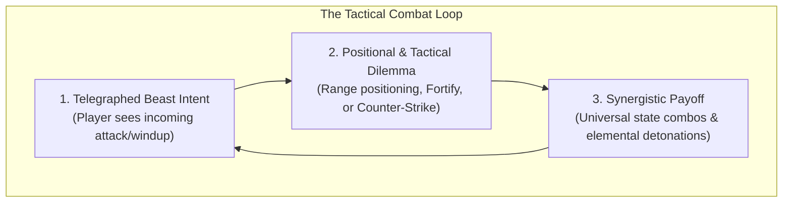
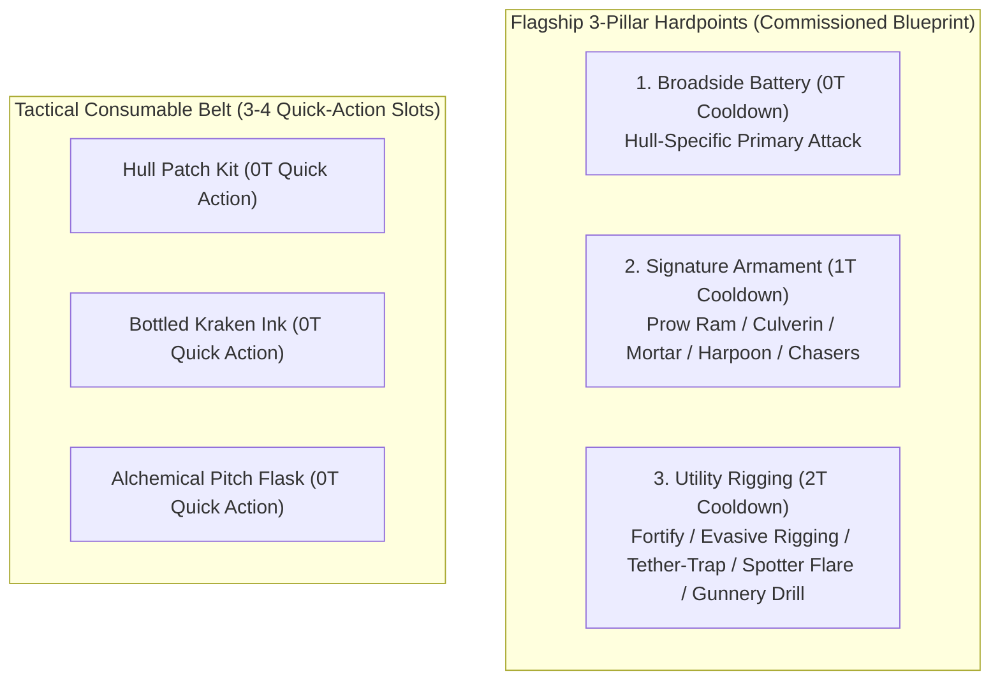
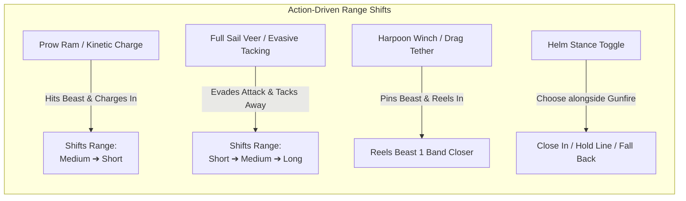
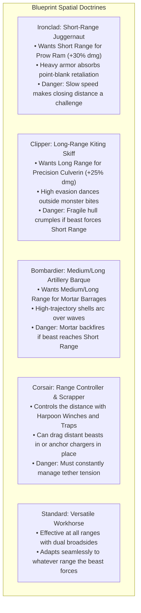
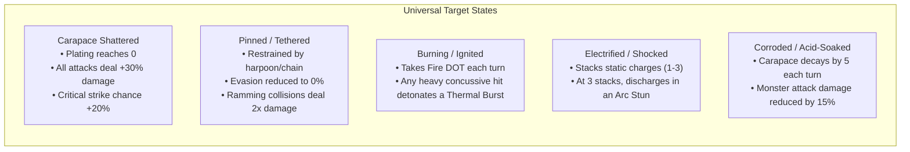
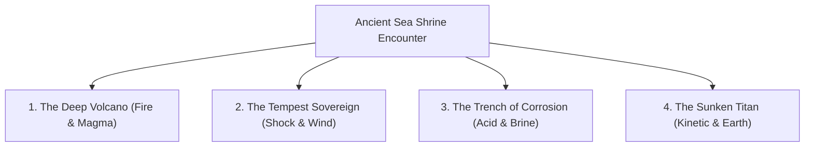
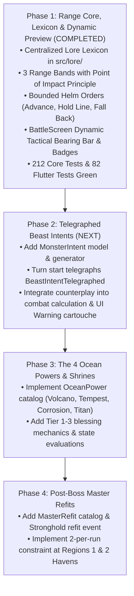

> **HISTORICAL / SUPERSEDED — NOT IMPLEMENTATION GUIDANCE.** Archived 20 October 2026 from `docs/COMBAT_SYSTEM_REDESIGN.md` at commit `c16a1a2`. Old approvals, locked specifications, instructions and test counts below apply only to that historical revision. Use the [current documentation guide](../../README.md) and open backlog for present work. Retain this file for explicitly requested historical reference only.

# Combat System Redesign & Tactical Depth Specification: The Monstrous Sea V2

> **Document Status:** Approved Design Blueprint  
> **Target Milestone:** Combat Overhaul & Tactical Dynamism  
> **Design Pillars:** Telegraphed Beast Intents, 3-Band Engagement Ranges, Action-Driven Mobility, Universal Non-Parasitic States, 4 Tiered Ocean Powers, Post-Boss Master Refits.

---

## 1. Executive Summary: Overcoming the "Math-Trading" Trap

### The Problem
In early turn-based prototypes, combat risked feeling like two static stat-blocks trading hits until one ran out of HP:
$$\text{Damage In} \Longleftrightarrow \text{Damage Out}$$
The optimal play was often mathematically trivial (spam the strongest ready weapon, heal when low), lacking reactive counterplay, positioning, or dramatic tension.

### The Solution: The Dynamic Tactical Triangle
To bring the addictive, replayable magic of *Hades* and *Slay the Spire* into our nautical cartography setting, combat is restructured around three core psychological levers:



---

## 2. Complete Retirement of Weapon Weight & Generic Weapon Swapping

### The Decision
**Weapon Weight and generic RPG weapon-swapping are permanently retired.** Flagships no longer loot random cannons from sea monsters or swap weapons in and out of cargo.

### The Modern Topology: 3 Intrinsic Hardpoints + Tactical Consumable Belt
See [PHASE_3A_HARDPOINT_AND_BELT_SPEC.md](PHASE_3A_HARDPOINT_AND_BELT_SPEC.md) for the complete locked specification. Every commissioned [`FlagshipBlueprint`](../../../packages/monstrous_core/lib/src/model/flagship_blueprint.dart) permanently mounts **strictly 3 intrinsic Hardpoints**:



- **Hardpoint Types (`HardpointType`)**:
  - `broadside`: Primary hull battery (`0T` Cooldown) with a blueprint-specific range curve and damage type.
  - `signature`: Defining prow/centerline tactical weapon (`1T` Cooldown across all blueprints).
  - `utility`: Blueprint-specific defensive, positional, or control mechanism (`2T` Cooldown across all blueprints).
- **Hardpoint Tempering & Progression**:
  - Hardpoints scale across the voyage via **Port Tempering (`Mk I -> Mk II -> Mk III`)**, **Hull Tier Refits (`Lvl 1 -> 4`)**, **Sea Shrine Blessings**, and **Master Refits**.
  - The 4 legacy weapons (*Torpedo Launcher*, *Blade Launcher*, *Lightning Railgun*, *Flamethrower*) are retired as standalone lootable items and folded into Shrine Infusions and Master Refit transformations.
- **Tactical Consumable Belt**:
  - Replaces legacy cargo tonnage with **3–4 Tactical Consumable Slots**.
  - Triggering a consumable in combat is a **0-turn-cost Quick Action** (1 per round) that does not forfeit the ship's hardpoint action.

---

## 2b. Complete Retirement of the Flee Mechanic

### The Decision
**Fleeing as a combat action has been unilaterally and permanently removed.** Fleeing back to port mid-voyage was an anachronism from the 2017 Java single-encounter console loop. In our modern multi-region roguelite architecture, a magic "escape to port" button completely breaks the tension of deep-sea navigation and bypasses the lineage/succession meta-loop.

### Roguelite Reality & Tactical Counterplay
- **No Mid-Voyage Teleports**: Once the flagship embarks beyond the harbor, the voyage continues until victory or shipwreck.
- **Defensive Counterplay via Distance**: Players in peril manage danger through tactical maneuvering: issuing the Helm Order to *Fall Off the Wind* to **Long Range** provides $+15\%$ evasion and distances the ship from devastating melee attacks, while allowing artillery bombardment.
- **The Lineage Loop**: When a captain sinks, they do not reload or teleport; their journey concludes, triggering the generational succession to pass heirloom traits, legacy doubloons, and birth a Nemesis beast.

---

## 3. The 3 Engagement Range Bands

Naval combat takes place across **three discrete range bands**. Range is not an abstract coordinate grid; it is a clean, visual operational distance between the flagship and the leviathan.

```
┌─────────────────────────┬─────────────────────────┬─────────────────────────┐
│       LONG RANGE        │      MEDIUM RANGE       │       SHORT RANGE       │
│  (Artillery & Kiting)   │  (Classic Broadsides)   │ (Point-Blank & Ramming) │
└─────────────────────────┴─────────────────────────┴─────────────────────────┘
```

### Range Characteristic Matrix

| Range Band | Description | Flagship Tactical Modifiers | Beast Behavioral Tendencies |
|---|---|---|---|
| **Long Range** | Distant seas; choppy swells, mist, and extreme distance. | • Culverins & Mortars deal $+25\%$ damage.<br>• Flagship gains $+15\%$ Evasion.<br>• Standard Cannons suffer $-15\%$ Accuracy. | • Cannot land direct bites/claws.<br>• Uses ranged spit, tidal waves, or submerge surges to close distance. |
| **Medium Range** | Standard naval engagement distance; optimal broadside angles. | • Baseline performance across all standard cannons and broadsides.<br>• No universal accuracy or damage penalties. | • Balanced attacks: tentacle sweeps, venom sprays, and coiling windups. |
| **Short Range** | Point-blank collision zone; foaming water, snapping jaws. | • Prow Rams & Point-Blank blasts deal $+30\%$ lethal damage.<br>• Flagship loses $-15\%$ Evasion (harder to dodge direct thrashes).<br>• Mortars risk **Hull Backfire** (splash damage to own ship). | • Lethal multi-strike thrashing, hull breaches, and grappling bites. |

---

### Action-Driven Mobility (Eliminating the "Move Tax")

> [!IMPORTANT]
> **No Wasted Turns:** A player should **never** spend their entire turn simply pressing "Move Forward". Movement is woven directly into attacks, maneuvers, and tactical ship commands.



1. **Integrated Attack Momentum**:
   - *Prow Ram (Ironclad)*: Deals heavy kinetic damage **AND** advances the ship from Medium $\rightarrow$ Short Range.
   - *Precision Culverin (Clipper)*: Snipes at weak spots while maintaining distance.
   - *Harpoon Winch (Corsair)*: Barbed tether deals damage **AND** reels the beast 1 range band closer (or pins it from diving or retreating to Long Range).
2. **Integrated Defensive Maneuvering**:
   - *Evasive Veer*: Grants $+20\%$ evasion against the current round's telegraphed attack **AND** opens range by 1 band (Short $\rightarrow$ Medium, or Medium $\rightarrow$ Long).
   - *Fortify Plating*: Drops anchor/braces hull, halving incoming damage and **holding the current range band** regardless of monster pushback.
3. **The Helm Stance Toggle**:
   - Each combat turn, along with choosing which weapon/salvo to fire, the player selects a **Helm Order**:
     - *Close the Distance* ($\rightarrow$ Advance 1 band)
     - *Hold the Line* ($\leftrightarrow$ Maintain band)
     - *Fall Off the Wind* ($\leftarrow$ Retreat 1 band)

---

### Blueprint Range Affinities

Every Blueprint possesses a clear spatial comfort zone and tactical danger:



---

## 4. Telegraphed Monster Intent System

At the start of every combat round, the monster **telegraphs its intended action** via an on-screen tactical readout:

```
┌────────────────────────────────────────────────────────────────────────┐
│  APEX KRAKEN OF THE TRENCHES                  [HP: 160/220] [Carapace: 12]  │
│  CURRENT RANGE: MEDIUM RANGE                                           │
│                                                                        │
│  ⚠️ INTENT: [MAST-CRUSHER SLAM] (Multi-turn Windup - Hits Next Turn)    │
│  "Two colossal tentacles rise 40 feet above the waves, preparing to    │
│   crush the deck for 38 damage. Disrupted by Poise break or Harpoon!"   │
└────────────────────────────────────────────────────────────────────────┘
```

### The 4 Beast Intent Archetypes & Player Counters

| Intent Archetype | Visual Telegraph | Mechanical Threat | Strategic Counterplay |
|---|---|---|---|
| **Direct Strike** | Snapping jaws, sweeping claw, thrashing tail. | Deals instant damage this round (e.g. 14–20 dmg). | • *Fortify Plating* absorbs damage.<br>• *Evasive Veer* dodges the attack.<br>• *Range shift* moves out of reach. |
| **Lethal Windup** | Rearing appendages, gathering tidal surge, deep magma inhalation. | Multi-turn windup dealing massive damage (35–50 dmg) on turn 2. | • **Poise Break**: Heavy weapons deal poise damage to interrupt.<br>• **Carapace Shatter**: Breaking armor stuns and cancels the windup.<br>• **Harpoon Tether**: Severing/pinning the limb cancels the strike. |
| **Submerge & Stalk** | Diving into the trench, emitting thick ink clouds, phosphorescent wake. | Monster becomes *Obscured* ($-30\%$ player hit chance) and charges. | • High-arc Mortars flush out submerged beasts.<br>• Sonic Culverin ignores obscurity.<br>• Harpoon prevents diving. |
| **Hazardous Spew** | Boiling bile throat pouch, crackling dorsal ridges, toxic barb rattle. | Inflicts status damage over time (Burn, Poison, Deck Fire). | • Cleansing consumable items.<br>• High-DPS burst to defeat beast before ticks accumulate. |

---

## 5. Universal Non-Parasitic Combat States

> [!CAUTION]
> **Anti-Parasitic Design Rule:** No weapon, item, or blessing may require a specific paired weapon to function. Every tool must be potent alone; synergies emerge from universal states applied to the target or battlefield.

### The Baseline: Neutral Cannons
- Standard naval cannons are **Universal Ballistic Weapons**.
- They deal pure kinetic/ballistic damage without built-in blast, concussive, or piercing properties.
- They only gain special damage properties through deliberate refits, blessings, or specialized shot.

### The 5 Universal States



---

## 6. The 4 Ocean Powers & Tiered Sea Shrine Blessings

During a voyage, reaching **Sea Shrines, Sunken Altars, and Abyssal Fissures** allows the captain to commune with one of **Four Mythic Ocean Powers**.



### The 4 Ocean Powers Overview

#### 1. The Deep Volcano *(Thermal / Fire / Magma)*
- **Thematic Origin**: Hydrothermal vents, boiling caldera rifts, and submerged magma chambers.
- **Combat Identity**: Sustained burning damage over time, explosive thermal detonations on heavy hits, and hazard immunity.
- **Synergy**: Any blast or concussive attack detonates burning flesh for immediate bonus burst damage.

#### 2. The Tempest Sovereign *(Static / Lightning / Storm)*
- **Thematic Origin**: Gathering typhoons, Saint Elmo’s fire, and deep-sea bio-electric leviathans.
- **Combat Identity**: Arcing chain-static between tentacles/appendages, building static voltage that staggers enemy windups, and tailwinds that boost ship speed/range control.
- **Synergy**: High attack-speed weapons build electrical charges rapidly, triggering multi-turn stuns.

#### 3. The Trench of Corrosion *(Acid / Brine-Melting / Decay)*
- **Thematic Origin**: Ancient sunken bones, acidic abyssal pools, and digestive brine seeps.
- **Combat Identity**: Melting enemy Carapace plating over time, weakening monster attack strength, and turning monster flesh vulnerable.
- **Synergy**: Renders heavily armored beasts completely defenseless against standard cannon volleys.

#### 4. The Sunken Titan *(Kinetic / Seismic / Defense)*
- **Thematic Origin**: Sunken tectonic monoliths, shifting continental shelves, and ancient stone kraken shells.
- **Combat Identity**: Massive poise damage, kinetic shockwaves that cancel windups, and reactive hull fortifying that damages beasts when they bite the ship.
- **Synergy**: Perfect for short-range brawlers and ramming strikes.

---

### Tiered Progression: Specialization vs. Diversification

When visiting Shrines across a run, the player chooses whether to dive deep into one power or diversify:

```
Tier I (Communing Altar): Basic Infusion on 1 Hardpoint
   │
   ▼
Tier II (Resonant Shrine): Compound Blessing (Synergy + Secondary Effect)
   │
   ▼
Tier III (Abyssal Font): Sovereign Masterwork (Transformative Run-Defining Power)
```

- **Specialization (Diving Deep)**:
  - *Example (Tempest III)*: Broadside volleys shoot lightning balls (Tier I) $\rightarrow$ critical strikes discharge chain lightning to all monster appendages (Tier II) $\rightarrow$ full salvos summon a permanent thunderstorm that automatically shocks the beast every turn (Tier III).
- **Diversification (Jack of All Trades)**:
  - Taking Volcano (Tier I) + Corrosion (Tier I) + Tempest (Tier I) grants fire, acid, and shock on different weapons, providing broad tactical coverage but lacking the overwhelming sovereign capstone.

---

## 7. Master Refits: The "Maritime Hammers"

### Pacing & Scarcity
- Master Refits are strictly located at the **Post-Boss Stronghold / Harbor Havens** (after slaying the Region 1 Kraken and Region 2 World Serpent).
- A full 3-region run grants **exactly 2 Master Refits**.
- This makes each refit a transformative, monumental decision that shapes how the flagship plays for the rest of the voyage.

### Blueprint-Tailored Refit Catalog

#### Ironclad Refits (Battering & Hull Plating)
1. **Prow Spike Beak**: Prow Ram inflicts deep arterial bleeding (10 physical damage per turn) and cannot be shaken off.
2. **Furnace-Charged Keel**: Ramming collisions at Short Range ignite the target in a blast of fiery coals, dealing $+50\%$ damage but boiling the water around both combatants.
3. **Reactive Reactive Deflectors**: When *Fortify* is active, $50\%$ of incoming melee attack damage is reflected back onto the attacker.

#### Clipper Refits (Speed & Surgical Precision)
1. **Twin-Rifled Culverin**: Precision Culverin fires a 2-shot burst instead of a single shot, rolling hit and critical chances independently.
2. **Phosphor Tracer Sights**: Hits with the Culverin illuminate the beast for 3 turns, completely negating all monster obscurity and evasion.
3. **Storm-Canvas Rigging**: Successfully evading an attack grants an immediate free counter-shot from your auxiliary mount.

#### Bombardier Refits (Artillery & Concussion)
1. **Siege Canister Mortar**: Mortar shells detonate in mid-air, spraying shrapnel over a massive area: hits the beast twice and shreds 20 Carapace instantly.
2. **Incendiary Naptha Shells**: Mortar impacts coat the target and surrounding sea in sticky burning naptha that cannot be extinguished by submerging.
3. **Bunker Bores**: Mortar attacks ignore $100\%$ of monster Carapace, dealing direct damage to internal organs.

#### Corsair Refits (Rigging & Harpoon Traps)
1. **Barbed Drag-Winch**: Harpooning a beast reduces its speed to 0 and pulls it 2 range bands closer in a single turn.
2. **Electric Copper Cables**: Winch cables conduct electrical charges; Shock effects deal double damage and stun duration is increased by $+1$ turn.
3. **Barbed Netting Launcher**: Launches a weighted iron net that prevents the beast from using multi-turn windup attacks for 2 turns.

---

## 8. Step-by-Step Implementation Roadmap

To maintain architectural integrity and keep all 212 core tests and 82 Flutter tests green, this refactor proceeds in measured phases:



### Phase 1 Completion Summary:
- **Centralized Lore Lexicon (`packages/monstrous_core/lib/src/lore/`)**: All player-facing descriptions, flavor quotes, tactical tips, dialogues, and chronicle logs are separated from formulas into dedicated files (`weapon_lore.dart`, `blueprint_lore.dart`, `eldritch_lore.dart`, `trait_lore.dart`, `chronicle_strings.dart`).
- **Tactical Engagement Bands & Bounded Helm Orders**: Flagship movement is bounded by operational distance (`long`: Hold Line / Advance; `medium`: Fall Back / Hold Line / Advance; `short`: Fall Back / Hold Line).
- **Point of Impact Principle**: Ram strikes at `CombatRange.short` (+30% collision bonus) even when charged from Medium. Standard cannons suffer -15% accuracy at Long. Culverins and Mortars gain +25% bonus damage at Long. Firing mortars at point-blank Short Range risks 20% self-splash backfire to own hull. Harpoon winches reel quarry 1 band closer on impact.
- **Dynamic UI Tactical Preview**: Toggling a Helm Order instantly previews the destination range band, adjusts weapon usability (disabling out-of-range weapons like Ram at Long), and displays live tactical modifier badges directly within the weapon action buttons.
- **Test Suite Status**: 212 / 212 core unit tests green, 82 / 82 Flutter tests green, 0 static analysis errors.

---

*This specification serves as the permanent architectural reference for the combat refactor, ensuring all mechanics harmonize with existing Blueprint hardpoints and post-end Covenant loops.*
