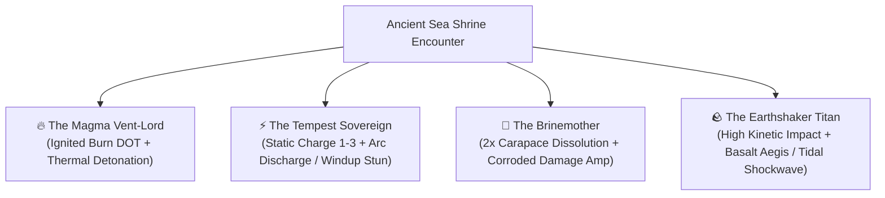

> **HISTORICAL / SUPERSEDED — NOT IMPLEMENTATION GUIDANCE.** Archived 20 October 2026 from `docs/PHASE_3B_OCEAN_POWERS_SPEC.md` at commit `c16a1a2`. Old approvals, locked specifications, instructions and test counts below apply only to that historical revision. Use the [current documentation guide](../../README.md) and open backlog for present work. Retain this file for explicitly requested historical reference only.

# Phase 3B Specification: The 4 Primordial Sea Powers & Tiered Shrine Blessings

> **Document Status:** Finalized Design & Implementation Specification (Locked for Implementation)  
> **Core Rule:** Each of a ship's 3 intrinsic hardpoints (`Broadside`, `Signature`, `Utility`) has a single **Blessing Socket** that can be dedicated to **one** of the 4 Primordial Sea Powers. Blessings augment the existing weapon's behavior with elemental/tectonic riders and cross-hardpoint synergies without overwriting the weapon's core identity.

---

## 0. Prerequisite Base Weapon Cleanup (`DamageType.blast` Exclusivity)

Before or alongside implementing the Blessing rules, fix two leftover base `DamageType` assignments in [`packages/monstrous_core/lib/src/content/ship_weapons.dart`](../../../packages/monstrous_core/lib/src/content/ship_weapons.dart):

1. **Ironclad `ShipWeaponType.prowRam`**:
   - **Current**: `damageType: DamageType.blast`
   - **Change to**: `damageType: DamageType.piercing` (Pure kinetic structural collision; converting the Ram into an explosive powder-ram is reserved for a Master Refit, not its base ability).
2. **Bombardier `ShipWeaponType.shrapnelHowitzer`**:
   - **Current**: `damageType: DamageType.blast`
   - **Change to**: `damageType: DamageType.slicing` (Anti-surface canister shrapnel; converting Howitzers to explosive shells is reserved for a Master Refit).
3. **Resulting `DamageType.blast` Identity**:
   - Base `DamageType.blast` is now strictly exclusive to the **Heavy Siege Mortar** (`ShipWeaponType.heavyMortar`), **Blast Pack** consumables (`ShipConsumableType.blastPack`), and **Magma Vent-Lord Thermal Detonations** (plus future Master Refits).
   - Update any affected unit tests in `packages/monstrous_core/test/combat_test.dart` and `packages/monstrous_core/test/flagship_blueprint_test.dart`.

---

## 1. Lore & The 4 Primordial Powers of the Sea

Before the **Abyssal Font** corrupted the deep trenches and spawned the aberrant leviathans, the ocean was governed by four ancient, mysterious **Primordial Powers**. They are revered as elemental forces of nature rather than chatty anthropomorphic gods. Because the Font usurped their waters, these four Primordials work together to aid the cursed bloodline—lending their wrath at Ancient Sea Shrines so the Captain can destroy the evil at the bottom of the Abyss.

### 1.1 Global Combat Math Rule: Percentage Damage Before Range Falloff
- **Percentage-Based Modifiers**: All direct weapon damage buffs from Blessings are **percentage modifiers** (e.g. `+15% / +25% / +35%`) rather than flat numbers. This ensures natural scaling from Region 1 (`40–55 HP` monsters) to Region 3 (`150–220 HP` Titans) and across gun-deck upgrades.
- **Applied Before Range Falloff**: Blessing damage percentages are applied to the weapon's base damage **before** multiplying by the weapon's range-band efficiency (`35% / 75% / 100% / 120%`). Poor positioning proportionally reduces the blessing's bonus damage just like base weapon damage.

---

## 2. Detailed Mechanics of the 4 Primordials

### 2.1 🔥 The Magma Vent-Lord (`OceanPower.magmaVentLord`)
- **Domain**: Subterranean hydrothermal vents, undersea lava tubes, boiling oil, and sulfurous fury.
- **Core Status**: **`Ignited` (`StatusEffect.burn`, lasts 3 turns)**
  - Ticks at the start of the monster's turn for **`6 / 10 / 15` Fire damage** (based on the highest Magma Vent-Lord tier on the ship, scaled slightly by region difficulty).
- **Synergy Hook (*Thermal Detonation*)**:
  - Striking an already **Burning** (`StatusEffect.burn`) monster with a Magma-blessed **Signature** weapon triggers an explosive **Thermal Detonation**, dealing an additional **`+25% / +40% / +60%` Blast damage** (`DamageType.blast`, which also receives the `1.5x` Blast multiplier against `carapacePlating`) without consuming the Burn!

| Hardpoint | Blessing Name | Tier I (Initiate) | Tier II (Resonant) | Tier III (Sovereign) |
| :--- | :--- | :--- | :--- | :--- |
| **Broadside (`0T`)** | **Magma Volley** | **`+10%`** weapon dmg; inflicts **Burn** (`6` Fire dmg/turn for 3T). | **`+20%`** weapon dmg; inflicts **Burn** (`10` Fire dmg/turn for 3T). | **`+30%`** weapon dmg; inflicts **Burn** (`15` Fire dmg/turn for 3T). |
| **Signature (`1T`)** | **Caldera Eruption** | **`+15%`** weapon dmg. If target is Burning, triggers **Thermal Detonation** (**`+25%`** Blast dmg, `1.5x` vs Carapace). | **`+25%`** weapon dmg. If target is Burning, triggers **Thermal Detonation** (**`+40%`** Blast dmg, `1.5x` vs Carapace). | **`+40%`** weapon dmg; inflicts **Burn** AND immediately triggers **Thermal Detonation** (**`+60%`** Blast dmg). |
| **Utility (`2T`)** | **Boiling Wake** | Activating Utility inflicts **Burn** (`3T`) and boils the water for `2T`: if the monster moves or charges a range band, it takes **`12` Fire dmg**. | Boiling Wake lasts `2T` and deals **`20` Fire dmg** whenever the monster moves or charges. | Boiling Wake lasts `3T`, deals **`30` Fire dmg** on monster movement, and increases all Burn tick damage by `+50%`. |

---

### 2.2 ⚡ The Tempest Sovereign (`OceanPower.tempestSovereign`)
- **Domain**: Hurricane squalls, St. Elmo's fire, and deep-sea bio-electric discharges.
- **Global Stun Fix (`combat.dart`)**:
  - Previously, monster `StatusEffect.stun` had a `50%` RNG coin-flip to wear off each turn, allowing lucky rolls to perma-stun bosses.
  - **Fix**: Monster `StatusEffect.stun` now **always** clears deterministically after the monster skips 1 action (1-turn hard duration).
- **Core Status**: **`Static Charge` (`staticStacks`: 1 to 3 stacks on `MonsterState`)**
- **Synergy Hook (*Arc Discharge* at 3 Static Stacks)**:
  - Reaching **3 Static Stacks** immediately consumes all 3 stacks and calls down a lightning bolt:
    1. **Shock Burst**: Deals **`12 / 20 / 28` Shock damage** (based on the highest Tempest tier on the ship).
    2. **Frenzy Purge**: Immediately clears all **`bloodFrenzy` stacks** on the monster.
    3. **Windup Shatter vs. Electro-Jolt**:
       - If the monster is telegraphing a **Lethal Windup** (`MonsterIntent.windup`), the discharge **shatters the windup and inflicts `StatusEffect.stun` (`1T`)**!
       - If the monster is performing a normal action (not a windup), it inflicts **`Electro-Jolt` (`1T`)**, causing muscle spasms that apply **`-30%` Monster Accuracy and `-25%` Monster Attack Damage** on its turn (preventing effortless perma-stun loops while keeping 3-stack discharges impactful every time).

| Hardpoint | Blessing Name | Tier I (Initiate) | Tier II (Resonant) | Tier III (Sovereign) |
| :--- | :--- | :--- | :--- | :--- |
| **Broadside (`0T`)** | **Galvanic Broadside** | **`+10%`** weapon dmg; applies **`+1 Static Stack`** on hit. | **`+18%`** weapon dmg; applies **`+1 Static Stack`** on hit. | **`+25%`** weapon dmg; applies **`+1 Static Stack`** (`35%` chance for **`+2 Stacks`**). |
| **Signature (`1T`)** | **Thunderclap Prow** | **`+15%`** weapon dmg, **`+15%` Crit Chance**, and applies **`+2 Static Stacks`** on hit. | **`+25%`** weapon dmg, **`+15%` Crit Chance**, and applies **`+2 Static Stacks`** on hit. | **`+35%`** weapon dmg, **`+20%` Crit Chance**, and applies **`+3 Static Stacks`** (instant **Arc Discharge**!). |
| **Utility (`2T`)** | **Storm-Arc Rigging** | Activating Utility applies **`+1 Static Stack`** and charges hull for `2T`: when monster attacks you, arcs back for **`10` Shock dmg** + **`+1 Static Stack`**. | Hull charge arcs back for **`18` Shock dmg** + **`+1 Static Stack`** when attacked (`2T`). | Activating Utility applies **`+2 Static Stacks`**; hull charge arcs for **`26` Shock dmg** + **`+1 Static Stack`** (`2T`). |

---

### 2.3 🧪 The Brinemother (`OceanPower.brinemother`)
- **Domain**: Abyssal brine pools, oxidized shipwrecks, caustic rust, and carapace-eating enzymes.
- **Design Identity (Distinct from Fire DOT)**:
  - The Brinemother does **not** deal generic flesh DOT. Instead, she is the **Carapace Melter & Global Damage Amplifier**, making her synergize with high-damage weapons and with other Primordial powers.
- **Core Status**: **`Corroded` (`corrodedStacks`: 1 to 3 stacks on `MonsterState`, lasts 3 turns)**
  - **Global Vulnerability**: Each stack of `Corroded` increases **all damage the monster takes from every source** (weapons, burns, lightning arcs, shockwaves) by **`+8%` per stack** (up to **`+24%`** at 3 stacks; **`+12%` per stack / `+36%` max** if the ship has any Tier III Brinemother blessing).
  - **Caustic Enfeeblement**: Each stack of `Corroded` weakens the monster's strikes by **`-5%` Attack Damage per stack** (up to **`-15%`** at 3 stacks).

| Hardpoint | Blessing Name | Tier I (Initiate) | Tier II (Resonant) | Tier III (Sovereign) |
| :--- | :--- | :--- | :--- | :--- |
| **Broadside (`0T`)** | **Caustic Volley** | **`+10%`** weapon dmg; strips **`2x` Carapace** (plus `+4` flat Carapace melt) and applies **`+1 Corroded Stack`**. | **`+18%`** weapon dmg; strips **`2x` Carapace** (plus `+8` flat Carapace melt) and applies **`+1 Corroded Stack`**. | **`+25%`** weapon dmg; strips **`2x` Carapace** (plus `+12` flat Carapace melt) and applies **`+2 Corroded Stacks`**. |
| **Signature (`1T`)** | **Acid-Bore Strike** | **`+15%`** weapon dmg; **pierces 100% of Carapace** to damage flesh directly (while still stripping Carapace) and applies **`+2 Corroded Stacks`**. | **`+25%`** weapon dmg; **pierces 100% of Carapace** and applies **`+2 Corroded Stacks`**. | **`+35%`** weapon dmg; **pierces 100% of Carapace**, applies **`+3 Corroded Stacks`**, and deals `+15%` bonus dmg if target has 0 Carapace. |
| **Utility (`2T`)** | **Verdigris Miasma** | Activating Utility clears **Monster Obscurity (ink/fog)**, melts **`8` Carapace**, and applies **`+1 Corroded Stack`**. | Clears **Monster Obscurity**, melts **`14` Carapace**, and applies **`+2 Corroded Stacks`**. | Clears **Monster Obscurity**, melts **`22` Carapace**, and applies **`+3 Corroded Stacks`**. |

---

### 2.4 🪨 The Earthshaker Titan (`OceanPower.earthshakerTitan`)
- **Domain**: Shifting seafloor fault-lines, basalt monoliths, concussive tremors, and tsunami shockwaves.
- **Design Identity**:
  - Rather than managing a multi-stack status effect, the Earthshaker Titan provides **the highest raw percentage weapon damage buffs across the board**, natural `1.5x` Carapace crushing, windup stagger, and an encrusted **Stone Hull Barrier (`Basalt Aegis`)** that lashes back with a tidal shockwave.

| Hardpoint | Blessing Name | Tier I (Initiate) | Tier II (Resonant) | Tier III (Sovereign) |
| :--- | :--- | :--- | :--- | :--- |
| **Broadside (`0T`)** | **Tremor Volley** | **`+15%`** kinetic weapon dmg (`1.5x` vs Carapace) and shakes the beast (**`-10%` Monster Accuracy** for `1T`). | **`+25%`** kinetic weapon dmg (`1.5x` vs Carapace) and shakes the beast (**`-15%` Monster Accuracy** for `1T`). | **`+35%`** kinetic weapon dmg (`1.5x` vs Carapace) and shakes the beast (**`-20%` Monster Accuracy** for `1T`). |
| **Signature (`1T`)** | **Fault-Line Shatter** | **`+20%`** kinetic weapon dmg (`1.5x` vs Carapace). Striking during a **Lethal Windup** deals **`+25%` bonus dmg** and **cancels the windup** into a normal attack. | **`+35%`** kinetic weapon dmg (`1.5x` vs Carapace) + **Windup Cancel** (`+25%` bonus dmg). | **`+50%`** kinetic weapon dmg (`1.5x` vs Carapace) + **Windup Cancel** (`+35%` bonus dmg & `1T` Stun on windup break). |
| **Utility (`2T`)** | **Basalt Aegis** | Activating Utility encrusts hull with a **`15 HP` Stone Barrier** (`2T`) and surging wake (**`+15%` Ship Evasion** while barrier holds). When monster hits or breaks the barrier, a **Tidal Shockwave** deals **`12` Kinetic dmg** back (`1.5x` vs Carapace). | **`25 HP` Stone Barrier** (`2T`), **`+15%` Ship Evasion**, and **`20` Kinetic dmg** reactive **Tidal Shockwave**. | **`35 HP` Stone Barrier** (`2T`), **`+20%` Ship Evasion**, and **`30` Kinetic dmg** reactive **Tidal Shockwave**. |

---

## 3. Shrine Encounter Flow (Flow A) & Hardpoint Dedication Rules

### 3.1 Cooperative Hardpoint Locking (No Overwriting)
- Each of the 3 hardpoints (`HardpointType.broadside`, `HardpointType.signature`, `HardpointType.utility`) can hold **one** `HardpointBlessing`.
- Once a hardpoint is blessed by a Primordial Power, that slot is **dedicated** to that Power for the rest of the run:
  - Choosing the **same** Power again allows upgrading that hardpoint from **Tier I $\rightarrow$ Tier II $\rightarrow$ Tier III (Max)**.
  - Choosing a **different** Power locks out hardpoints that are already blessed by another Power (displayed in the UI as *"Dedicated to [Other Power]"*). Because the Primordials are allied wardens rather than jealous rivals, they never overwrite or destroy another Power's blessing.

### 3.2 Weighted Primordial Appearance at Shrines
When entering `SessionPhase.shrine`, the Shrine selects **2 Primordial Powers** to manifest:
1. **Eligibility Filter**: A Primordial Power is eligible to appear only if the ship has at least one hardpoint that is either **unblessed** OR **already blessed by that same Power at Tier I or Tier II**.
2. **Selection Weighting**:
   - **Unaligned Power** (not currently on any of the ship's hardpoints): Base weight = **`1.0`**.
   - **Aligned Power** (already on at least 1 hardpoint and still has a valid upgrade or open slot): Weight = **`2.5`** (`2.5x` more likely to appear so players can reliably reach Tier II and Tier III upgrades).

### 3.3 Two-Step Player Choice at the Shrine (`Flow A`)
1. **Step 1 — Choose Which of the 2 Manifested Primordials to Commune With (or Decline)**:
   - The Shrine presents the **2 manifested Primordials** side-by-side with their domain lore and active synergy summary.
   - **Polite Decline Option (*"Read the Ancient Runes / Offer Respects"*)**: If the player does not want either Power on their remaining slots, they can decline and receive a temporary **Runic Guidance Boon** (`+10%` Accuracy in the next combat + reveals adjacent Sea Chart nodes).
2. **Step 2 — Choose Which Hardpoint to Bless or Upgrade**:
   - Selecting one of the 2 Primordials displays the ship's **3 Hardpoint Cards** (`Broadside`, `Signature`, `Utility`):
     - If the slot is **Unblessed**: Shows the **Tier I** Blessing preview.
     - If the slot is **Blessed by this Primordial (Tier I or II)**: Shows the **Tier II** or **Tier III** upgrade preview with highlighted stat increases.
     - If the slot is **Blessed by another Primordial** (or already **Tier III**): Shown as disabled/locked (*"Dedicated to [Other Power]"* or *"Max Sovereign Tier Reached"*).
   - The player can switch between the 2 manifested Primordials before committing their choice.

---

## 4. Implementation Checklist & Architecture

### Step 1: Core Models (`packages/monstrous_core`)
- **`lib/src/content/ship_weapons.dart`**:
  - Change `ShipWeaponType.prowRam` to `DamageType.piercing` and `ShipWeaponType.shrapnelHowitzer` to `DamageType.slicing`.
- **`lib/src/models/ocean_power.dart`** (New file, exported in `monstrous_core.dart`):
  - `enum OceanPower { magmaVentLord, tempestSovereign, brinemother, earthshakerTitan }`
  - `class HardpointBlessing` with fields:
    - `final OceanPower power;`
    - `final HardpointType slot;`
    - `final int tier;` (`1`, `2`, or `3`)
    - Computed getters for title, subtitle, mechanical description, and stat modifiers.
- **`lib/src/models/ship.dart` (`ShipState`)**:
  - Add `final Map<HardpointType, HardpointBlessing> blessings;` (default `{}`).
  - Add combat-scoped temporary state fields (cleared at combat start/end):
    - `final int basaltBarrierHp;` (for Earthshaker's *Basalt Aegis*)
    - `final int basaltAegisTurns;`
    - `final int stormRiggingTurns;` (for Tempest's *Storm-Arc Rigging*)
    - `final int boilingWakeTurns;` (for Magma Vent-Lord's *Boiling Wake*)
  - Serialize `blessings` in `toJson()` / `fromJson()`.
- **`lib/src/models/monster.dart` (`MonsterState`)**:
  - Add status counters:
    - `final int staticStacks;` (`0..3`)
    - `final int corrodedStacks;` (`0..3`)
    - `final int corrodedTurns;`
    - `final bool isElectroJolted;` (`1T` `-30%` accuracy / `-25%` damage from *Arc Discharge*)
    - `final int tremorAccPenalty;` (`1T` `-10%/-15%/-20%` accuracy from *Tremor Volley*)

### Step 2: Combat Resolution (`packages/monstrous_core/lib/src/rules/combat.dart`)
- **Pre-Falloff Percentage Damage**:
  - In `calculateAttack` / `resolveCombatTurn`, apply the active hardpoint's Blessing damage percentage (`+10%` to `+50%`) to base weapon damage **before** the range-band efficiency multiplier.
- **Global Vulnerability (`Corroded`)**:
  - Multiply all final damage dealt to the monster by `1.0 + (corrodedStacks * (hasTier3Brine ? 0.12 : 0.08))`.
- **Hardpoint Riders**:
  - **Magma Vent-Lord**: Apply `StatusEffect.burn` on *Magma Volley* / *Boiling Wake*; trigger *Thermal Detonation* (`+25%/+40%/+60%` Blast damage, `1.5x` vs Carapace) on *Caldera Eruption* if target is burning; deal `12/20/30` Fire damage when monster changes range while `boilingWakeTurns > 0`.
  - **Tempest Sovereign**: Add `staticStacks` on *Galvanic Broadside*, *Thunderclap Prow* (with `+15%/+20%` crit chance), and *Storm-Arc Rigging*. When `staticStacks >= 3`, trigger **Arc Discharge** (`12/20/28` Shock dmg, clear `bloodFrenzy`, Stun `1T` if `MonsterIntent.windup` else `isElectroJolted = true`). Fix monster `StatusEffect.stun` in `updateStatusEffects` to deterministically wear off after 1 turn.
  - **Brinemother**: Apply `2x` Carapace damage + flat Carapace melt on *Caustic Volley*; bypass 100% Carapace mitigation on *Acid-Bore Strike*; clear monster obscurity and strip `8/14/22` Carapace on *Verdigris Miasma*; increment `corrodedStacks` (capped at 3, refreshes `corrodedTurns = 3`).
  - **Earthshaker Titan**: Apply `1.5x` Carapace multiplier and `tremorAccPenalty` on *Tremor Volley*; cancel `MonsterIntent.windup` and deal `+25%/+35%` bonus damage on *Fault-Line Shatter*; grant `15/25/35` `basaltBarrierHp` + `+15%/+20%` evasion on *Basalt Aegis*, absorbing incoming monster damage and dealing `12/20/30` Kinetic reactive damage (`1.5x` vs Carapace) when struck.

### Step 3: Shrine Session Logic (`packages/monstrous_core/lib/src/rules/shrine.dart` & `game_session.dart`)
- Generate `List<OceanPower> shrineManifestedPowers` (2 powers weighted `2.5x` toward existing upgradable/expandable powers) when entering a Shrine node.
- Add `AcceptShrineBlessing(OceanPower power, HardpointType slot)` action to `GameSession` that installs Tier I or upgrades Tier I $\rightarrow$ II $\rightarrow$ III on `ship.blessings[slot]`.
- Keep `CommuneWithShrine()` (`ShrineChoice.divination`) as the *"Read the Ancient Runes"* fallback option (`+10%` accuracy boon + chart reveal).

### Step 4: Flutter Shrine UI (`apps/monstrous_sea/lib/src/screens/shrine_screen.dart` & `combat_screen.dart`)
- Update `ShrineScreen` to display the 2 manifested Primordials at the top, the 3 Hardpoint Blessing cards (`Broadside`, `Signature`, `Utility`) for the selected Primordial in the center (showing Tier I / II / III previews or *"Dedicated to [Other Power]"* lock badges), and the *"Read the Ancient Runes"* fallback button at the bottom.
- Update `CombatScreen` hardpoint buttons and monster status badges to display active Blessing icons/tiers, `Static Charge (x/3)`, `Corroded (x/3)`, and `Basalt Barrier HP`.

### Step 5: Simulation Bots & Verification (`packages/monstrous_sim`)
- Update `CautiousBot`, `RecklessBot`, `GreedyBot`, and `RandomBot` in `packages/monstrous_sim/lib/src/bots/` to evaluate `shrineManifestedPowers` and dispatch `AcceptShrineBlessing` (prioritizing upgrading existing blessings to Tier II/III or blessing unblessed hardpoints).
- Run `dart test` across all packages and generate an updated 1,000-run Monte Carlo balance report.
