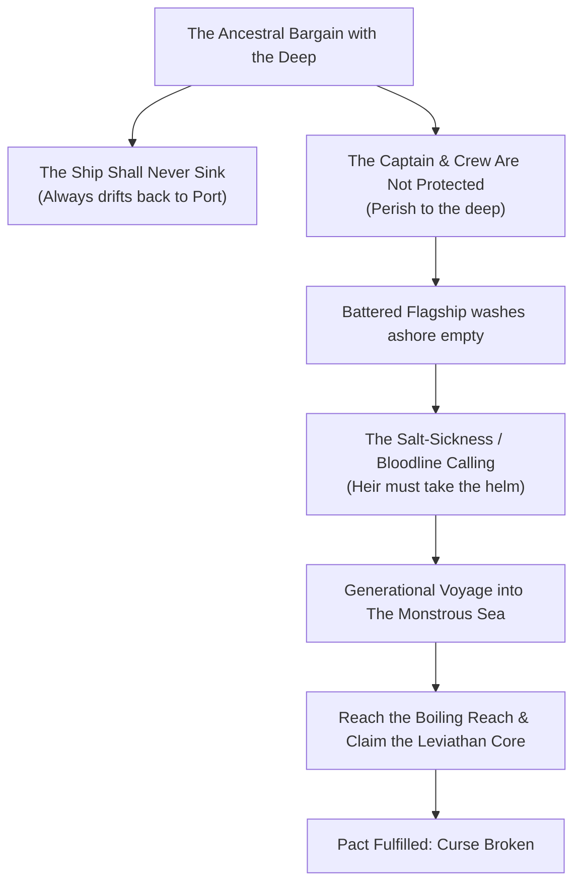
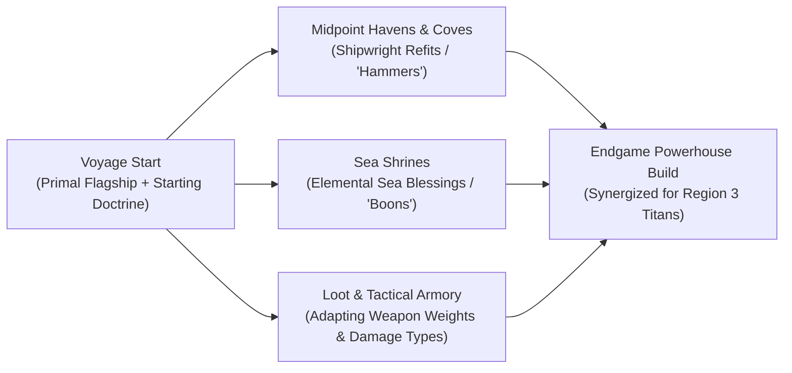
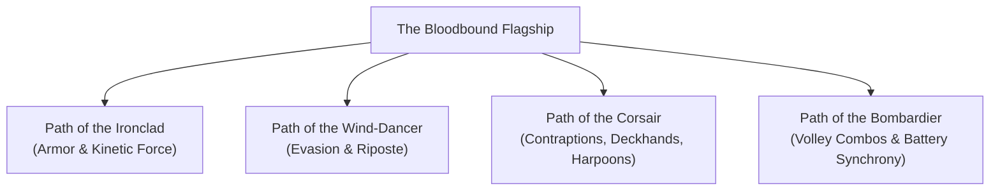
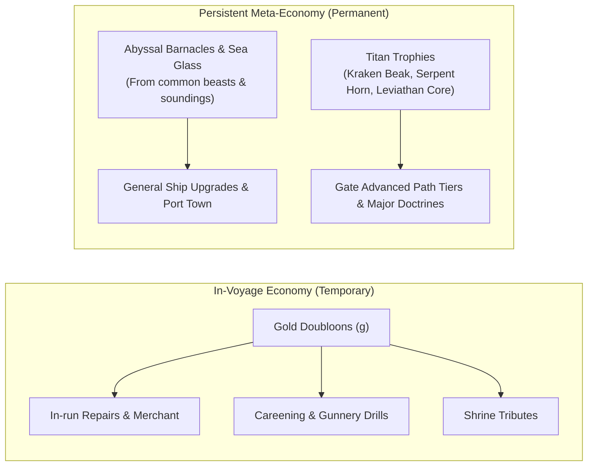
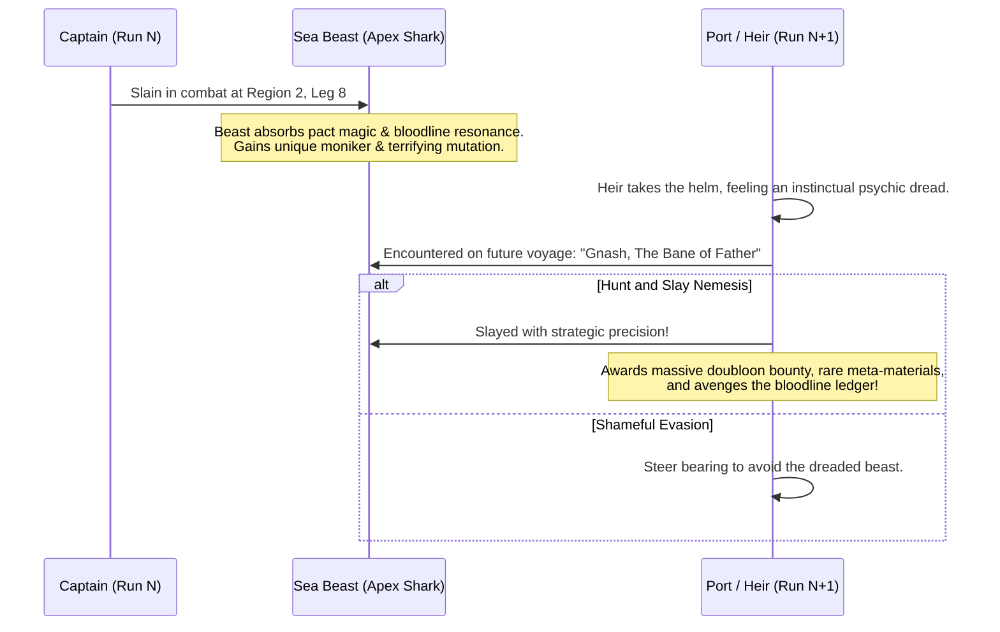
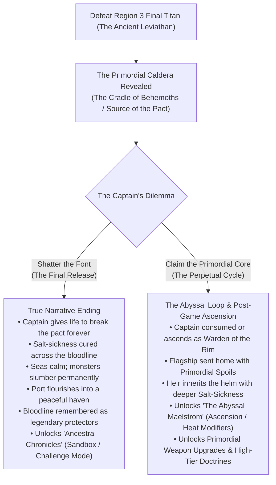
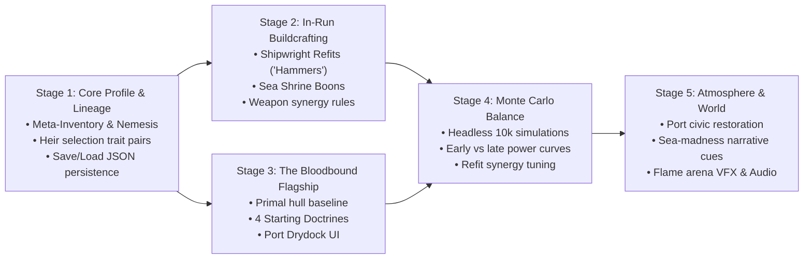

> **HISTORICAL / SUPERSEDED — NOT IMPLEMENTATION GUIDANCE.** Archived 20 October 2026 from `docs/ROGUE_LITE_DESIGN.md` at commit `c16a1a2`. Old approvals, locked specifications, instructions and test counts below apply only to that historical revision. Use the [current documentation guide](../../README.md) and open backlog for present work. Retain this file for explicitly requested historical reference only.

# The Monstrous Sea V2 — Rogue-lite Evolution & Progression GDD

## 1. Overview & Creative Thesis

*The Monstrous Sea V2* transitions from a traditional, high-attrition permadeath game into a **narrative-driven Rogue-lite**. Every voyage—whether it ends in heroic victory or a watery grave—advances the generational power, narrative understanding, and physical world of the player's bloodline.

The core gameplay loop centers on:
1. **The Voyage**: Navigating dangerous waters, battling terrifying beasts, managing in-run gold and supplies.
2. **The Tragic Demise or Triumphant Return**: The captain falls, but the **Bloodbound Ship** miraculously washes back into harbor alone.
3. **The Port & Succession**: The next heir takes the helm with unique traits, refits the flagship with salvaged meta-materials, develops the port town, and prepares for the next expedition.
4. **The Ultimate Purpose**: Slaying the three regional Titans and claiming the relic at the boiling edge of the world to finally fulfill and shatter the ancient pact.

---

## 2. Narrative Foundation: The Abyssal Pact

### The Originator's Bargain
Generations ago, the founder of your family line struck a bargain with the eldritch powers of the deep during a cataclysmic tempest. In exchange for safe passage, the deep promised:
> *"Thy vessel shall never be swallowed by the abyss; no matter the fury of the waves or the monsters of the trench, the ship shall always return to shore."*

The trickster wording of the deep: **the vessel returns, but its captain and crew are forfeit.**

### The Two-Stage Curse: Salt-Sickness on Shore, Sea-Madness in the Deep
When a captain perishes at sea and the ship drifts back into harbor on the evening tide, the mantle falls upon the next heir. The pact manifests as a insidious, two-stage affliction:

1. **Stage 1: The Shore-Bound Salt-Sickness (Physical Withering)**:
   - While on dry land, the heir suffers from an excruciating, wasting malady. Their skin cracks like dried salt, their limbs grow frail, and the sound of crashing waves echoes incessantly in their ears.
   - The townspeople know the signs all too well: the bloodline is "called to the sea."
   - The sickness vanishes the moment their boots touch the deck and the ship departs the harbor.

2. **Stage 2: The Deep Sea-Madness (Psychological Possession)**:
   - The physical relief of sailing masks an even darker psychological trap. As the ship ventures into the deeper waters of Region 2 and Region 3—far past the point of no return—the deep begins to whisper directly into the captain’s mind.
   - The vast, silent abyss generates an escalating **Sea-Madness**: auditory hallucinations of sunken chimes, phantom shadows skimming beneath the hull, and an intoxicating, irrational attachment to the ocean's dark power.
   - By the time a captain reaches the boiling rim of the world, their perception of reality is thoroughly compromised. They no longer see the deep as a horror to be vanquished, but as a sacred mystery only they are worthy of understanding.

---

## 3. The Bloodbound Flagship: Balance Philosophy & Progression

Instead of arbitrary, interchangeable ship hulls, the player commands **The Ancestral Flagship**—a single legendary vessel bound to their bloodline.

### A. The Game Designer's Dilemma: Avoiding Early-Game Trivialization
> [!CAUTION]
> **The Rogue-lite Power-Curve Trap:**
> In poorly balanced rogue-lites, meta-progression is purely vertical (e.g. stacking $+200\%$ HP and $+300\%$ damage). The consequence is fatal to the game loop: Region 1 (*The Siren Shoals*) becomes an unengaging, brainless chore where the player steamrolls monsters with zero tension just to reach where they died.
>
> If a player perishes near the end of Region 3, they should **never** be able to sleepwalk through Region 1 on the next run. Early regions must remain tactically engaging, and player victory must stem from mastery, decision-making, and emergent build-crafting rather than raw stat-padding.

### B. The Lore of the "Bargain's Reset"
Why doesn't an upgraded super-ship return intact to port?
* The ancient pact guarantees only that **the vessel itself returns to shore**.
* The abyssal transit strips away mortal attachments: cannon emplacements rust away in the depths, custom iron plates are torn off by the crushing pressure of the trench, and temporary munitions wash into the abyss.
* The ship washes ashore in its **pristine, primal state**—the mystical keel intact, waiting for the heir to commission and outfit it anew.

### C. Horizontal & Utility Meta-Progression (What Carries Over)
To reward long-term play without breaking the difficulty curve, meta-progression at the Port Hub focuses on **horizontal variety and tactical flexibility** (similar to *Hades* or *Dead Cells*):

1. **Armory Blueprint Expansions (Expanding the Pool, Not Starting Power)**:
   - Meta-resources unlock new weapon and consumable blueprints (e.g. *Lightning Railguns*, *Flamethrowers*, *Blade Launchers*, *Chakrams*).
   - Once unlocked, these items begin appearing in procedural shop stocks, shipwreck caches, and loot drops during voyages.
2. **Conservative Baseline Resilience (Diminishing Returns)**:
   - *Oakum Keel*: Modest starting HP boosts (e.g. +5 HP per tier, capped at +20 HP total).
   - *Caulked Reserve (Emergency Defiance)*: A costly upgrade allowing the flagship to survive **one fatal hull breach per voyage** with 15% HP remaining.
3. **Expedition Logistics & QoL**:
   - Starting with a modest purse of gold doubloons (25g $\rightarrow$ 50g max) to buy an extra consumable before embarking.
   - 1 Navigational Sounding Reroll at the Helm per region.
4. **Doctrine Specializations (Starting Archetypes)**:
   - Unlocking the 4 starting naval doctrines, allowing the player to choose their baseline tactical identity for the voyage.

### D. In-Run Buildcrafting: Where True Power is Forged
The vertical power climb happens **during the voyage** through three interconnected systems:

1. **Shipwright Refits (The "Daedalus Hammer" System)**:
   - At Midpoint Havens and Secluded Coves, the Traveling Shipwright offers **transformative weapon augmentations**:
     * *Canister Shot*: Cannons fire a spread of 2 shots with high bleed chance against flesh.
     * *Overcharged Coils*: Lightning weapons chain to stun adjacent monster parts (tentacles).
     * *Bunker Casemate*: Absorbs the first 15 damage of every combat engagement.
2. **Shrine Blessings (The "Boon" System)**:
   - Commuting at ancient shrines infuses the flagship with supernatural elemental synergies (e.g. attacks inflict Burn on critical hits; successful evades trigger a lightning riposte).
3. **Dynamic Tactical Armory Swapping**:
   - Because players can swap weapons outside of combat at the Helm, discovering high-tier weapons in loot enables adapting loadouts to counter specific regional threats (e.g. equipping Blast weapons to crack Carapace in Region 2/3).

### E. Specialized Starting Disciplines (Doctrines)
Before setting sail, the captain commissions the flagship into one of **four tactical doctrines**:

1. **Path of the Ironclad (The Bulwark)**:
   * *Core Mechanic*: Heavy plating, damage thresholding, and kinetic release.
   * *Playstyle*: Absorbs massive hits with Carapace/Armor plating; charges a "Kinetic Ram" or "Shockwave" counter-attack as it absorbs blows.
2. **Path of the Wind-Dancer (The Sloop / Corvette)**:
   * *Core Mechanic*: Evasion, tactical maneuvering, and critical flanking.
   * *Playstyle*: Exploits wind headings and monster windups. Successful evades grant guaranteed critical strikes or free bonus shots.
3. **Path of the Corsair (Reimagined Freighter)**:
   * *Core Mechanic*: Deckhands, deployable traps, salvage harpoons, and contraptions.
   * *Playstyle*: Instead of just carrying cargo, the Corsair uses specialized tools: Harpoon Winches that pin beasts and rip off tentacles, deployable Float Mines, and mercenary crew actions (bribes, emergency repairs).
4. **Path of the Bombardier (Reimagined Standard Barque)**:
   * *Core Mechanic*: Multi-battery volleys, status synergy, and reload mastery.
   * *Playstyle*: Firing a Piercing weapon weakens the monster's hide, granting bonus damage to subsequent Blast weapons; staggered reloads keep up relentless pressure.

> [!TIP]
> **Progression Flexibility:** Players can unlock nodes across these paths at Port, and configure their **Active Doctrine** before setting sail. A respec system allows resetting spent points so players can experiment with different builds.

---

## 4. The Two-Tier Economy: In-Run Doubloons vs. Meta-Currencies

### In-Run Currency: Gold Doubloons ($\text{g}$) — "Use It or Lose It"
* Earned from monster bounties, cargo salvage, and events.
* **Spent entirely during the run** to survive: buying consumables, hiring shipwrights at havens, bribing smugglers, and paying tributes.
* **The "Use It or Lose It" Philosophy**: True to games like *Hades*, unspent gold doubloons do **not** convert to meta-currency upon death. Gold is mundane metal that sinks to the abyss. Players are actively encouraged to spend their gold tactically to push their current voyage as far as possible, rather than hoarding coins for post-run growth.

### Meta-Currencies: Dual-Source Matrix (Materials vs. Organics)
Meta-resources survive because they **bind directly to the ship's supernatural keel**. To encourage a rich variety of exploration (non-combat soundings, shipwrecks, shrines) alongside ferocious monster combat, meta-currencies are split by source:

| Tier | Category | Currency Name | Acquisition Method | Primary Usage |
|---|---|---|---|---|
| **Common** | **Material** | **Sea Glass** | Shipwreck salvage, calm soundings, event caches | Port civic restorations, basic hull repairs |
| **Common** | **Organic** | **Monster Bone** | Slain sea monsters, shark jaws, beast remains | Basic armory slots, ammo pouch expansion |
| **Rare** | **Material** | **Depth-Wrought Iron** | Deep soundings, sunken galleons, shrine offerings | Tier II/III hull integrity, weapon deck weight |
| **Rare** | **Organic** | **Abyssal Barnacles** | Apex predators, hazard survival, deep harvesting | Doctrine specialization nodes, weapon augments |
| **Titan** | **Trophy** | **Kraken's Beak** | Slaying The Kraken (Region 1 Titan) | Unlocking advanced doctrine tiers & new paths |
| **Titan** | **Trophy** | **World Serpent's Scale** | Slaying Jörmungandr (Region 2 Titan) | Unlocking mastery doctrines & deep harbor drydock |
| **Primordial**| **Core** | **The Leviathan Core** | Slaying The Ancient Leviathan (Region 3 Titan) | Tied directly to the final narrative choice (Shatter vs. Claim) |

> [!NOTE]
> **The Leviathan Core & Narrative Economy:**
> If the captain chooses to **Shatter the Font**, the Core is extinguished to break the curse (ending the game). If the captain chooses to **Claim the Core**, it is carried home by the flagship, unlocking the *Abyssal Covenant* (Heat system) and enabling the harvest of **Primordial Cinders** for corrupted end-game refits.

---

## 5. Heir Succession & Qualitative Traits

When a captain falls, the player is presented with **3 potential heirs** from the family line:
* Each candidate presents a **unique pair of gameplay-altering traits** (a Boon and a Flavorful Quirk).
* The player selects their desired trait pair, then **customizes their heir's name** (e.g. *Captain Edward Blackwood III*).

### Qualitative Traits: Captain Temperaments & Tactical Rule Alterations
Rather than boring numerical $+10\%$ stat buffs (which duplicate shipyard upgrades), traits reflect the **captain's human training, quirks, and psychological state**, altering gameplay rules and presenting meaningful tactical trade-offs:

#### Maritime Boons (Positive Rule Modifiers)
| Trait | Flavor | Mechanical Rule Impact |
|---|---|---|
| **Veteran Cannoneer** | Keen eye for weak points | Blast and Piercing attacks ignore $20\%$ of monster Carapace plating. |
| **Storm-Seer** | Reads ocean currents like text | Navigating through high gales restores $+10$ ship HP (riding shallows) instead of hazard drift. |
| **Iron Constitution** | Hardened immune system | Poison and Burn status effects have double wear-off chance each turn ($50\%$ vs $25\%$). |
| **Smuggler's Kin** | Raised among scoundrels | Smuggler Ketches offer 1 free contraband consumable, and contraband prices are discounted by $25\%$. |
| **Drillmaster** | Rigorous deck discipline | Using a consumable item does not end the ship's combat turn. |

#### Curious Quirks (Tactical Trade-Offs & Flaws)
| Trait | Flavor | Mechanical Rule Impact |
|---|---|---|
| **Blood Oath (Vendetta)** | Obsessed with family vengeance | Deals $+30\%$ damage against the parent's Nemesis. **Forced Heading**: When the Nemesis appears on the sea chart, the captain is compelled forward and *cannot turn away* (heading is locked). |
| **Reckless Helmsman** | Impatient on steady courses | "Dead Ahead" heading is disabled at sea; steering Port or Starboard grants $+10\%$ evasion during combat. |
| **Superstitious** | Terrified of blasphemous omens | Refuses to enter Abyssal Pacts at Shrines; completely immune to Siren charms, confusion, and fear. |
| **Pernicious Salt-Addict** | Addicted to the spray of combat | Weapon damage dealt increased by $+15\%$; all restorative effects (potions, careening) are $25\%$ less effective. |
| **Overzealous Gunner** | Believes only in total broadsides | Individual weapon firing is disabled; only full multi-weapon volleys can be fired (volleys deal $+15\%$ bonus damage). |

---

## 6. The Nemesis Beast System

Because the ship is drawn back to harbor by the pact, there are no sunken shipwrecks to salvage. Instead, the sea remembers your defeat through **The Nemesis Beast**.

### Nemesis Mechanics & Spawn Rules
1. **Residual Imbuement & Mutation**:
   - The specific beast that dealt the death blow absorbs pact resonance and residual life force from the fallen captain.
   - It ascends to an empowered Nemesis: $+30\%$ HP, elevated Carapace plating, and gains Apex predator traits if it was a standard monster.
2. **Species Moniker Generation**:
   - The beast gains an infamy moniker incorporating the predecessor captain's name:
     - *Shark*: `[MonsterName] — The Butcher of Captain [CaptainName]` or `[CaptainName]'s Undertaker`
     - *Serpent*: `[MonsterName] — The Coils of [CaptainName]'s Doom`
     - *Crustacean*: `[MonsterName] — The Crusher of [CaptainName]'s Keel`
     - *Squid / Jellyfish*: `[MonsterName] — The Drowner of [CaptainName]`
3. **Pacing & Spawn Rules**:
   - **Region Guaranteed**: The Nemesis is guaranteed to inhabit the region where the parent was slain.
   - **Pacing Buffer**: It will **not** appear immediately upon entering the region. A minimum cooldown of **2–3 encounters** must pass first, allowing the player to acclimate to region mechanics and allowing psychological dread to build.
   - **The Navigational Dilemma**: When it emerges, it appears as an ominous sounding on one of the dead-reckoning bearings. 
     - *Standard Captains*: Can choose to bravely engage it for epic doubloons, rare meta-materials, and bloodline honor—or tactically steer around it, forfeiting the bounty.
     - *Captains with the Blood Oath Quirk*: The captain's vengeful obsession takes over. The navigational wheel locks, compelling the flagship straight into the Nemesis encounter with no option to turn away.

---

## 7. Port Progression & The Living Harbor

The Port Hub is more than a store—it is the ancestral sanctuary of the family and a bustling maritime community that evolves as generations pass.

### Civic Development & Town Restoration
Players can invest excess meta-materials into restoring and decorating the Port for the townspeople:
* **The Seawall & Harbor Lights**: Rebuilding the old lighthouse reveals deeper starting navigational visibility on the sea chart.
* **The Fishermen's Memorial**: A stone monument commemorating fallen captains and lost sailors. Unlocks lore entries and grants starting morale blessings.
* **The Tavern & Hearth**: Upgrading the harbor tavern attracts veteran deckhands and quirky hirelings who offer single-voyage perks.
* **The Apothecary's Garden**: Supplies the flagship with a free baseline herbal draught at the start of every voyage.
* **Civic Pride**: Visual upgrades to the port (parchment banners, bustling docks, restored stonework) show tangible proof that the family's sacrifice is shielding and uplifting humanity.

---

## 8. Technical & Systems Roadmap Integration

In addition to the rogue-lite progression, the following core features are scheduled across upcoming milestones:

### A. Game State Persistence (Save & Resume)
* Implement full JSON serialization for `GameSession`, `ShipState`, `LineageTracker`, and `PortState`.
* Auto-save after each encounter, sea heading, or port interaction, allowing players to safely close the game and resume mid-voyage.

### B. Audio & Atmospheric Soundscape (`AudioService`)
* **Dynamic Marine Ambience**: Lapping waves, wind gusting through shrouds, creaking hull timbers that groan under stress.
* **Combat Audio**: Heavy cannon detonations, metallic carapace ricochets, monster shrieks, and muffled underwater soundscapes.
* **Tavern & Victory Themes**: Melancholic sea shanties on accordion/fiddle for Port screens and solemn pipes upon captain demise.

### C. Visual Polish & Flame Arena VFX
* **Particle Systems**: Cannon smoke billows, glowing phosphor embers in fog, boiling caldera water ripples, and blood dispersal in the water.
* **Dynamic Animations**: Projectile arc trajectories, monster attack lunges, carapace splinter fragments, and screen-shake on critical hits.
* **Expanded Ink Cartography**: Hand-drawn flourishes for newly revealed soundings, weather overlays (rain squalls, heat hazes), and compass animations.

### D. Deepened Encounter Variety
* **Derelict Ghost Vessels**: Eerie adrift ships from other cursed fleets offering high-risk curses and rewards.
* **Abyssal Rifts & Maelstroms**: Navigational hazards that test helm control in exchange for skipping legs or finding sunken vaults.
* **Siren Reefs**: Auditory lure events where captains must balance crew discipline against enchanting boons.

---

## 8. The Climax at the Edge of the World & The Post-Game Paradox

### A. The Primordial Caldera (The Font of Monsters)
Beneath the boiling waves of Region 3 lies not just another beast, but **The Cradle of Behemoths**—a colossal hydrothermal abyss pulsing with primordial life. The Ancient Leviathan was its guardian and firstborn. 

This font is the very seat of power where the ancestor made the original desperate bargain. When the Leviathan falls, the caldera opens, exposing the raw, beating heart of the deep.

### B. The Captain's Dilemma
Upon triumphing at the edge of the world, the captain stands alone at the helm over the caldera and faces a momentous choice:

#### Path 1: Shatter the Font (The Final Release — The True Narrative Ending)
* **The Action**: The captain fires their remaining ordnance directly into the core or steers the vessel into the rift to collapse the hydrothermal conduits, extinguishing the font of monstrosities once and for all.
* **The Cost**: The collapse claims the captain. In their final moments, they accept death, believing their name and line will fade into quiet oblivion now that the hunt is over.
* **The Epilogue (What They Left Behind)**: 
  * The salt-sickness immediately lifts from every living heir.
  * The seas grow peaceful and clear for the first time in centuries.
  * A cinematic epilogue pans across the **Port Hub**. Every civic improvement the family funded over dozens of generations—the stone seawall, the glowing lighthouse, the fishermen's cottages, the bustling public square—stands bathed in warm sunlight.
  * In the town center, the townspeople unveil a great bronze and granite monument:  
    > *"To the Captains of the Unsunken Keel. They bore the salt and faced the night so our children might inherit the shore."*
  * The family didn't fade into obscurity—their sacrifice became the bedrock of an enduring civilization.
* **Post-Game Access**: Completing this ending awards the **Grand Admiralty Crest** and unlocks **The Ancestral Chronicles** (a ledger-driven sandbox and challenge mode allowing the player to replay runs, test extreme ship builds, or tackle historical voyages).

#### Path 2: Claim the Primordial Core (The Perpetual Cycle — Rogue-lite Continuation)
* **The Action (Sea-Madness Rationalization)**: 
  - Under the intoxicating whisper of deep-sea madness, the captain's judgment collapses into self-righteous delusion.
  - They convince themselves: *"This font cannot be destroyed—to sever it would unleash a tidal cataclysm! Some grand guardian must contain it, and only my bloodline has the strength to bear this eternal vigil."*
  - Oblivious to the fact that the entity has already seduced and corrupted their thoughts, the captain reaches into the rift and claims the **Primordial Leviathan Core**.
* **The Fate**: The power is too immense for a mortal frame. The captain is consumed by the boiling light or transforms into the new silent guardian of the caldera rim.
* **The Ship's Return**: True to the ancient pact, the *Bloodbound Flagship* is cast back through the waves, drifting into the home harbor beneath blood-red skies, carrying the **Leviathan Core** inside its hold.
* **The Heir's Awakening & The Abyssal Covenant (Heat System)**:
  * The next heir awakens with the Salt-Sickness burning hotter than ever, bound by a direct psychic conduit to the deep.
  * **The Abyssal Covenant**: The entity whispers tempting pacts—risky voyage modifiers (e.g. *Red Tides* increasing poison ticks, *Armored Carapace* on all beasts, *Thick Phosphor Haze*, *Relentless Feeding Frenzies*) in exchange for harvesting **Primordial Cinders**.
  * **Corrupted Doctrines & Twisted Relics**: Primordial Cinders fund grotesque, bio-mechanical upgrades (e.g. *Living Tentacle Harpoons*, *Abyssal Siphon Casemates*, *Chitin-Infused Keels*).
* **The Creeping Corruption (World Consequence)**:
  * As the player increases the Covenant Heat, the corruption **physically seeps closer to shore**.
  * Waters in Region 1 (*The Siren Shoals*) that were once relatively peaceful become tainted by bioluminescent rot, spawning mutated apex horrors right outside the harbor.
  * **The Dark Thematic Irony**: The player realizes the deep's true intention from the very first bargain: the family was never a lineage of protectors—they were an unwitting vector used by the deep to nurture, harvest, and drag the primordial nightmare out of the trench and onto humanity's doorstep.

### C. Seeding the Lore Along the Voyage
The thematic weight of this climax is earned by discovering fragments of truth throughout every voyage:
* **Ancient Sea Shrines**: Runes etched in coral reveal the history of the ancestor—not as an infallible hero, but as a terrified captain who made a devil's bargain to save their crew, inadvertently passing the debt to their children.
* **Dying Words of Apex Monsters**: Slain apex beasts echo alien telepathic warnings: *"The child of the pact returns... the deep still thirsts for the keel's master."*
* **Tavern Rumors & Town Folk**: Older fishermen in Port recount memories of past captains, subtly expressing their awe, pity, and gratitude for the cursed line that keeps the fishing waters safe.

---

## 9. Consensus Specifications: Covenant of the Deep & Titan Trophies

> [!IMPORTANT]
> **Design Directives & Boundaries:**
> These specifications capture the core vision established with the user. Future implementation phases must strictly adhere to these principles.

### A. The Caldera Dilemma: Shatter vs. Claim
1. **Using Up the Core**: The Ancient Leviathan yields the **Leviathan Core**—the primordial battery sustaining the Abyssal Font. The player must actively use up this core to obliterate the font:
   - **Shatter the Core**: The captain shatters the core directly into the caldera rift, causing a catastrophic implosion that collapses the hydrothermal conduits, permanently extinguishes the font, and cures the generational salt-sickness across the bloodline.
   - **In-Game Clarity**: The very first time the player defeats the Ancient Leviathan, the prompt must make the consequences crystal clear:
     * **Shatter the Core**: Concludes the bloodline's burden, cures the family, rolls the true narrative ending & port memorial epilogue, and unlocks the *Ancestral Chronicles* (sandbox challenge mode).
     * **Claim the Core (Ascend)**: Keeps the Core, perpetuates the generational loop, consumes the captain into legend, and unlocks a new, eldritch tier of progression at the home harbor.

### B. The Covenant of the Deep & The Heir's Motivation
1. **Thematic Origin**: Why does the next heir embrace the Covenant?
   - When the flagship returns without its captain after claiming the Core, it returns profoundly altered: the **Leviathan Core is fused into the ship's capstan and keel**, radiating an eerie, bioluminescent warmth.
   - Upon the harbor stones near the ancestral slipway, an **Abyssal Covenant Altar** rises from the tides. The heir does not just inherit a ship; they inherit a vessel whispering with the deep's power, compelled by an amplified salt-sickness that can only be channeled through dark maritime pacts.
2. **Mechanical Hygiene & Rule Integrity**:
   - **No Vestigial AC**: Pacts must never re-introduce legacy Armor Class buffs. Pacts modifying defense strictly grant **Carapace plating** to monsters.
   - **Dead-Reckoning Navigation Accuracy**: Navigation modifiers like *Choking Fog* do not reference abstract visibility ranges; they directly **scramble or redact the lookout call descriptions** on the dead-reckoning course options at the helm (e.g. replacing monster and encounter details with `"Fog-shrouded waters: lookout calls muffled by thick phosphor haze"`).
   - **Regional Environmental Hazards**: Hazard pacts scale existing hazards:
     * *Region 2 (Sargasso Drift)*: Intensifies Tangled Kelp evasion drag (e.g. $-20\%$ evasion) and doubles the chance of beasts starting obscured.
     * *Region 3 (Boiling Reach)*: Increases Thermal Caldera Scald damage and frequency (e.g. 15 thermal damage every 2 rounds instead of 10 every 3 rounds).
   - **Weapon Economy Isolation**: Pacts must not rely on outdated weapon charge mechanics; action economy adjustments must harmonize with the active hardpoint system.
3. **Terminology & Eldritch Rewards**:
   - **Difficulty Metric**: We do not use the term "Heat". The burden of the pacts is measured in **Pact Burden** (or **Covenant Depth** / **Bargain Weight**).
   - **Eldritch Currency (Caldera Ash / Primordial Cinders)**:
     * Not awarded from trivial encounters.
     * Specifically awarded upon **slaying Region Titans under active Pact Burden**, serving as a prestigious reward for conquering an entire region under harsher conditions.

### C. Titan Trophy Acquisition & Progression Curve
1. **Guaranteed Trophy Drops (No Hades Gating)**:
   - Slaying a Region Titan **always drops its trophy** on every kill:
     * Region 1 (The Kraken): **Kraken's Beak**
     * Region 2 (The World Serpent): **World Serpent's Scale**
     * Region 3 (The Ancient Leviathan): **The Leviathan Core**
   - This ensures that a player who chooses to end the loop upon their very first Leviathan kill still experiences a satisfying, complete progression arc without feeling locked out of rewards.
2. **The "Power-Up Milestone"**:
   - Defeating the first region boss (The Kraken) must feel like a monumental power-up moment. When the captain inevitably perishes in later waters and the next heir takes over, having that first **Kraken's Beak** in the ancestral inventory unlocks an impactful new tier of capability.
   - This power jump is essential because Region 2 (The Sargasso Drift) escalates sharply in difficulty, demanding upgraded capabilities.
3. **Diminishing Returns on Repeated Boss Kills**:
   - To prevent players from repeatedly farming Region 1 to trivialize Regions 2 and 3:
     * The first trophy unlocks the cornerstone capability.
     * Subsequent trophies face **diminishing returns**: escalating upgrade costs, luxury drydock conveniences, or serving as inputs for high-tier resource conversion sinks.
   - Slaying each subsequent Titan (Serpent, Leviathan) must feel like unlocking a distinct, higher chapter of ancestral power.

### D. Brainstorming Titan Trophy Spenders & Mechanics
Rather than simple linear stat buffs or generic blueprint masteries, Titan Trophies should unlock engaging, tangible systems:
1. **Ancestral Keel Runes / Talismans**: Relics forged from titan remains that can be slotted into the flagship to grant unique qualitative rules (e.g. a *Kraken-Beak Prowhorn* that inflicts bleeding on rams, or a *Serpent-Scale Sheathing* that nullifies seaweed drag).
2. **Drydock Hardpoint Expansions**: Spending trophies to unlock specialized deck mounts on blueprints (e.g. allowing an auxiliary slot to mount exotic munitions or secondary utility gear).
3. **Boss Relic Weapons**: Unique, handcrafted weapons forged exclusively from titan remains (e.g. *The Kraken's Harpoon*, *The World Serpent's Venom Spitter*).
4. **Port Civic Infrastructure**: Investing trophies into monumental civic works (e.g. *The Deepwater Pier*, *The Astrolabe Observatory*) that grant persistent voyage-wide conveniences.

---

## 10. Technical & Systems Roadmap Integration

In addition to the rogue-lite progression, the following core features are scheduled across upcoming milestones:

### A. Game State Persistence (Save & Resume)
* Implement full JSON serialization for `GameSession`, `ShipState`, `LineageTracker`, and `PortState`.
* Auto-save after each encounter, sea heading, or port interaction, allowing players to safely close the game and resume mid-voyage.

### B. Audio & Atmospheric Soundscape (`AudioService`)
* **Dynamic Marine Ambience**: Lapping waves, wind gusting through shrouds, creaking hull timbers that groan under stress.
* **Combat Audio**: Heavy cannon detonations, metallic carapace ricochets, monster shrieks, and muffled underwater soundscapes.
* **Tavern & Victory Themes**: Melancholic sea shanties on accordion/fiddle for Port screens and solemn pipes upon captain demise.

### C. Visual Polish & Flame Arena VFX
* **Particle Systems**: Cannon smoke billows, glowing phosphor embers in fog, boiling caldera water ripples, and blood dispersal in the water.
* **Dynamic Animations**: Projectile arc trajectories, monster attack lunges, carapace splinter fragments, and screen-shake on critical hits.
* **Expanded Ink Cartography**: Hand-drawn flourishes for newly revealed soundings, weather overlays (rain squalls, heat hazes), and compass animations.

### D. Deepened Encounter Variety
* **Derelict Ghost Vessels**: Eerie adrift ships from other cursed fleets offering high-risk curses and rewards.
* **Abyssal Rifts & Maelstroms**: Navigational hazards that test helm control in exchange for skipping legs or finding sunken vaults.
* **Siren Reefs**: Auditory lure events where captains must balance crew discipline against enchanting boons.

---

## 11. The 5-Stage Implementation Roadmap

### Stage 1: Foundational Profile, Succession & Persistence
* **Deliverables**:
  - `MetaInventory`: Pure Dart model tracking the dual-source matrix (*Sea Glass* & *Monster Bone*, *Depth-Wrought Iron* & *Abyssal Barnacles*, *Kraken's Beak*, *World Serpent's Scale*, *Leviathan Core*).
  - `NemesisRecord`: Captures killer species, moniker template, region index, mutation buffs, and revenge bounty.
  - `HeirCandidate` & `BloodlineTrait`: Generates 3 candidates with 1 Maritime Boon and 1 Curious Quirk, supporting custom heir naming and the *Blood Oath* navigation constraint.
  - `ProfileStorage`: JSON serialization for `player_profile.json` (meta-currencies, unlocked blueprints, lineage tree, active nemesis).
  - `VoyageStorage`: JSON serialization for transient mid-voyage save/resume (`voyage_save.json`), auto-wiping on captain death to prevent save-scumming.
* **Exit Gate**: All core unit tests pass; profile and active voyage save/load cleanly with 0 data loss; deterministic RNG seed tests verified.

### Stage 2: In-Run Buildcrafting Engine ("Hammers" & "Boons")
* **Deliverables**:
  - `ShipwrightRefit`: Data-driven catalog of transformative weapon augments offered at Havens and Coves.
  - `ShrineBlessing`: Elemental status augments (burn, shock, cold scald) acquired at shrines.
  - Combat rules engine updated to evaluate in-run refits and elemental synergies.
* **Exit Gate**: 100% test coverage in `monstrous_core` verifying all refits and blessings trigger as designed.

### Stage 3: The Bloodbound Flagship, Blueprints & Hardpoint Architecture [COMPLETED]
* **Deliverables**:
  - Single persistent Flagship model returned by the Abyssal Pact, shaped by ancestral Blueprints.
  - 5 Blueprints: `Blueprint: Standard` (Baseline/unlocked), `Blueprint: Ironclad` (Damage reduction, Prow Ram shatters carapace), `Blueprint: Clipper` (Evasion, Precision Culverin armor piercing), `Blueprint: Bombardier` (Heavy Mortar concussive blast), `Blueprint: Corsair` (Harpoon Winch tentacle severance, 25 cargo).
  - Deck Hardpoints Architecture (`broadside`, `prow`, `mortar`, `utility`, `auxiliary`) enforcing tactical trade-offs without gear obsolescence.
  - Port Drydock UI (`PortScreen` Shipwright's Drafting Table) displaying persistent meta-currency ledger, hardpoint slots, and unlock/commission actions.
  - Two unlock waves using dual-source meta-currencies: Tier 1 (15 Sea Glass + 10 Monster Bone) and Tier 2 (8 Depth-Wrought Iron + 6 Abyssal Barnacles).
* **Exit Gate**: All 189 core tests and 77 Flutter tests pass; full coverage for unlocking, commissioning, signature weapon rules, and drafting table UI widget tests.

### Stage 4: Covenant of the Deep, Titan Trophies & Eldritch Post-End Loops [COMPLETED]
* **Deliverables**:
  - **The Caldera Dilemma**: Transparent choice on `VictoryScreen`:
    - `Shatter the Core` (`CalderaClimaxChoice.shatterCore`): Consumes 1 Leviathan Core to detonate and collapse the Abyssal Font, curing the salt-sickness and permanently concluding the bloodline quest (`SessionPhase.ended`).
    - `Claim the Core` (`CalderaClimaxChoice.claimCore`): Captain ascends as Warden of the Caldera; the flagship returns alone to harbor with the Core fused into the keel (`profile.hasUnlockedCovenant = true`, `ascensionLoopCount++`), triggering heir succession (`SessionPhase.death`) and awakening the Covenant Altar.
  - **The Covenant of the Deep**:
    - Strictly measured in **Pact Burden** (never "Heat").
    - 7 Pacts cleanly mapped to active game systems (`abyssalVigor`, `calcifiedCarapace`, `feedingFrenzy`, `chokingFog`, `brittleOak`, `volatileEnvirons`, `apexEmergence`).
    - **Primordial Cinders**: Prestigious eldritch currency dropped exclusively from Region Titans defeated under active Pact Burden (`totalPactBurden > 0`).
  - **Three-Chapter Titan Trophy Progression**:
    - **Chapter 1 (Pre-Loop)**: Signature Armament Tiers I $\rightarrow$ II (1 Kraken Beak + 10 Sea Glass + 8 Monster Bone, 1.25x dmg) $\rightarrow$ III (2 Kraken Beaks + 1 Serpent Scale + 8 Depth Iron + 6 Barnacles, 1.45x dmg) & Reserve Auxiliary Hardpoint Expansion (+1 Aux Slot, +2 Max Weapon Weight).
    - **Chapter 2 (Post-Loop Eldritch Relics)**: Transformative weapons forged with Titan Trophies and Primordial Cinders: `Abyssal Siphon Ram` (Ironclad), `Ghostwake Rail-Culverin` (Clipper), `Caldera Brimstone Mortar` (Bombardier), `Kraken-Sinew Drag Winch` (Corsair).
    - **Chapter 3 (Long-Game Sinks)**: Multi-rank Cursed Harbor Monuments (`Obsidian Tide-Obelisk`, `Idol of the Coiled Deep`, `Brazier of the Eternal Rim`) providing permanent generational bonuses across all future voyages.
  - **UI Implementation**:
    - `_showCovenantDialog` with 3 interactive tabs (`COVENANT PACTS`, `ELDRITCH RELICS`, `CURSED MONUMENTS`).
    - Covenant Altar banner card and `COVENANT` action button in `PortScreen`.
    - Ascension subtitle adaptation in `DeathScreen`.
* **Exit Gate**: All 197 domain tests and 82 Flutter tests pass; 0 lint errors across the workspace; verified with automated unit and UI widget test suites.

### Interlude: Core Combat & Tactical Depth Overhaul
*See full specification in [`docs/COMBAT_SYSTEM_REDESIGN.md`](COMBAT_SYSTEM_REDESIGN.md).*
* **Scope**:
  1. **Retire Weapon Weight**: Transition fully to the physical Deck Hardpoint Topology (`broadside`, `prow`, `mortar`, `utility`, `auxiliary`).
  2. **3-Band Engagement Ranges**: `Long Range` (Artillery/Kiting), `Medium Range` (Broadsides), `Short Range` (Point-Blank/Rams) with integrated action-driven mobility (no move tax).
  3. **Telegraphed Beast Intents**: Beasts broadcast intent at turn start (Direct Strike, Multi-turn Windup, Submerge/Ambush, Hazard Spew), enabling direct player counterplay.
  4. **Universal Non-Parasitic Combos**: Combos emerge from shared states (Carapace Shattered, Pinned/Tethered, Burning, Shocked, Corroded) without rigid weapon pairing.
  5. **4 Ocean Powers & Sea Shrines**: *The Deep Volcano* (Fire), *The Tempest Sovereign* (Shock), *The Trench of Corrosion* (Acid), *The Sunken Titan* (Kinetic) with Tier I $\rightarrow$ II $\rightarrow$ III specialization.
  6. **Post-Boss Master Refits**: Exactly 2 per 3-region run at post-boss strongholds (after Kraken and Serpent), offering transformative weapon playstyle alterations.

### Stage 5: Atmospheric Immersion, Civic Port & Final Climax
* **Deliverables**:
  - Port Civic Restoration screen (Lighthouse, Memorial, Tavern, Apothecary).
  - Epilogue screens for Shatter ending.
  - Creeping Corruption visual markers on Region 1 sea chart under high Pact Burden.
  - Audio and Flame particle effects integration.
* **Exit Gate**: Full end-to-end voyage playable on Windows desktop with audio, particle polish, and complete narrative epilogue.

---

## 12. Verification & Architectural Integrity

All new progression systems must preserve the project's strict architecture:
1. **Core Decoupling**: All meta-currency balances, ship upgrade trees, trait evaluations, and nemesis tracking must live in pure Dart within `packages/monstrous_core/` with 100% test coverage.
2. **Deterministic Replayability**: Upgrades and traits must accept `GameRng` to ensure Monte Carlo balance simulations in `packages/monstrous_sim/` can simulate multi-generation bloodline runs.
3. **UI Implementation**: Port screens, succession modals, and the ancestral ledger in `apps/monstrous_sea/` must strictly observe the established `InkTheme` and use custom procedural painters or curated ink-and-parchment raster assets.

