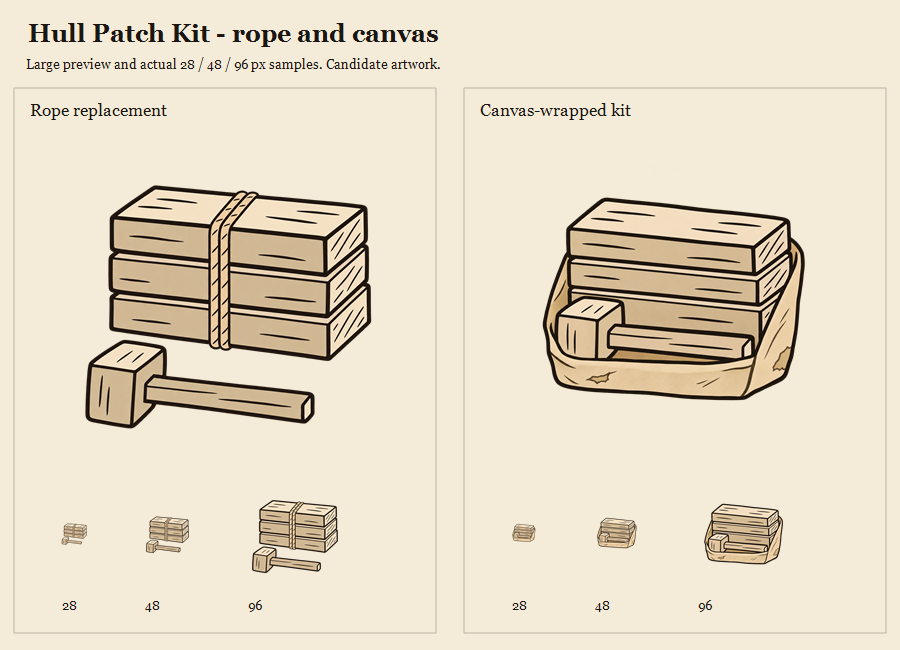
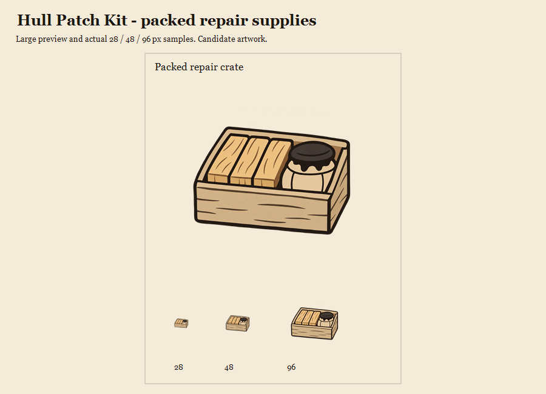
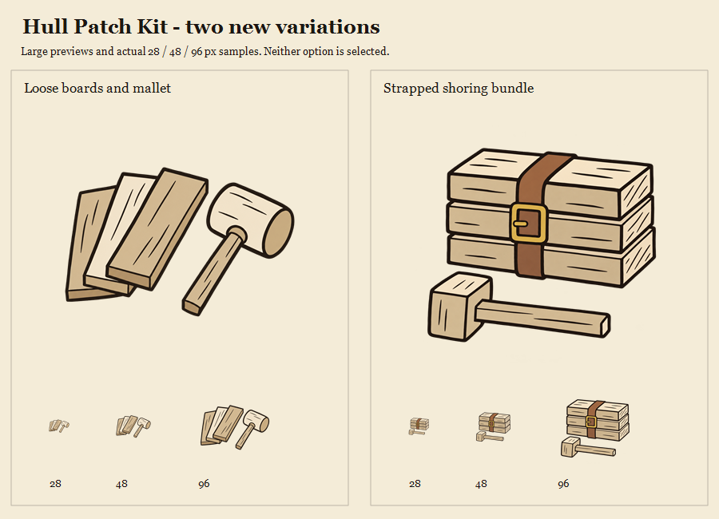
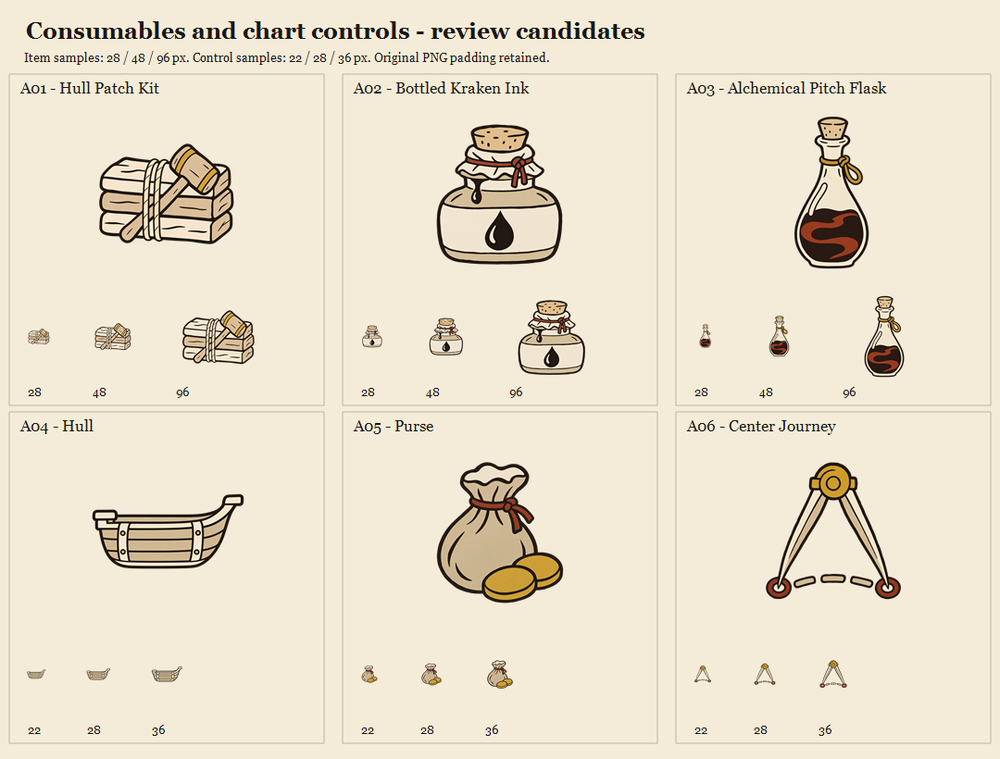
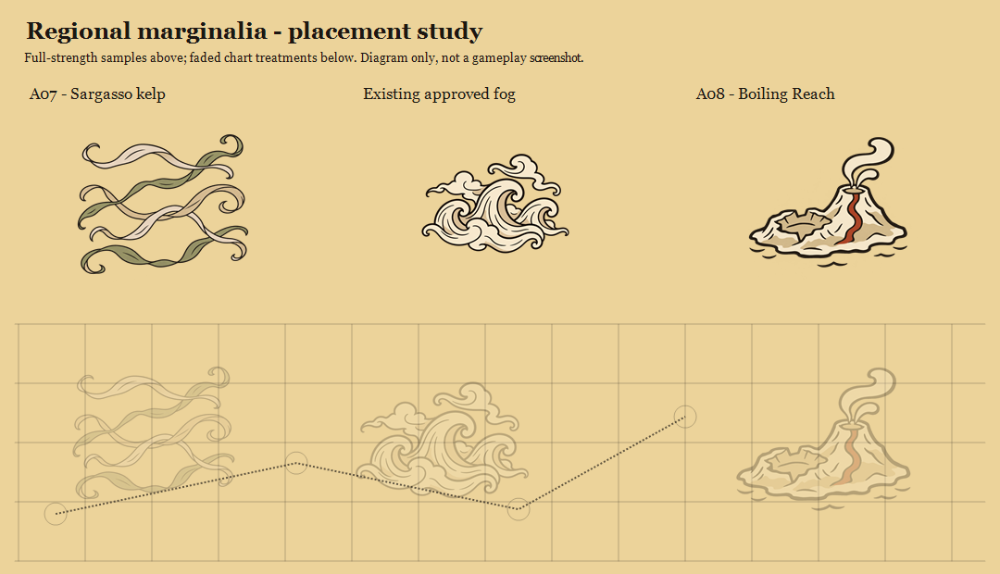

# Consumable and chart artwork review — 6 November 2026

**Status: all eight selected illustrations approved and integrated on 7 November 2026, using the revised hull and berry-free kelp.** The user scheduled this focused pass after the navigation/playtest UI work. Broader hardpoint, material, Covenant and home-menu artwork remains deferred in [the backlog](../BACKLOG.md#deferred-ui-art-and-icons).

The project requires approved art in the app bundle ([developer guide](../../CLAUDE.md#presentation-and-art)). Review originals live in a separate [candidate directory](candidates/artwork-pass-2026-11-06/). All eight selected originals have been copied unchanged into the app; unused alternatives remain outside the bundle. Existing approved assets, player saves and historical evidence are preserved.

## Approved complete pass

The user approved the rest of the pass after selecting the rope kit, explicitly retaining the revised hull and berry-free kelp. The app now uses the three accurate consumable illustrations, revised Hull/Purse status art, chart dividers for Center Journey, Drift kelp/fog and Reach volcanic marginalia. [Complete integration verification](../archive/README.md#approved-artwork-pass-verification-2026-11-07) records the visited-region-only rendering checks, real-font layouts and separate Windows preview. All prior drafts and receipts below remain historical evidence.

## Approved Hull Patch Kit

The user selected the **rope replacement**: “I like the rope one better, let's go with that one.” [The approved PNG](../../apps/monstrous_sea/assets/art/icon_hull_patch_kit_rope_from_leather_v1.png) is copied unchanged from its candidate original. `PilotArt.hullPatchKit` and the shared `SvgAssetView.pathForItem` mapping now use it for illustrated merchant and reward menus, including wreck cargo. Combat and inspection currently use text-only belt controls.

[Integration verification](../archive/README.md#hull-patch-kit-art-verification-2026-11-07) records 53 targeted checks, two font-loaded merchant captures, clean analysis and an isolated Windows preview. The canvas alternative remains preserved and unselected.

## User-requested revisions

- **Hull Patch Kit, latest direction — 7 November:** The user prefers the leather version's squared planks and square-headed hammer as the starting point. Replace only its belt/buckle with rope and retain the separate hammer's arrangement; do not lash the hammer back onto the boards. Also try the discussed canvas-wrapped version. The repair-crate concept was declined. The user subsequently selected the rope edit; the canvas alternative was not selected. Retain the [first patch kit](candidates/artwork-pass-2026-11-06/icon_hull_patch_kit_map_v1.png) and [rope revision](candidates/artwork-pass-2026-11-06/icon_hull_patch_kit_map_v2.png) for comparison.
- **Sargasso kelp:** Replace the small branching sprig with long overlapping strands, loose curls and open gaps suitable for faded chart decoration. The latest revision removes all four berry-like pods and their stalks; [the strand revision with pods](candidates/artwork-pass-2026-11-06/chart_sargasso_kelp_map_v2.png) and [its regional proof](candidates/artwork-pass-2026-11-06/regional-context-v2.png) remain preserved. [Earlier kelp](candidates/artwork-pass-2026-11-06/chart_sargasso_kelp_map_v1.png).
- **Hull:** The user prefers the revised hull. Other candidates are not automatically approved by that preference.

The initial individual previews numbered nine because the hull had two drafts. The A-IDs on review sheets identify eight intended assets; they are not that preview sequence. The [first item/control sheet](candidates/artwork-pass-2026-11-06/items-and-controls.png), [first regional study](candidates/artwork-pass-2026-11-06/regional-context.png) and [first alpha checks](candidates/artwork-pass-2026-11-06/alpha-checks.json) remain retained.

## Rope and canvas variations

**Requested 7 November 2026; rope subsequently approved and integrated.** Both use the leather version as the edit source. This comparison preserves the review before selection.

| Option | Original | Change |
| --- | --- | --- |
| Rope replacement | [Transparent PNG](candidates/artwork-pass-2026-11-06/icon_hull_patch_kit_rope_from_leather_v1.png) | Replace the leather belt and buckle with cord around the wood only; retain the squared planks and separate hammer's arrangement. |
| Canvas-wrapped kit | [Transparent PNG](candidates/artwork-pass-2026-11-06/icon_hull_patch_kit_canvas_packet_v1.png) | Fold sailcloth around the boards and mallet as a compact packet, with recognizable wood and tool visible above the cloth. |

[Current-round alpha/source-copy checks](candidates/artwork-pass-2026-11-06/patch-kit-rope-canvas-2026-11-07-v1-alpha-checks.json) passed. Originals keep their generated dimensions: rope 1254 × 1254; canvas 1388 × 1133. The comparison preserves aspect ratio and has been visually inspected. Reproduce with `powershell.exe -NoProfile -ExecutionPolicy Bypass -File tools/art/render_artwork_pass.ps1 -PatchRound rope-canvas-2026-11-07 -Revision v1`.

## Hull Patch Kit proposal

**Declined repair-crate concept retained as evidence.**

[Packed repair crate — original transparent PNG](candidates/artwork-pass-2026-11-06/icon_hull_patch_kit_repair_crate_v1.png). Three pre-cut oak boards and one sealed pitch pot sit together inside a small crate. No separate hammer, loose tool, strap or binding. The user declined this concept as worse than the earlier candidates. [Alpha/source-copy checks](candidates/artwork-pass-2026-11-06/patch-kit-packed-v1-alpha-checks.json) passed, and its large/small-size proof was visually inspected. Reproduce with `powershell.exe -NoProfile -ExecutionPolicy Bypass -File tools/art/render_artwork_pass.ps1 -PatchProposal -Revision v1`.

## Hull Patch Kit variations

**Earlier options retained as review evidence.** The leather belt was declined, but the user later chose that version's boards, hammer and separate arrangement as the basis for the rope edit.

| Option | Illustration | Direction |
| --- | --- | --- |
| Loose boards and mallet | [Original transparent PNG](candidates/artwork-pass-2026-11-06/icon_hull_patch_kit_loose_boards_v1.png) | Three sawn planks and a separate wooden mallet; no binding or knot. |
| Strapped shoring bundle | [Original transparent PNG](candidates/artwork-pass-2026-11-06/icon_hull_patch_kit_leather_bundle_v1.png) | Three squared timbers in one leather strap with a brass buckle; a separate mallet below. |

Both were generated afresh from the approved treasure/cannon style references, rather than editing the old rounded planks and rope. [Alternative alpha checks/hashes](candidates/artwork-pass-2026-11-06/patch-kit-variations-v1-alpha-checks.json) verify the source copies and transparency. Reproduce the comparison with `powershell.exe -NoProfile -ExecutionPolicy Bypass -File tools/art/render_artwork_pass.ps1 -PatchAlternatives -Revision v1`. The following combined sheet retains the earlier patch-kit candidate as retained evidence; the loose-board option and leather binding were declined, with the leather version's geometry reused for the latest edit.

## Selected illustrations and earlier review proof

| ID | Selection | Integrated use |
| --- | --- | --- |
| A01 | Hull Patch Kit — [approved rope replacement](#approved-hull-patch-kit); earlier drafts retained for comparison | Replaces the tincture bottle through the shared item-art selector. |
| A02 | [Bottled Kraken Ink](candidates/artwork-pass-2026-11-06/icon_kraken_ink_map_v1.png) — squat stoneware jar with ink drop | Replaces the Blast Pack barrel. The broad jar silhouette differs from both flasks. |
| A03 | [Alchemical Pitch Flask](candidates/artwork-pass-2026-11-06/icon_alchemical_pitch_map_v1.png) — tall narrow flask with dark pitch | Replaces the Blast Pack barrel. The tall shape and restrained rust accent distinguish it from the round multicolored tincture. |
| A04 | [Hull](candidates/artwork-pass-2026-11-06/icon_chart_hull_map_v2.png) — bare planked hull | Replaces the chart status shield. Retain the Hull label, numbers and condition colors. The user prefers this revised hull to the first attempt. |
| A05 | [Purse](candidates/artwork-pass-2026-11-06/icon_chart_purse_map_v1.png) — tied coin pouch | Replaces the chart's generic overlapping circles. Retain the Purse label, gold amount and gold accent. |
| A06 | [Center Journey](candidates/artwork-pass-2026-11-06/icon_center_journey_map_v1.png) — dividers spanning a plotted course | Replaces the centering symbol. Retain the tooltip, input behavior and current zoom. |
| A07 | [Sargasso kelp](candidates/artwork-pass-2026-11-06/chart_sargasso_kelp_map_v3.png) | Long tangled strands of decorative kelp near committed Drift history, paired with the existing approved fog illustration. |
| A08 | [Boiling Reach](candidates/artwork-pass-2026-11-06/chart_reach_caldera_map_v1.png) — cone and broken caldera | Decorative volcanic landforms near committed Reach history. |

Control samples include the existing 22-pixel badge size and larger 28/36-pixel alternatives. The integrated hull/purse illustrations use 32 logical pixels and Center Journey uses 28; real-font layouts were checked at 115–130% text. The images supplement existing labels and tooltips; small-size readability is part of the selection, not established by inspecting only the large originals.

## Regional treatment

This retained image is the original placement study, **not a gameplay screenshot**. Existing [fog artwork](../../apps/monstrous_sea/assets/art/icon_fog_map.png) is reusable; no replacement is needed. Integrated ornaments move with the chart and are faded below route markers. Placement uses committed regional visits, avoids recorded markers and other illustrations, and adds no terrain rules or gameplay RNG. Existing creature marginalia and structural map linework remain; later-region illustrations replace generic coast sketches in those waters.

## Provenance and verification

- Generated with the built-in `image_gen` tool using the approved treasure/tincture PNGs as style references. [The prompt record](artwork_pass_2026_11_06.json) contains each exact prompt, source path, candidate path, reference list and the rejected hull attempt's rationale.
- The eight primary candidate originals, two earlier patch-kit alternatives and repair-crate proposal are 1254 × 1254 PNGs with true alpha. The latest rope/canvas originals retain the dimensions recorded above. [Alpha checks and SHA-256 hashes](candidates/artwork-pass-2026-11-06/alpha-checks-v3.json) confirm clear padding, no painted edge pixels and byte-identical copies of generated sources. The requested 10% margin was not consistently met, but none of the drawings is clipped.
- [The proof renderer](../../tools/art/render_artwork_pass.ps1) resizes/composites copies for review only. It does not modify the originals. The retained v3 sheets describe the pre-approval state; render the current record into a new version with `powershell.exe -NoProfile -ExecutionPolicy Bypass -File tools/art/render_artwork_pass.ps1 -Revision v4` from the repository root.
- The combined, regional and patch-kit comparison sheets were visually inspected at full size before selection. The [integration receipt](../archive/README.md#hull-patch-kit-art-verification-2026-11-07) separately records verification of the approved kit in the app. Earlier candidate proofs do not imply approval or runtime integration of the other illustrations.

All eight selections are integrated and verified. Adding illustrations to the currently text-only inspection/combat belt remains separate presentation work. The pass changes no saves, encounters or provisional tuning.
