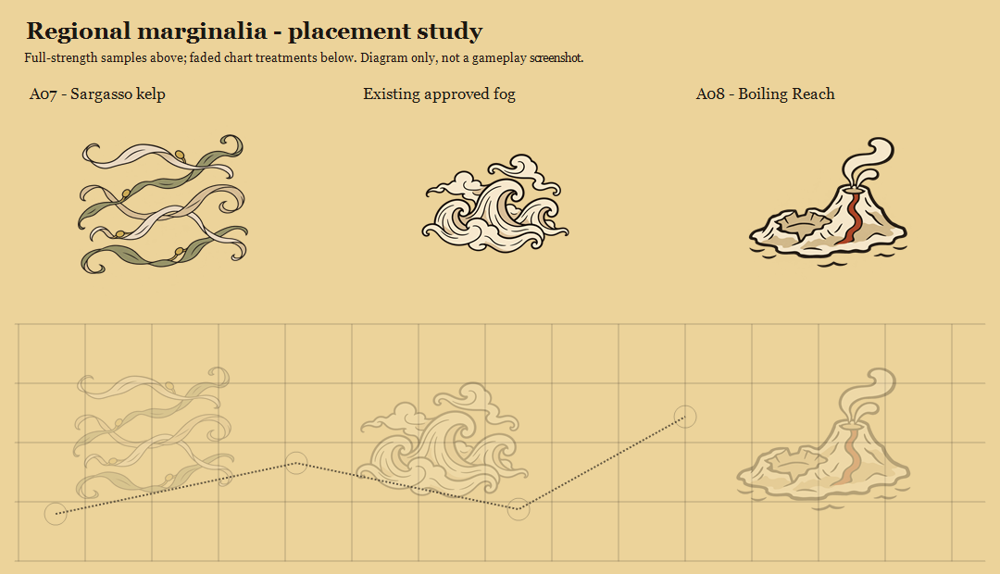

# Consumable and chart artwork review — 6 November 2026

**Status: patch kit and kelp revised after user review; revised hull preferred; production art mappings unchanged.** The user scheduled this focused pass after the navigation/playtest UI work. Broader hardpoint, material, Covenant and home-menu artwork remains deferred in [the backlog](../BACKLOG.md#deferred-ui-art-and-icons).

The project requires approved art in the app bundle ([developer guide](../../CLAUDE.md#presentation-and-art)). These originals therefore live in a separate [candidate directory](candidates/artwork-pass-2026-11-06/). Selection is the next step before integration. Existing approved assets, player saves and historical evidence remain unchanged.

## User-requested revisions

- **Hull Patch Kit:** Replace the malformed front knot with two continuous rope wraps; the tie-off sits behind the stack. Preserve the planks, mallet and ink style. [Earlier patch kit](candidates/artwork-pass-2026-11-06/icon_hull_patch_kit_map_v1.png).
- **Sargasso kelp:** Replace the small branching sprig with long overlapping strands, loose curls and open gaps suitable for faded chart decoration. [Earlier kelp](candidates/artwork-pass-2026-11-06/chart_sargasso_kelp_map_v1.png).
- **Hull:** The user prefers the revised hull. Other candidates are not automatically approved by that preference.

The initial individual previews numbered nine because the hull had two drafts. The A-IDs on review sheets identify eight intended assets; they are not that preview sequence. The [first item/control sheet](candidates/artwork-pass-2026-11-06/items-and-controls.png), [first regional study](candidates/artwork-pass-2026-11-06/regional-context.png) and [first alpha checks](candidates/artwork-pass-2026-11-06/alpha-checks.json) remain retained.

## Candidates

| ID | Candidate | Intended mapping |
| --- | --- | --- |
| A01 | [Hull Patch Kit](candidates/artwork-pass-2026-11-06/icon_hull_patch_kit_map_v2.png) — oak shoring and mallet, with two simple cord wraps | Replace the incorrectly reused tincture bottle for this consumable everywhere the shared item-art selector is used. |
| A02 | [Bottled Kraken Ink](candidates/artwork-pass-2026-11-06/icon_kraken_ink_map_v1.png) — squat stoneware jar with ink drop | Replace the incorrectly reused Blast Pack barrel. The broad jar silhouette differs from both flasks. |
| A03 | [Alchemical Pitch Flask](candidates/artwork-pass-2026-11-06/icon_alchemical_pitch_map_v1.png) — tall narrow flask with dark pitch | Replace the incorrectly reused Blast Pack barrel. The shape and restrained rust accent distinguish it from the round multicolored tincture. |
| A04 | [Hull](candidates/artwork-pass-2026-11-06/icon_chart_hull_map_v2.png) — bare planked hull | Replace the chart status shield. Retain the Hull label, numbers and condition colors. The user prefers this revised hull to the first attempt. |
| A05 | [Purse](candidates/artwork-pass-2026-11-06/icon_chart_purse_map_v1.png) — tied coin pouch | Replace the chart's generic overlapping circles. Retain the Purse label, gold amount and gold accent. |
| A06 | [Center Journey](candidates/artwork-pass-2026-11-06/icon_center_journey_map_v1.png) — dividers spanning a plotted course | Replace the centering symbol. Retain the tooltip, input behavior and current zoom. |
| A07 | [Sargasso kelp](candidates/artwork-pass-2026-11-06/chart_sargasso_kelp_map_v2.png) | Long tangled strands of decorative kelp near committed Drift history, paired with the existing approved fog illustration. |
| A08 | [Boiling Reach](candidates/artwork-pass-2026-11-06/chart_reach_caldera_map_v1.png) — cone and broken caldera | Decorative volcanic landforms near committed Reach history. |

Control samples include the existing 22-pixel badge size and larger 28/36-pixel alternatives. A starting integration proposal is 28–32 logical pixels for the illustrated controls, with final layout checks at 115–130% text. The images supplement existing labels and tooltips; small-size readability is part of the selection, not established by inspecting only the large originals.

## Regional treatment

This is a placement study, **not a gameplay screenshot**. Existing [fog artwork](../../apps/monstrous_sea/assets/art/icon_fog_map.png) is reusable; no replacement is needed. Proposed ornaments move with the chart and are faded below route markers. Final placement must avoid obscuring the wake, labels or controls. It must depend only on visited regions/committed history, reveal no future destinations, consume no gameplay RNG and add no terrain rules. Keep the existing creature marginalia and structural map linework.

## Provenance and verification

- Generated with the built-in `image_gen` tool using the approved treasure/tincture PNGs as style references. [The prompt record](artwork_pass_2026_11_06.json) contains each exact prompt, source path, candidate path, reference list and the rejected hull attempt's rationale.
- Eight selected candidate originals are 1254 × 1254 PNGs with true alpha. [Alpha checks and SHA-256 hashes](candidates/artwork-pass-2026-11-06/alpha-checks-v2.json) confirm clear padding, no painted edge pixels and byte-identical copies of generated sources. The requested 10% margin was not consistently met, but none of the drawings is clipped.
- [The proof renderer](../../tools/art/render_artwork_pass.ps1) resizes/composites copies for review only. It does not modify the originals. Reproduce with `powershell.exe -NoProfile -ExecutionPolicy Bypass -File tools/art/render_artwork_pass.ps1 -Revision v2` from the repository root.
- Both proof sheets were visually inspected at full size. The application's asset bundle and runtime remain unchanged at this review stage; no Flutter build or gameplay suite is claimed for candidate artwork.

After selection, integrate the three consumable mappings through `SvgAssetView.pathForItem` so merchants, salvage, loot, inspection and combat use the same identities; then update the two helm badges, Center Journey control and regional marginalia. Verify bundle decoding, item identity, visited-region-only placement and realistic chart layouts. Do not change saves, encounters or provisional tuning as part of this art pass.
