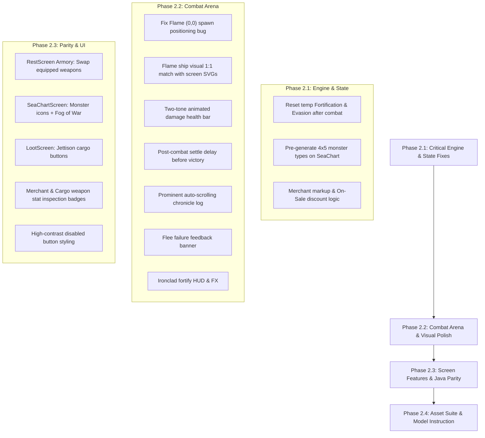

# Feedback & Remediation Plan: The Monstrous Sea V2

This document consolidates player feedback from the initial playable build, root-cause analyses, exact solutions, and an actionable remediation plan divided into structured engineering streams.

---

## 1. Asset & Art Pipeline Stream

### 1.1 Ship SVGs Re-Authoring (Floating Masts Bug)
- **Problem**: The Ironclad and Freighter SVGs currently have floating masts separated from the hull geometry due to misaligned SVG viewBox offsets and disconnect between `<path>` hull coordinates and mast `<line>` tags.
- **Goal**: Re-author clean, authentic 18th-century nautical line-art SVGs where masts, rigging, and crow's nests are physically connected to the ship deck and hull.
- **Specialized Model Prompt Plan**: See Section 6 for the complete standalone prompt crafted to instruct a vector-specialized LLM to generate precise, mathematically connected SVGs without AI raster artifacts.

### 1.2 Individual Consumable Icons
- **Problem**: Unstable Tincture currently reuses a ship's wheel icon (`icon_helm.svg`). All consumables share generic graphics.
- **Fix**: Author 3 distinct vector SVGs in `assets/art/`:
  - `item_tincture.svg`: Antique glass apothecary potion vial with bubbling venom.
  - `item_blast_pack.svg`: Bound dynamite / black powder barrel keg with burning fuse.
  - `item_chakram.svg`: Serrated iron chakram / razor-edged throwing disc.

### 1.3 Individual Weapon Icons
- **Problem**: Blade Launcher and elemental weapons share a generic cannon icon.
- **Fix**: Author 5 distinct vector SVGs in `assets/art/`:
  - `weapon_cannon.svg`: Classic broadside brass 18-pounder cannon on wooden carriage.
  - `weapon_torpedo.svg`: Steampunk steam-pneumatic brass torpedo launcher tube.
  - `weapon_blade_launcher.svg`: Mechanical spring-loaded crossbow / sawblade catapult.
  - `weapon_lightning_railgun.svg`: Galvanic coil-wrapped Leyden battery rail.
  - `weapon_flamethrower.svg`: Greek fire siphon projector with brass bellows and nozzle.

---

## 2. Combat Engine & Arena Stream

### 2.1 Battle Component Spawn Coordinates (Top-Left Jump Bug)
- **Problem**: In `MonstrousSeaBattleGame`, `_shipVisual` and `_monsterVisual` spawn at `(0, 0)` (top-left) and only snap to the center after the first turn.
- **Root Cause**: `_shipVisual.position` was only set inside `onGameResize` gated behind `if (isLoaded)`. During initial mounting, `onGameResize` fired before `isLoaded` was true, leaving positions at `(0, 0)`.
- **Fix**: Explicitly compute and assign `position = Vector2(size.x * 0.25, size.y * 0.55)` in `onLoad()` as soon as `size` is known, and update in `onGameResize`.

### 2.2 Ship Visual Consistency Between Screens
- **Problem**: Port and Captain screens display the ship SVG (`SvgAssetView`), whereas the combat arena renders a hardcoded procedural sloop with canvas primitives that looks completely different.
- **Fix**: Make `_ShipBattleComponent` render the actual SVG corresponding to `ship.shipClass` (and Flying Dutchman variant), ensuring 1:1 visual continuity across all screens.

### 2.3 Post-Combat Settle Delay
- **Problem**: Defeating a monster immediately triggers `SessionPhase.loot`, snapping to `LootScreen` before damage numbers, floating text, and monster death animations can finish playing.
- **Fix**: In `BattleScreen._dispatchCombatAction`, when an action results in monster defeat, add a deliberate settle pause (1.2 to 1.5 seconds) allowing the fatal blow numbers, screen shake, and victory narration to register before transitioning the view.

### 2.4 Animated Two-Tone Health Bar (`HullGauge`)
- **Problem**:
  - The health bar does not communicate lost health clearly; missing health lacks a distinct backing track.
  - Health snaps instantly instead of animating smoothly.
  - On `RestScreen`, the gauge lacks clear visual contrast.
- **Fix**:
  - Add a dark crimson backing track (`InkTheme.crimsonAccent.withValues(alpha: 0.35)`) representing missing hull.
  - Interpolate health changes smoothly using `TweenAnimationBuilder<double>` over 400ms with `Curves.easeOutCubic`.
  - Provide a distinct two-tone segmented appearance (green vitality shrinking against crimson damage).

### 2.5 Ironclad Fortification Leak Across Battles (Bug Fix)
- **Problem**: Fortifying defenses increases `currentDmgReduction`, but this value is never reset when combat ends. Across multiple encounters, the Ironclad permanently accumulates infinite armor.
- **Root Cause**: Missing post-combat state reset in `GameSession`.
- **Fix**:
  - Separate `baseDmgReduction` (hull passive) from `tempCombatFortification`.
  - In `GameSession._resolveMonsterDefeat()` and `_handleFleeEncounter()`, explicitly reset `ship.currentDmgReduction = ship.baseDmgReduction` and `ship.currentEvasion = ship.baseEvasion`.

### 2.6 Ironclad Fortify HUD Visibility & Visual FX
- **Problem**: Player cannot see how much damage reduction they have accumulated, and fortifying gives no visual feedback.
- **Fix**:
  - Display the active fortification amount in the Ship HUD: e.g. `ARMOR: 6 AC | Fortified: -8 Dmg`.
  - Trigger a visual plating flash / floating text (`"+X FORTIFIED"`) and iron shield icon animation in `MonstrousSeaBattleGame`.

### 2.7 Flee Attempt Feedback
- **Problem**: When a flee roll fails, the monster suddenly attacks without informing the user that fleeing was attempted and failed.
- **Fix**: Emit and render an explicit banner / modal alert: *"Flee Attempt Failed! The beast cut off your escape!"* before playing the monster's retaliation.

### 2.8 Combat Chronicle Log Ergonomics
- **Problem**: Log button is tiny and easy to miss; log is collapsed by default and does not auto-scroll to the newest entries.
- **Fix**:
  - Display the combat chronicle by default in a dedicated horizontal drawer positioned above the weapon selection dock.
  - Auto-scroll `ScrollController` to `maxScrollExtent` whenever new entries are added, unless the player manually scrolled upward.

---

## 3. Gameplay Mechanics & Original Java Parity Stream

### 3.1 Rest Area Armory (Weapon Equipping & Swapping)
- **Problem**: In the original Java game, the Rest Area allowed swapping weapons between the cargo hold and active mounts. `RestScreen` currently lacks this.
- **Root Cause**: The engine methods `EquipCargoWeapon` and `UnequipShipWeapon` exist in `GameSession`, but `RestScreen` did not render the armory UI.
- **Fix**: Add an **Armory & Weapon Mounts** section in `RestScreen` displaying:
  - Active weapon mounts with weight indicators (`currentWeight / maxWeight`).
  - Cargo hold weapons with "Mount" and active weapons with "Stow" buttons.

### 3.2 Sea Chart Monster Icons & Row-by-Row Fog of War
- **Problem**: The sea map shows generic `[row, col]` text and only reveals The Kraken at `[3, 4]`. The original Java version revealed all monster icons in the current row (`row <= currentRow`) so players could prepare their armaments, while hiding subsequent rows in dense fog of war (`░░░░`).
- **Fix**:
  - Pre-generate the 4×5 monster roster in `SeaChart` on map initialization/reset.
  - In `SeaChartScreen`:
    - For `row <= currentRow`: display the monster's type SVG icon (`monster_shark.svg`, `monster_serpent.svg`, `monster_squid.svg`, etc.).
    - For `row > currentRow`: shroud cells in an antique cartographic fog texture / stamped clouds (`FOG OF WAR`).

### 3.3 Loot Screen: Jettison Cargo to Make Room
- **Problem**: If the cargo hold is full upon victory, players cannot discard old items to pick up valuable loot floating in the water.
- **Root Cause**: Engine command `DropCargoItem(index)` exists, but `LootScreen` had no button for it.
- **Fix**: Add a "Your Hold (Full)" tray in `LootScreen` allowing players to click **"Jettison"** on any stowed item to free up space for pending spoils.

---

## 4. Economy & Merchant Stream

### 4.1 Weapon Stat Inspection
- **Problem**: Players cannot see weapon damage ranges, charge times, hit modifiers, or status effects in the Merchant or Inventory, making RNG comparisons impossible.
- **Fix**: Add detailed stat badges or an expandable inspection modal for all weapons:
  - Base Damage range: e.g. `[16-24] Piercing`
  - Charge time: `Ready every X turns`
  - Hit roll bonus: `+2 Hit`
  - Status effects: `Inflicts Burn (25% wear-off)`

### 4.2 Merchant Markup & "On Sale" System
- **Problem**: Merchant currently buys and sells at nominal value (`item.value`).
- **Fix**:
  - Buy price markup: Merchant sells items at `(item.value * 1.35).round()`.
  - Sell price: Player sells items at nominal `item.value` (or 75% for non-treasure).
  - "On Sale" Deal: Each visit, 1 random merchant item is marked as **"MERCHANT'S SPECIAL"** discounted by 25-40% with a special gold banner.

### 4.3 Disabled Button Visual Distinction
- **Problem**: In the Drydock repair dialog, unaffordable options are not distinct enough from active buttons.
- **Fix**:
  - When unaffordable: Render button in faded bone parchment (`opacity: 0.45`), dashed ink border, strikethrough gold text, and replace label with *"Lacks Gold"* or *"Too Costly"*.

---

## 5. Implementation Roadmap & Execution Order



---

## 6. Prompt Specification for Specialized SVG Generation Model

To achieve clean, professional, hand-crafted vector graphics that eliminate floating elements and strictly adhere to the no-AI-raster constraint, use the following prompt template when prompting a model or subagent:

```markdown
You are an expert SVG Vector Graphic Designer specializing in authentic 18th-century nautical cartography and engraving art.

### Task:
Author clean, valid, standalone SVG files for naval vessels, sea monsters, and items for "The Monstrous Sea V2".

### Strict Constraints:
1. NO AI-generated raster images (no embedded base64 PNGs/JPEGs). Only pure XML/SVG vector paths.
2. Aesthetic: Antique ink-and-parchment cartographic style.
   - Primary stroke color: `#1B1612` (iron-gall ink)
   - Accent fill colors: `#F4ECD8` (vellum parchment), `#D5C4A1` (dark parchment), `#8C2D19` (crimson), `#C59B27` (brass gold)
   - Stroke widths: 1.5px to 3px with crisp lines, cross-hatching, and woodcut engraving details.
3. Coordinate Discipline (CRITICAL):
   - viewBox must be exactly "0 0 200 200" (or "0 0 100 100" for icons).
   - ALL masts must physically connect to the ship's deck/hull path. Under NO circumstances should a mast or sail float in the air.
   - The hull must form a closed path `<path d="..." />` anchoring the bottom half of the graphic (e.g., Y=120 to Y=170).
   - Masts must originate from the deck (e.g., start at Y=120) and extend upward with cross-spars and rigging ropes connecting back to the hull.

### Ship Types to Generate:
1. **Ironclad Ram**: Low-slung, heavily armored iron-plated hull with rivets, submerged ram prow, reinforced low pilot house, and a single sturdy armored mast bolted directly into the deck.
2. **Heavy Freighter**: Bulky, wide cargo hull with deep draft, double wooden decks, high sterncastle, 3 tall fully-rigged square masts securely planted into the hull.
3. **Swift Corvette**: Sleek, sharp, raked clipper hull with lateen triangular sails, bowsprit, and aerodynamic lines.
4. **Standard Sloop**: Balanced two-masted merchant schooner.
5. **Flying Dutchman**: Ghostly, jagged, tattered-sailed galleon with barnacle ribs and spectral lines.

### Item Icons to Generate (viewBox: 0 0 64 64):
1. **Unstable Tincture**: Antique corked glass vial with bubbles and poison droplet.
2. **Blast Pack**: Bound wooden gunpowder keg with iron bands and sizzling fuse.
3. **Chakram**: Serrated circular throwing ring blade with cross-hatched edge.
4. **Ship Weapons**: Broadside Cannon, Torpedo Launcher tube, Blade Catapult, Coil Railgun, Fire Siphon.
```
