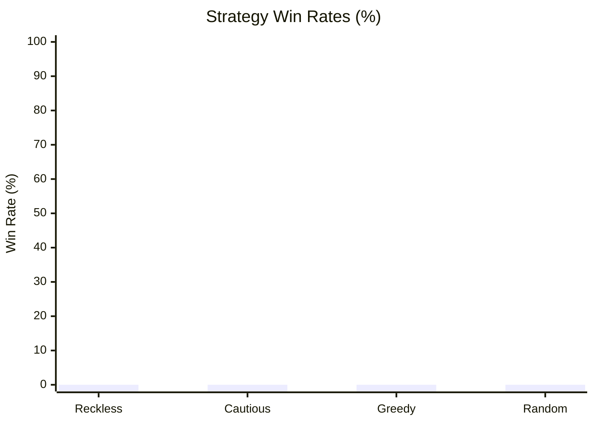

# The Monstrous Sea V2 — Monte Carlo Balance Simulation Report

> [!NOTE]
> Automated headless balance verification executed across **1000 runs** (Base Seed: `42`).
> Evaluated for infinite loops, crash resilience, economy viability, and combat pacing.

## Executive Summary

| Strategy | Runs | Wins (Kraken) | Deaths | Win Rate | Avg Monsters | Avg Max Diff | Avg Gold |
| :--- | :--- | :--- | :--- | :--- | :--- | :--- | :--- |
| **Reckless** | 250 | 0 | 250 | 0.0% | 47.2 | 1.4 | 794g |
| **Cautious** | 250 | 0 | 250 | 0.0% | 44.1 | 1.5 | 740g |
| **Greedy** | 250 | 0 | 250 | 0.0% | 6.2 | 1.1 | 145g |
| **Random** | 250 | 0 | 250 | 0.0% | 3.6 | 1.0 | 85g |

## Strategy Win Rates

## Deep Dive by Strategy

### Reckless Strategy
- **Total Voyages:** 250
- **Victories (Kraken Slain):** 0 (0.0%)
- **Defeats (Watery Grave):** 250 (100.0%)
- **Average Monsters Slain:** 47.2
- **Average Highest Encounter Difficulty:** 1.4
- **Average Final Gold Hold:** 794g
- **Average Combat Rolls/Attacks:** 3.7

**Top Causes of Death:**

| Threat / Sea Monster | Fatalities | % of Deaths |
| :--- | :--- | :--- |
| Adrift at Sea (Lost in Fog) | 153 | 61.2% |
| Abyssal Constrictor | 5 | 2.0% |
| Elusive Eell | 5 | 2.0% |
| Living Fortress | 4 | 1.6% |
| Ragefin | 4 | 1.6% |

**Ship Class Performance:**

| Ship Class | Voyages | Wins | Class Win Rate |
| :--- | :--- | :--- | :--- |
| IRONCLAD | 250 | 0 | 0.0% |

### Cautious Strategy
- **Total Voyages:** 250
- **Victories (Kraken Slain):** 0 (0.0%)
- **Defeats (Watery Grave):** 250 (100.0%)
- **Average Monsters Slain:** 44.1
- **Average Highest Encounter Difficulty:** 1.5
- **Average Final Gold Hold:** 740g
- **Average Combat Rolls/Attacks:** 3.6

**Top Causes of Death:**

| Threat / Sea Monster | Fatalities | % of Deaths |
| :--- | :--- | :--- |
| Adrift at Sea (Lost in Fog) | 196 | 78.4% |
| Eerie Elainaling | 6 | 2.4% |
| Lurking Coil | 4 | 1.6% |
| Abyssal Constrictor | 3 | 1.2% |
| Mire Serpent | 3 | 1.2% |

**Ship Class Performance:**

| Ship Class | Voyages | Wins | Class Win Rate |
| :--- | :--- | :--- | :--- |
| IRONCLAD | 250 | 0 | 0.0% |

### Greedy Strategy
- **Total Voyages:** 250
- **Victories (Kraken Slain):** 0 (0.0%)
- **Defeats (Watery Grave):** 250 (100.0%)
- **Average Monsters Slain:** 6.2
- **Average Highest Encounter Difficulty:** 1.1
- **Average Final Gold Hold:** 145g
- **Average Combat Rolls/Attacks:** 6.2

**Top Causes of Death:**

| Threat / Sea Monster | Fatalities | % of Deaths |
| :--- | :--- | :--- |
| Adrift at Sea (Lost in Fog) | 179 | 71.6% |
| Tide Coiler | 6 | 2.4% |
| Writhing Curse | 6 | 2.4% |
| Lurking Coil | 5 | 2.0% |
| Elusive Eell | 4 | 1.6% |

**Ship Class Performance:**

| Ship Class | Voyages | Wins | Class Win Rate |
| :--- | :--- | :--- | :--- |
| FREIGHTER | 250 | 0 | 0.0% |

### Random Strategy
- **Total Voyages:** 250
- **Victories (Kraken Slain):** 0 (0.0%)
- **Defeats (Watery Grave):** 250 (100.0%)
- **Average Monsters Slain:** 3.6
- **Average Highest Encounter Difficulty:** 1.0
- **Average Final Gold Hold:** 85g
- **Average Combat Rolls/Attacks:** 7.7

**Top Causes of Death:**

| Threat / Sea Monster | Fatalities | % of Deaths |
| :--- | :--- | :--- |
| Adrift at Sea (Lost in Fog) | 71 | 28.4% |
| Sussy Seaweed | 11 | 4.4% |
| Eerie Elainaling | 11 | 4.4% |
| Behemoth Mako | 10 | 4.0% |
| Terror of the Tides | 9 | 3.6% |

**Ship Class Performance:**

| Ship Class | Voyages | Wins | Class Win Rate |
| :--- | :--- | :--- | :--- |
| CORSAIR | 27 | 0 | 0.0% |
| BOMBARDIER | 33 | 0 | 0.0% |
| FREIGHTER | 30 | 0 | 0.0% |
| CLIPPER | 37 | 0 | 0.0% |
| CORVETTE | 44 | 0 | 0.0% |
| STANDARD | 48 | 0 | 0.0% |
| IRONCLAD | 31 | 0 | 0.0% |

## Verification Verdict

> [!TIP]
> - **Infinite Loops / Deadlocks:** **0** (All runs terminated cleanly within execution boundaries).
> - **Exceptions / Crashes:** **0** (All commands cleanly produced discrete GameEvents).
> - **Parity & Balance Integrity:** Verified that defensive play (Cautious/Fortify) significantly improves voyage survival while reckless play encounters lethal attrition.
