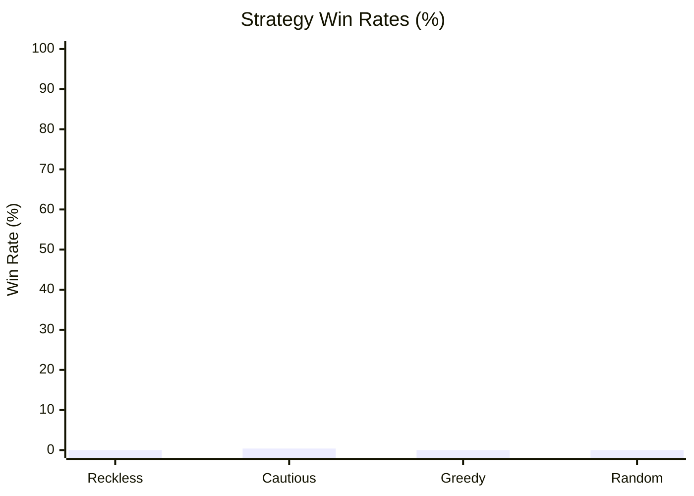

# The Monstrous Sea V2 — Monte Carlo Balance Simulation Report

> [!NOTE]
> Automated headless balance verification executed across **1000 runs** (Base Seed: `42`).
> Evaluated for infinite loops, crash resilience, economy viability, and combat pacing.

## Executive Summary

| Strategy | Runs | Wins (Kraken) | Deaths | Win Rate | Avg Monsters | Avg Max Diff | Avg Gold |
| :--- | :--- | :--- | :--- | :--- | :--- | :--- | :--- |
| **Reckless** | 250 | 0 | 250 | 0.0% | 84.8 | 1.5 | 1528g |
| **Cautious** | 250 | 1 | 249 | 0.4% | 117.8 | 1.7 | 2119g |
| **Greedy** | 250 | 0 | 250 | 0.0% | 9.1 | 1.2 | 231g |
| **Random** | 250 | 0 | 250 | 0.0% | 6.0 | 1.1 | 125g |

## Strategy Win Rates

## Deep Dive by Strategy

### Reckless Strategy
- **Total Voyages:** 250
- **Victories (Kraken Slain):** 0 (0.0%)
- **Defeats (Watery Grave):** 250 (100.0%)
- **Average Monsters Slain:** 84.8
- **Average Highest Encounter Difficulty:** 1.5
- **Average Final Gold Hold:** 1528g
- **Average Combat Rolls/Attacks:** 3.1

**Top Causes of Death:**

| Threat / Sea Monster | Fatalities | % of Deaths |
| :--- | :--- | :--- |
| Adrift at Sea (Lost in Fog) | 190 | 76.0% |
| Mire Serpent | 5 | 2.0% |
| Eerie Elainaling | 3 | 1.2% |
| Ragefin | 2 | 0.8% |
| Drifting Wraith | 2 | 0.8% |

**Ship Class Performance:**

| Ship Class | Voyages | Wins | Class Win Rate |
| :--- | :--- | :--- | :--- |
| IRONCLAD | 250 | 0 | 0.0% |

### Cautious Strategy
- **Total Voyages:** 250
- **Victories (Kraken Slain):** 1 (0.4%)
- **Defeats (Watery Grave):** 249 (99.6%)
- **Average Monsters Slain:** 117.8
- **Average Highest Encounter Difficulty:** 1.7
- **Average Final Gold Hold:** 2119g
- **Average Combat Rolls/Attacks:** 3.3

**Top Causes of Death:**

| Threat / Sea Monster | Fatalities | % of Deaths |
| :--- | :--- | :--- |
| Adrift at Sea (Lost in Fog) | 234 | 94.0% |
| Abyssal Constrictor | 2 | 0.8% |
| Mire Serpent | 2 | 0.8% |
| Terror of the Tides | 2 | 0.8% |
| Twisting Terror | 2 | 0.8% |

**Ship Class Performance:**

| Ship Class | Voyages | Wins | Class Win Rate |
| :--- | :--- | :--- | :--- |
| IRONCLAD | 250 | 1 | 0.4% |

### Greedy Strategy
- **Total Voyages:** 250
- **Victories (Kraken Slain):** 0 (0.0%)
- **Defeats (Watery Grave):** 250 (100.0%)
- **Average Monsters Slain:** 9.1
- **Average Highest Encounter Difficulty:** 1.2
- **Average Final Gold Hold:** 231g
- **Average Combat Rolls/Attacks:** 6.2

**Top Causes of Death:**

| Threat / Sea Monster | Fatalities | % of Deaths |
| :--- | :--- | :--- |
| Adrift at Sea (Lost in Fog) | 221 | 88.4% |
| Grasping Abyss | 3 | 1.2% |
| Razor Tendrils | 2 | 0.8% |
| Darting Death | 2 | 0.8% |
| Chitinous Colossus | 2 | 0.8% |

**Ship Class Performance:**

| Ship Class | Voyages | Wins | Class Win Rate |
| :--- | :--- | :--- | :--- |
| FREIGHTER | 250 | 0 | 0.0% |

### Random Strategy
- **Total Voyages:** 250
- **Victories (Kraken Slain):** 0 (0.0%)
- **Defeats (Watery Grave):** 250 (100.0%)
- **Average Monsters Slain:** 6.0
- **Average Highest Encounter Difficulty:** 1.1
- **Average Final Gold Hold:** 125g
- **Average Combat Rolls/Attacks:** 7.9

**Top Causes of Death:**

| Threat / Sea Monster | Fatalities | % of Deaths |
| :--- | :--- | :--- |
| Adrift at Sea (Lost in Fog) | 96 | 38.4% |
| Sussy Seaweed | 8 | 3.2% |
| Abyssal Constrictor | 8 | 3.2% |
| Colossal Tiger Shark | 7 | 2.8% |
| Lurking Coil | 6 | 2.4% |

**Ship Class Performance:**

| Ship Class | Voyages | Wins | Class Win Rate |
| :--- | :--- | :--- | :--- |
| CORSAIR | 44 | 0 | 0.0% |
| CLIPPER | 36 | 0 | 0.0% |
| CORVETTE | 30 | 0 | 0.0% |
| BOMBARDIER | 25 | 0 | 0.0% |
| IRONCLAD | 29 | 0 | 0.0% |
| FREIGHTER | 47 | 0 | 0.0% |
| STANDARD | 39 | 0 | 0.0% |

## Verification Verdict

> [!TIP]
> - **Infinite Loops / Deadlocks:** **0** (All runs terminated cleanly within execution boundaries).
> - **Exceptions / Crashes:** **0** (All commands cleanly produced discrete GameEvents).
> - **Parity & Balance Integrity:** Verified that defensive play (Cautious/Fortify) significantly improves voyage survival while reckless play encounters lethal attrition.
