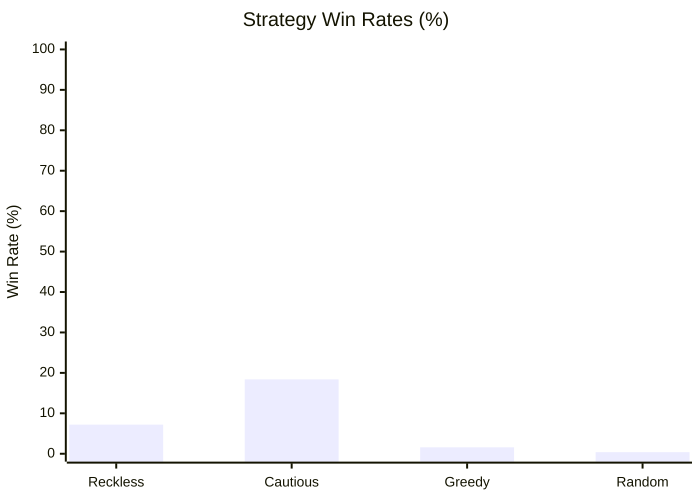

# The Monstrous Sea V2 — Monte Carlo Balance Simulation Report

> [!NOTE]
> Automated headless balance verification executed across **1000 runs** (Base Seed: `42`).
> Evaluated for infinite loops, crash resilience, economy viability, and combat pacing.

## Executive Summary

| Strategy | Runs | Wins (Kraken) | Deaths | Win Rate | Avg Monsters | Avg Max Diff | Avg Gold |
| :--- | :--- | :--- | :--- | :--- | :--- | :--- | :--- |
| **Reckless** | 250 | 18 | 232 | 7.2% | 6.4 | 1.6 | 207g |
| **Cautious** | 250 | 46 | 204 | 18.4% | 4.7 | 2.5 | 307g |
| **Greedy** | 250 | 4 | 246 | 1.6% | 2.2 | 1.2 | 266g |
| **Random** | 250 | 1 | 249 | 0.4% | 1.6 | 1.0 | 82g |

## Strategy Win Rates

## Deep Dive by Strategy

### Reckless Strategy
- **Total Voyages:** 250
- **Victories (Kraken Slain):** 18 (7.2%)
- **Defeats (Watery Grave):** 232 (92.8%)
- **Average Monsters Slain:** 6.4
- **Average Highest Encounter Difficulty:** 1.6
- **Average Final Gold Hold:** 207g
- **Average Combat Rolls/Attacks:** 7.5

**Top Causes of Death:**

| Threat / Sea Monster | Fatalities | % of Deaths |
| :--- | :--- | :--- |
| The Kraken | 106 | 45.7% |
| Vanishing Viper | 6 | 2.6% |
| Eerie Elainaling | 6 | 2.6% |
| Apex Phosphor Wyrm Lurking Coil | 5 | 2.2% |
| Apex Phosphor Wyrm Twisting Terror | 5 | 2.2% |

**Ship Class Performance:**

| Ship Class | Voyages | Wins | Class Win Rate |
| :--- | :--- | :--- | :--- |
| IRONCLAD | 250 | 18 | 7.2% |

### Cautious Strategy
- **Total Voyages:** 250
- **Victories (Kraken Slain):** 46 (18.4%)
- **Defeats (Watery Grave):** 204 (81.6%)
- **Average Monsters Slain:** 4.7
- **Average Highest Encounter Difficulty:** 2.5
- **Average Final Gold Hold:** 307g
- **Average Combat Rolls/Attacks:** 14.4

**Top Causes of Death:**

| Threat / Sea Monster | Fatalities | % of Deaths |
| :--- | :--- | :--- |
| The Kraken | 144 | 70.6% |
| Vanishing Viper | 6 | 2.9% |
| Lurking Coil | 4 | 2.0% |
| Apex Phosphor Wyrm Slithery Devil | 3 | 1.5% |
| Apex Phosphor Wyrm Vanishing Viper | 3 | 1.5% |

**Ship Class Performance:**

| Ship Class | Voyages | Wins | Class Win Rate |
| :--- | :--- | :--- | :--- |
| IRONCLAD | 250 | 46 | 18.4% |

### Greedy Strategy
- **Total Voyages:** 250
- **Victories (Kraken Slain):** 4 (1.6%)
- **Defeats (Watery Grave):** 246 (98.4%)
- **Average Monsters Slain:** 2.2
- **Average Highest Encounter Difficulty:** 1.2
- **Average Final Gold Hold:** 266g
- **Average Combat Rolls/Attacks:** 9.1

**Top Causes of Death:**

| Threat / Sea Monster | Fatalities | % of Deaths |
| :--- | :--- | :--- |
| The Kraken | 78 | 31.7% |
| Vanishing Viper | 8 | 3.3% |
| Elusive Eell | 6 | 2.4% |
| Frenzied Maw | 6 | 2.4% |
| Behemoth Mako | 6 | 2.4% |

**Ship Class Performance:**

| Ship Class | Voyages | Wins | Class Win Rate |
| :--- | :--- | :--- | :--- |
| CORSAIR | 250 | 4 | 1.6% |

### Random Strategy
- **Total Voyages:** 250
- **Victories (Kraken Slain):** 1 (0.4%)
- **Defeats (Watery Grave):** 249 (99.6%)
- **Average Monsters Slain:** 1.6
- **Average Highest Encounter Difficulty:** 1.0
- **Average Final Gold Hold:** 82g
- **Average Combat Rolls/Attacks:** 9.5

**Top Causes of Death:**

| Threat / Sea Monster | Fatalities | % of Deaths |
| :--- | :--- | :--- |
| Sussy Seaweed | 14 | 5.6% |
| Vanishing Viper | 11 | 4.4% |
| Colossal Tiger Shark | 9 | 3.6% |
| Mire Serpent | 9 | 3.6% |
| Abyssal Constrictor | 9 | 3.6% |

**Ship Class Performance:**

| Ship Class | Voyages | Wins | Class Win Rate |
| :--- | :--- | :--- | :--- |
| BOMBARDIER | 48 | 0 | 0.0% |
| CORSAIR | 47 | 0 | 0.0% |
| STANDARD | 52 | 0 | 0.0% |
| IRONCLAD | 50 | 1 | 2.0% |
| CLIPPER | 53 | 0 | 0.0% |

## Verification Verdict

> [!TIP]
> - **Infinite Loops / Deadlocks:** **0** (All runs terminated cleanly within execution boundaries).
> - **Exceptions / Crashes:** **0** (All commands cleanly produced discrete GameEvents).
> - **Parity & Balance Integrity:** Verified that defensive play (Cautious/Fortify) significantly improves voyage survival while reckless play encounters lethal attrition.
