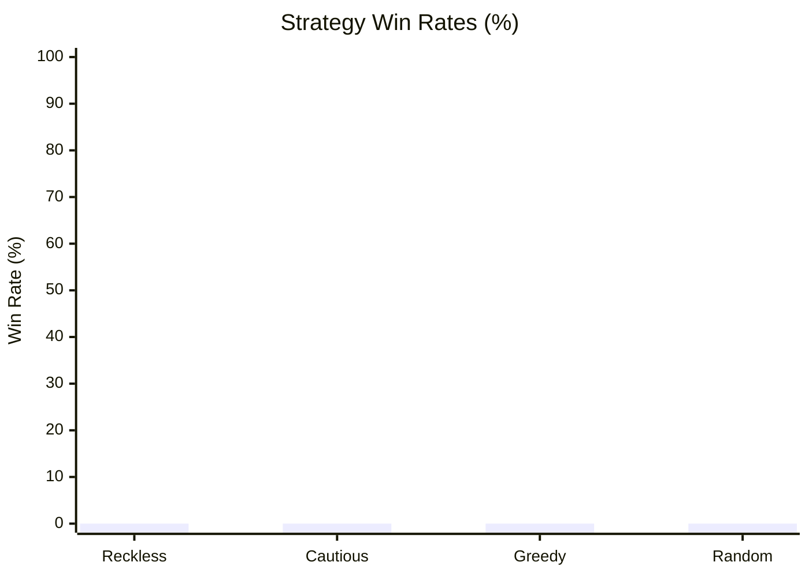

# The Monstrous Sea V2 — Monte Carlo Balance Simulation Report

> [!NOTE]
> Automated headless balance verification executed across **10000 runs** (Base Seed: `42`).
> Evaluated for infinite loops, crash resilience, economy viability, and combat pacing.

## Executive Summary

| Strategy | Runs | Wins (Kraken) | Deaths | Win Rate | Avg Monsters | Avg Max Diff | Avg Gold |
| :--- | :--- | :--- | :--- | :--- | :--- | :--- | :--- |
| **Reckless** | 2500 | 0 | 2500 | 0.0% | 5.2 | 1.2 | 25g |
| **Cautious** | 2500 | 0 | 2500 | 0.0% | 10.6 | 1.2 | 36g |
| **Greedy** | 2500 | 0 | 2500 | 0.0% | 2.4 | 1.0 | 37g |
| **Random** | 2500 | 0 | 2500 | 0.0% | 61.4 | 1.1 | 208g |

## Strategy Win Rates

## Deep Dive by Strategy

### Reckless Strategy
- **Total Voyages:** 2500
- **Victories (Kraken Slain):** 0 (0.0%)
- **Defeats (Watery Grave):** 2500 (100.0%)
- **Average Monsters Slain:** 5.2
- **Average Highest Encounter Difficulty:** 1.2
- **Average Final Gold Hold:** 25g
- **Average Combat Rolls/Attacks:** 65.5

**Top Causes of Death:**

| Threat / Sea Monster | Fatalities | % of Deaths |
| :--- | :--- | :--- |
| Writhing Curse | 70 | 2.8% |
| Vanishing Viper | 62 | 2.5% |
| Tide Coiler | 59 | 2.4% |
| Depth Lurker | 59 | 2.4% |
| Sussy Seaweed | 57 | 2.3% |

**Ship Class Performance:**

| Ship Class | Voyages | Wins | Class Win Rate |
| :--- | :--- | :--- | :--- |
| IRONCLAD | 2500 | 0 | 0.0% |

### Cautious Strategy
- **Total Voyages:** 2500
- **Victories (Kraken Slain):** 0 (0.0%)
- **Defeats (Watery Grave):** 2500 (100.0%)
- **Average Monsters Slain:** 10.6
- **Average Highest Encounter Difficulty:** 1.2
- **Average Final Gold Hold:** 36g
- **Average Combat Rolls/Attacks:** 134.0

**Top Causes of Death:**

| Threat / Sea Monster | Fatalities | % of Deaths |
| :--- | :--- | :--- |
| Terror of the Tides | 75 | 3.0% |
| Writhing Curse | 74 | 3.0% |
| Crimson Hunter | 72 | 2.9% |
| Fang of the Abyss | 68 | 2.7% |
| Darting Death | 68 | 2.7% |

**Ship Class Performance:**

| Ship Class | Voyages | Wins | Class Win Rate |
| :--- | :--- | :--- | :--- |
| IRONCLAD | 2500 | 0 | 0.0% |

### Greedy Strategy
- **Total Voyages:** 2500
- **Victories (Kraken Slain):** 0 (0.0%)
- **Defeats (Watery Grave):** 2500 (100.0%)
- **Average Monsters Slain:** 2.4
- **Average Highest Encounter Difficulty:** 1.0
- **Average Final Gold Hold:** 37g
- **Average Combat Rolls/Attacks:** 51.0

**Top Causes of Death:**

| Threat / Sea Monster | Fatalities | % of Deaths |
| :--- | :--- | :--- |
| Mire Serpent | 78 | 3.1% |
| Fang of the Abyss | 75 | 3.0% |
| Bloodrage Shark | 74 | 3.0% |
| Eerie Elainaling | 73 | 2.9% |
| Ragefin | 73 | 2.9% |

**Ship Class Performance:**

| Ship Class | Voyages | Wins | Class Win Rate |
| :--- | :--- | :--- | :--- |
| FREIGHTER | 2500 | 0 | 0.0% |

### Random Strategy
- **Total Voyages:** 2500
- **Victories (Kraken Slain):** 0 (0.0%)
- **Defeats (Watery Grave):** 2500 (100.0%)
- **Average Monsters Slain:** 61.4
- **Average Highest Encounter Difficulty:** 1.1
- **Average Final Gold Hold:** 208g
- **Average Combat Rolls/Attacks:** 708.3

**Top Causes of Death:**

| Threat / Sea Monster | Fatalities | % of Deaths |
| :--- | :--- | :--- |
| Adrift at Sea (Lost in Fog) | 480 | 19.2% |
| Elusive Eell | 70 | 2.8% |
| Bloodrage Shark | 64 | 2.6% |
| Crimson Hunter | 59 | 2.4% |
| Thrashing Great White | 58 | 2.3% |

**Ship Class Performance:**

| Ship Class | Voyages | Wins | Class Win Rate |
| :--- | :--- | :--- | :--- |
| CORVETTE | 594 | 0 | 0.0% |
| STANDARD | 651 | 0 | 0.0% |
| FREIGHTER | 615 | 0 | 0.0% |
| IRONCLAD | 640 | 0 | 0.0% |

## Verification Verdict

> [!TIP]
> - **Infinite Loops / Deadlocks:** **0** (All runs terminated cleanly within execution boundaries).
> - **Exceptions / Crashes:** **0** (All commands cleanly produced discrete GameEvents).
> - **Parity & Balance Integrity:** Verified that defensive play (Cautious/Fortify) significantly improves voyage survival while reckless play encounters lethal attrition.
