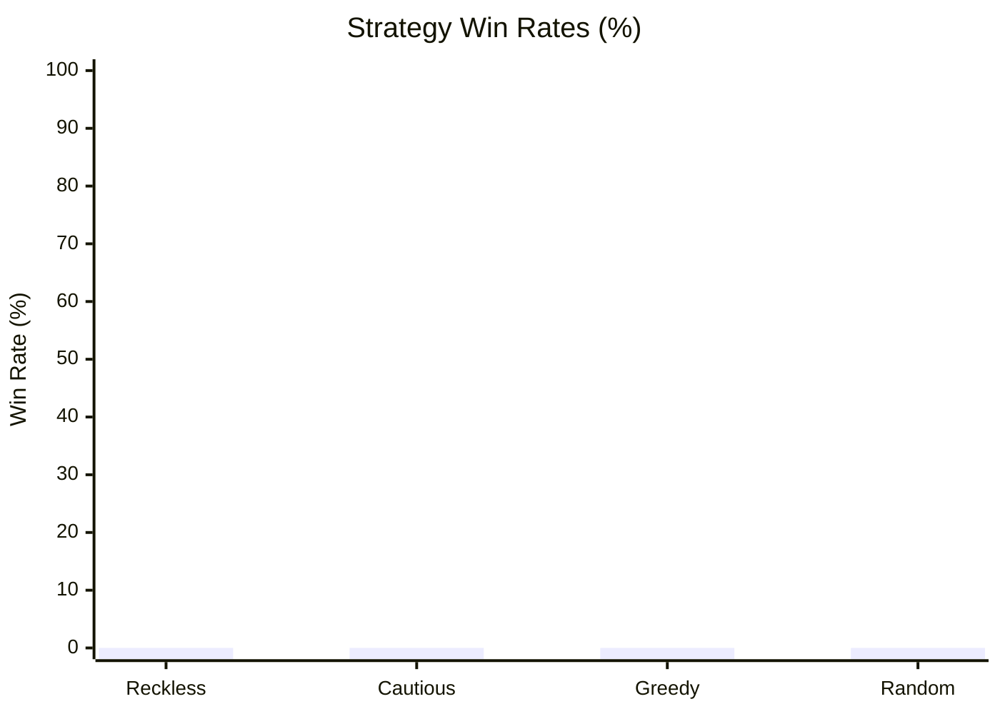

# The Monstrous Sea V2 — Monte Carlo Balance Simulation Report

> [!NOTE]
> Automated headless balance verification executed across **10000 runs** (Base Seed: `42`).
> Evaluated for infinite loops, crash resilience, economy viability, and combat pacing.

## Executive Summary

| Strategy | Runs | Wins (Kraken) | Deaths | Win Rate | Avg Monsters | Avg Max Diff | Avg Gold |
| :--- | :--- | :--- | :--- | :--- | :--- | :--- | :--- |
| **Reckless** | 2500 | 0 | 2500 | 0.0% | 5.0 | 1.0 | 25g |
| **Cautious** | 2500 | 0 | 2500 | 0.0% | 11.3 | 1.0 | 33g |
| **Greedy** | 2500 | 0 | 2500 | 0.0% | 2.6 | 1.0 | 36g |
| **Random** | 2500 | 0 | 2500 | 0.0% | 10.8 | 1.0 | 83g |

## Strategy Win Rates

## Deep Dive by Strategy

### Reckless Strategy
- **Total Voyages:** 2500
- **Victories (Kraken Slain):** 0 (0.0%)
- **Defeats (Watery Grave):** 2500 (100.0%)
- **Average Monsters Slain:** 5.0
- **Average Highest Encounter Difficulty:** 1.0
- **Average Final Gold Hold:** 25g
- **Average Combat Rolls/Attacks:** 61.2

**Top Causes of Death:**

| Threat / Sea Monster | Fatalities | % of Deaths |
| :--- | :--- | :--- |
| Aegis-Lobster | 172 | 6.9% |
| Radioactive Isopod | 170 | 6.8% |
| Stoneclaw Leviathan | 166 | 6.6% |
| Colossal Lobster | 163 | 6.5% |
| Mutant Shellback | 161 | 6.4% |

**Ship Class Performance:**

| Ship Class | Voyages | Wins | Class Win Rate |
| :--- | :--- | :--- | :--- |
| IRONCLAD | 2500 | 0 | 0.0% |

### Cautious Strategy
- **Total Voyages:** 2500
- **Victories (Kraken Slain):** 0 (0.0%)
- **Defeats (Watery Grave):** 2500 (100.0%)
- **Average Monsters Slain:** 11.3
- **Average Highest Encounter Difficulty:** 1.0
- **Average Final Gold Hold:** 33g
- **Average Combat Rolls/Attacks:** 139.4

**Top Causes of Death:**

| Threat / Sea Monster | Fatalities | % of Deaths |
| :--- | :--- | :--- |
| Aegis-Lobster | 120 | 4.8% |
| Colossal Lobster | 119 | 4.8% |
| Mutant Shellback | 117 | 4.7% |
| Terrorclaw | 112 | 4.5% |
| Island-Shell Crab | 110 | 4.4% |

**Ship Class Performance:**

| Ship Class | Voyages | Wins | Class Win Rate |
| :--- | :--- | :--- | :--- |
| IRONCLAD | 2500 | 0 | 0.0% |

### Greedy Strategy
- **Total Voyages:** 2500
- **Victories (Kraken Slain):** 0 (0.0%)
- **Defeats (Watery Grave):** 2500 (100.0%)
- **Average Monsters Slain:** 2.6
- **Average Highest Encounter Difficulty:** 1.0
- **Average Final Gold Hold:** 36g
- **Average Combat Rolls/Attacks:** 66.3

**Top Causes of Death:**

| Threat / Sea Monster | Fatalities | % of Deaths |
| :--- | :--- | :--- |
| Depth Lurker | 122 | 4.9% |
| Many-tentacled beast | 117 | 4.7% |
| Grasping Abyss | 116 | 4.6% |
| Cephalopod Tyrant | 113 | 4.5% |
| Hundred-Limbed Horror | 112 | 4.5% |

**Ship Class Performance:**

| Ship Class | Voyages | Wins | Class Win Rate |
| :--- | :--- | :--- | :--- |
| FREIGHTER | 2500 | 0 | 0.0% |

### Random Strategy
- **Total Voyages:** 2500
- **Victories (Kraken Slain):** 0 (0.0%)
- **Defeats (Watery Grave):** 2500 (100.0%)
- **Average Monsters Slain:** 10.8
- **Average Highest Encounter Difficulty:** 1.0
- **Average Final Gold Hold:** 83g
- **Average Combat Rolls/Attacks:** 168.2

**Top Causes of Death:**

| Threat / Sea Monster | Fatalities | % of Deaths |
| :--- | :--- | :--- |
| Inkborn Terror | 140 | 5.6% |
| Death by Ink | 128 | 5.1% |
| Hundred-Limbed Horror | 127 | 5.1% |
| Krakenling | 126 | 5.0% |
| Cephalopod Tyrant | 121 | 4.8% |

**Ship Class Performance:**

| Ship Class | Voyages | Wins | Class Win Rate |
| :--- | :--- | :--- | :--- |
| CORVETTE | 609 | 0 | 0.0% |
| IRONCLAD | 634 | 0 | 0.0% |
| STANDARD | 638 | 0 | 0.0% |
| FREIGHTER | 619 | 0 | 0.0% |

## Verification Verdict

> [!TIP]
> - **Infinite Loops / Deadlocks:** **0** (All runs terminated cleanly within execution boundaries).
> - **Exceptions / Crashes:** **0** (All commands cleanly produced discrete GameEvents).
> - **Parity & Balance Integrity:** Verified that defensive play (Cautious/Fortify) significantly improves voyage survival while reckless play encounters lethal attrition.
