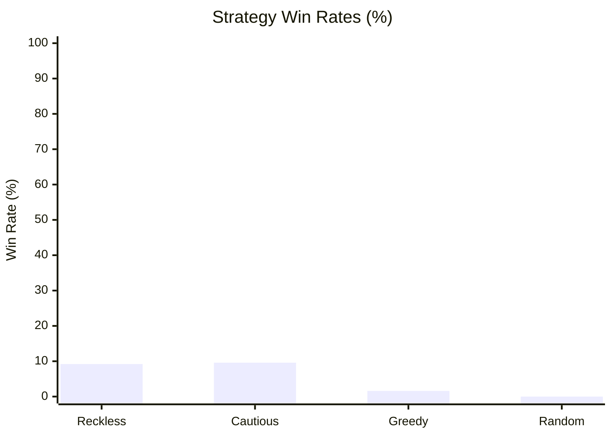

# The Monstrous Sea V2 — Monte Carlo Balance Simulation Report

> [!NOTE]
> Automated headless balance verification executed across **1000 runs** (Base Seed: `42`).
> Evaluated for infinite loops, crash resilience, economy viability, and combat pacing.

## Executive Summary

| Strategy | Runs | Wins (Kraken) | Deaths | Win Rate | Avg Monsters | Avg Max Diff | Avg Gold |
| :--- | :--- | :--- | :--- | :--- | :--- | :--- | :--- |
| **Reckless** | 250 | 23 | 227 | 9.2% | 6.4 | 1.6 | 215g |
| **Cautious** | 250 | 24 | 226 | 9.6% | 4.5 | 2.2 | 223g |
| **Greedy** | 250 | 4 | 246 | 1.6% | 2.3 | 1.2 | 269g |
| **Random** | 250 | 0 | 250 | 0.0% | 1.5 | 1.0 | 73g |

## Strategy Win Rates

## Deep Dive by Strategy

### Reckless Strategy
- **Total Voyages:** 250
- **Victories (Kraken Slain):** 23 (9.2%)
- **Defeats (Watery Grave):** 227 (90.8%)
- **Average Monsters Slain:** 6.4
- **Average Highest Encounter Difficulty:** 1.6
- **Average Final Gold Hold:** 215g
- **Average Combat Rolls/Attacks:** 7.4

**Top Causes of Death:**

| Threat / Sea Monster | Fatalities | % of Deaths |
| :--- | :--- | :--- |
| The Kraken | 100 | 44.1% |
| Eerie Elainaling | 8 | 3.5% |
| Abyssal Constrictor | 6 | 2.6% |
| Apex Phosphor Wyrm Twisting Terror | 6 | 2.6% |
| Vanishing Viper | 6 | 2.6% |

**Ship Class Performance:**

| Ship Class | Voyages | Wins | Class Win Rate |
| :--- | :--- | :--- | :--- |
| IRONCLAD | 250 | 23 | 9.2% |

### Cautious Strategy
- **Total Voyages:** 250
- **Victories (Kraken Slain):** 24 (9.6%)
- **Defeats (Watery Grave):** 226 (90.4%)
- **Average Monsters Slain:** 4.5
- **Average Highest Encounter Difficulty:** 2.2
- **Average Final Gold Hold:** 223g
- **Average Combat Rolls/Attacks:** 14.7

**Top Causes of Death:**

| Threat / Sea Monster | Fatalities | % of Deaths |
| :--- | :--- | :--- |
| The Kraken | 150 | 66.4% |
| Apex Abyssal Krakenling Razor Tendrils | 5 | 2.2% |
| Vanishing Viper | 4 | 1.8% |
| Mire Serpent | 4 | 1.8% |
| Lurking Coil | 3 | 1.3% |

**Ship Class Performance:**

| Ship Class | Voyages | Wins | Class Win Rate |
| :--- | :--- | :--- | :--- |
| IRONCLAD | 250 | 24 | 9.6% |

### Greedy Strategy
- **Total Voyages:** 250
- **Victories (Kraken Slain):** 4 (1.6%)
- **Defeats (Watery Grave):** 246 (98.4%)
- **Average Monsters Slain:** 2.3
- **Average Highest Encounter Difficulty:** 1.2
- **Average Final Gold Hold:** 269g
- **Average Combat Rolls/Attacks:** 9.0

**Top Causes of Death:**

| Threat / Sea Monster | Fatalities | % of Deaths |
| :--- | :--- | :--- |
| The Kraken | 80 | 32.5% |
| Mire Serpent | 7 | 2.8% |
| Elusive Eell | 6 | 2.4% |
| Frenzied Maw | 6 | 2.4% |
| Colossal Tiger Shark | 6 | 2.4% |

**Ship Class Performance:**

| Ship Class | Voyages | Wins | Class Win Rate |
| :--- | :--- | :--- | :--- |
| CORSAIR | 250 | 4 | 1.6% |

### Random Strategy
- **Total Voyages:** 250
- **Victories (Kraken Slain):** 0 (0.0%)
- **Defeats (Watery Grave):** 250 (100.0%)
- **Average Monsters Slain:** 1.5
- **Average Highest Encounter Difficulty:** 1.0
- **Average Final Gold Hold:** 73g
- **Average Combat Rolls/Attacks:** 9.7

**Top Causes of Death:**

| Threat / Sea Monster | Fatalities | % of Deaths |
| :--- | :--- | :--- |
| Sussy Seaweed | 12 | 4.8% |
| Bloodthirsty Bull Shark | 11 | 4.4% |
| Darting Death | 10 | 4.0% |
| Mire Serpent | 10 | 4.0% |
| Writhing Curse | 9 | 3.6% |

**Ship Class Performance:**

| Ship Class | Voyages | Wins | Class Win Rate |
| :--- | :--- | :--- | :--- |
| BOMBARDIER | 54 | 0 | 0.0% |
| CORSAIR | 56 | 0 | 0.0% |
| STANDARD | 51 | 0 | 0.0% |
| CLIPPER | 48 | 0 | 0.0% |
| IRONCLAD | 41 | 0 | 0.0% |

## Verification Verdict

> [!TIP]
> - **Infinite Loops / Deadlocks:** **0** (All runs terminated cleanly within execution boundaries).
> - **Exceptions / Crashes:** **0** (All commands cleanly produced discrete GameEvents).
> - **Parity & Balance Integrity:** Verified that defensive play (Cautious/Fortify) significantly improves voyage survival while reckless play encounters lethal attrition.
