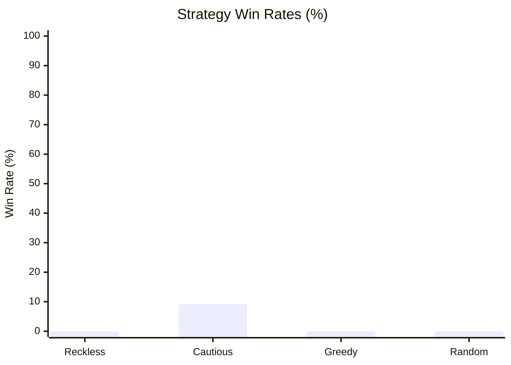

# The Monstrous Sea V2 — Monte Carlo Balance Simulation Report

> [!NOTE]
> Automated headless balance verification executed across **1000 runs** (Base Seed: `42`).
> Evaluated for infinite loops, crash resilience, economy viability, and combat pacing.

## Executive Summary

| Strategy | Runs | Wins (Kraken) | Deaths | Win Rate | Avg Monsters | Avg Max Diff | Avg Gold |
| :--- | :--- | :--- | :--- | :--- | :--- | :--- | :--- |
| **Reckless** | 250 | 0 | 250 | 0.0% | 2.2 | 0.9 | 72g |
| **Cautious** | 250 | 23 | 227 | 9.2% | 3.3 | 2.0 | 228g |
| **Greedy** | 250 | 0 | 250 | 0.0% | 1.7 | 1.1 | 227g |
| **Random** | 250 | 0 | 250 | 0.0% | 1.2 | 0.9 | 69g |

## Strategy Win Rates

## Deep Dive by Strategy

### Reckless Strategy
- **Total Voyages:** 250
- **Victories (Kraken Slain):** 0 (0.0%)
- **Defeats (Watery Grave):** 250 (100.0%)
- **Average Monsters Slain:** 2.2
- **Average Highest Encounter Difficulty:** 0.9
- **Average Final Gold Hold:** 72g
- **Average Combat Rolls/Attacks:** 7.8

**Top Causes of Death:**

| Threat / Sea Monster | Fatalities | % of Deaths |
| :--- | :--- | :--- |
| Abyssal Constrictor | 12 | 4.8% |
| Mire Serpent | 9 | 3.6% |
| Lurking Coil | 9 | 3.6% |
| Vanishing Viper | 7 | 2.8% |
| Elusive Eell | 7 | 2.8% |

**Ship Class Performance:**

| Ship Class | Voyages | Wins | Class Win Rate |
| :--- | :--- | :--- | :--- |
| STANDARD | 250 | 0 | 0.0% |

### Cautious Strategy
- **Total Voyages:** 250
- **Victories (Kraken Slain):** 23 (9.2%)
- **Defeats (Watery Grave):** 227 (90.8%)
- **Average Monsters Slain:** 3.3
- **Average Highest Encounter Difficulty:** 2.0
- **Average Final Gold Hold:** 228g
- **Average Combat Rolls/Attacks:** 10.3

**Top Causes of Death:**

| Threat / Sea Monster | Fatalities | % of Deaths |
| :--- | :--- | :--- |
| The Kraken | 115 | 50.7% |
| Vanishing Viper | 6 | 2.6% |
| Darting Death | 5 | 2.2% |
| Lurking Coil | 5 | 2.2% |
| Mire Serpent | 5 | 2.2% |

**Ship Class Performance:**

| Ship Class | Voyages | Wins | Class Win Rate |
| :--- | :--- | :--- | :--- |
| STANDARD | 250 | 23 | 9.2% |

### Greedy Strategy
- **Total Voyages:** 250
- **Victories (Kraken Slain):** 0 (0.0%)
- **Defeats (Watery Grave):** 250 (100.0%)
- **Average Monsters Slain:** 1.7
- **Average Highest Encounter Difficulty:** 1.1
- **Average Final Gold Hold:** 227g
- **Average Combat Rolls/Attacks:** 9.7

**Top Causes of Death:**

| Threat / Sea Monster | Fatalities | % of Deaths |
| :--- | :--- | :--- |
| The Kraken | 73 | 29.2% |
| Twisting Terror | 13 | 5.2% |
| Mire Serpent | 10 | 4.0% |
| Sussy Seaweed | 10 | 4.0% |
| Tide Coiler | 8 | 3.2% |

**Ship Class Performance:**

| Ship Class | Voyages | Wins | Class Win Rate |
| :--- | :--- | :--- | :--- |
| STANDARD | 250 | 0 | 0.0% |

### Random Strategy
- **Total Voyages:** 250
- **Victories (Kraken Slain):** 0 (0.0%)
- **Defeats (Watery Grave):** 250 (100.0%)
- **Average Monsters Slain:** 1.2
- **Average Highest Encounter Difficulty:** 0.9
- **Average Final Gold Hold:** 69g
- **Average Combat Rolls/Attacks:** 9.9

**Top Causes of Death:**

| Threat / Sea Monster | Fatalities | % of Deaths |
| :--- | :--- | :--- |
| Elusive Eell | 10 | 4.0% |
| Twisting Terror | 9 | 3.6% |
| Terror of the Tides | 8 | 3.2% |
| Tide Coiler | 8 | 3.2% |
| Lurking Coil | 7 | 2.8% |

**Ship Class Performance:**

| Ship Class | Voyages | Wins | Class Win Rate |
| :--- | :--- | :--- | :--- |
| STANDARD | 250 | 0 | 0.0% |

## Verification Verdict

> [!TIP]
> - **Infinite Loops / Deadlocks:** **0** (All runs terminated cleanly within execution boundaries).
> - **Exceptions / Crashes:** **0** (All commands cleanly produced discrete GameEvents).
> - **Parity & Balance Integrity:** Verified that defensive play (Cautious/Fortify) significantly improves voyage survival while reckless play encounters lethal attrition.
