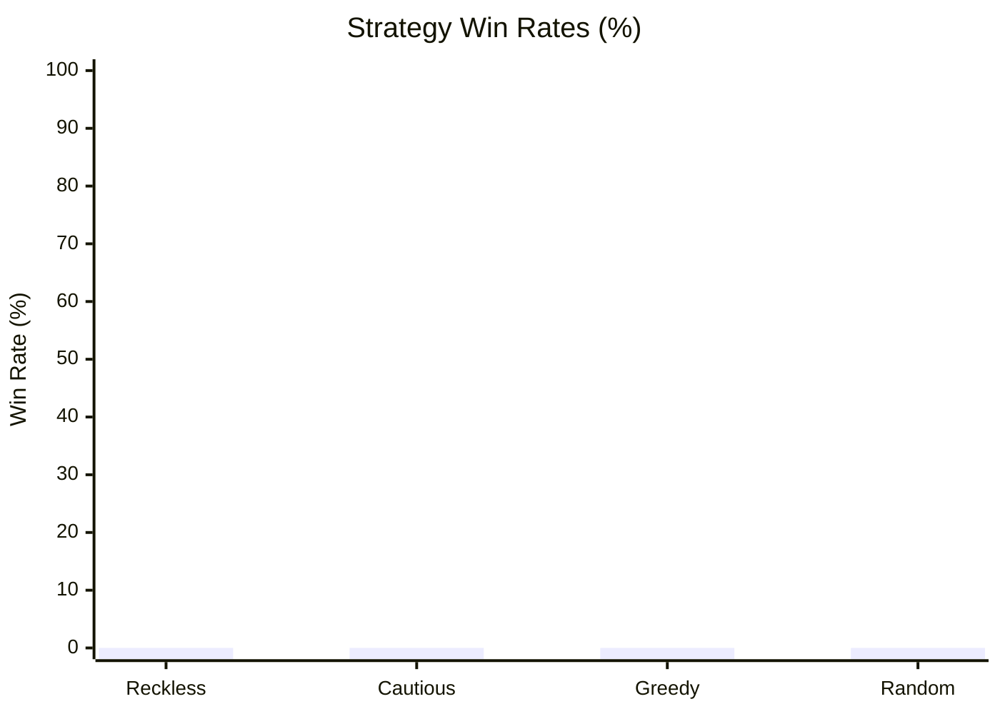

# The Monstrous Sea V2 — Monte Carlo Balance Simulation Report

> [!NOTE]
> Automated headless balance verification executed across **1000 runs** (Base Seed: `42`).
> Evaluated for infinite loops, crash resilience, economy viability, and combat pacing.

## Executive Summary

| Strategy | Runs | Wins (Kraken) | Deaths | Win Rate | Avg Monsters | Avg Max Diff | Avg Gold |
| :--- | :--- | :--- | :--- | :--- | :--- | :--- | :--- |
| **Reckless** | 250 | 0 | 250 | 0.0% | 70.9 | 1.4 | 1262g |
| **Cautious** | 250 | 0 | 250 | 0.0% | 52.7 | 1.5 | 974g |
| **Greedy** | 250 | 0 | 250 | 0.0% | 3.8 | 1.0 | 135g |
| **Random** | 250 | 0 | 250 | 0.0% | 2.7 | 0.9 | 67g |

## Strategy Win Rates

## Deep Dive by Strategy

### Reckless Strategy
- **Total Voyages:** 250
- **Victories (Kraken Slain):** 0 (0.0%)
- **Defeats (Watery Grave):** 250 (100.0%)
- **Average Monsters Slain:** 70.9
- **Average Highest Encounter Difficulty:** 1.4
- **Average Final Gold Hold:** 1262g
- **Average Combat Rolls/Attacks:** 1.8

**Top Causes of Death:**

| Threat / Sea Monster | Fatalities | % of Deaths |
| :--- | :--- | :--- |
| Adrift at Sea (Lost in Fog) | 171 | 68.4% |
| Writhing Curse | 10 | 4.0% |
| Colossal Tiger Shark | 5 | 2.0% |
| Darting Death | 4 | 1.6% |
| Mire Serpent | 4 | 1.6% |

**Ship Class Performance:**

| Ship Class | Voyages | Wins | Class Win Rate |
| :--- | :--- | :--- | :--- |
| IRONCLAD | 250 | 0 | 0.0% |

### Cautious Strategy
- **Total Voyages:** 250
- **Victories (Kraken Slain):** 0 (0.0%)
- **Defeats (Watery Grave):** 250 (100.0%)
- **Average Monsters Slain:** 52.7
- **Average Highest Encounter Difficulty:** 1.5
- **Average Final Gold Hold:** 974g
- **Average Combat Rolls/Attacks:** 3.4

**Top Causes of Death:**

| Threat / Sea Monster | Fatalities | % of Deaths |
| :--- | :--- | :--- |
| Adrift at Sea (Lost in Fog) | 187 | 74.8% |
| Lurking Coil | 4 | 1.6% |
| Mire Serpent | 4 | 1.6% |
| Shellbound Menace | 3 | 1.2% |
| Mutant Shellback | 3 | 1.2% |

**Ship Class Performance:**

| Ship Class | Voyages | Wins | Class Win Rate |
| :--- | :--- | :--- | :--- |
| IRONCLAD | 250 | 0 | 0.0% |

### Greedy Strategy
- **Total Voyages:** 250
- **Victories (Kraken Slain):** 0 (0.0%)
- **Defeats (Watery Grave):** 250 (100.0%)
- **Average Monsters Slain:** 3.8
- **Average Highest Encounter Difficulty:** 1.0
- **Average Final Gold Hold:** 135g
- **Average Combat Rolls/Attacks:** 5.3

**Top Causes of Death:**

| Threat / Sea Monster | Fatalities | % of Deaths |
| :--- | :--- | :--- |
| Adrift at Sea (Lost in Fog) | 142 | 56.8% |
| Thrashing Great White | 9 | 3.6% |
| Lurking Coil | 6 | 2.4% |
| Vanishing Viper | 6 | 2.4% |
| Sussy Seaweed | 5 | 2.0% |

**Ship Class Performance:**

| Ship Class | Voyages | Wins | Class Win Rate |
| :--- | :--- | :--- | :--- |
| FREIGHTER | 250 | 0 | 0.0% |

### Random Strategy
- **Total Voyages:** 250
- **Victories (Kraken Slain):** 0 (0.0%)
- **Defeats (Watery Grave):** 250 (100.0%)
- **Average Monsters Slain:** 2.7
- **Average Highest Encounter Difficulty:** 0.9
- **Average Final Gold Hold:** 67g
- **Average Combat Rolls/Attacks:** 7.5

**Top Causes of Death:**

| Threat / Sea Monster | Fatalities | % of Deaths |
| :--- | :--- | :--- |
| Adrift at Sea (Lost in Fog) | 45 | 18.0% |
| Tide Coiler | 11 | 4.4% |
| Vanishing Viper | 10 | 4.0% |
| Ragefin | 9 | 3.6% |
| Abyssal Constrictor | 8 | 3.2% |

**Ship Class Performance:**

| Ship Class | Voyages | Wins | Class Win Rate |
| :--- | :--- | :--- | :--- |
| CORSAIR | 38 | 0 | 0.0% |
| CLIPPER | 41 | 0 | 0.0% |
| STANDARD | 35 | 0 | 0.0% |
| BOMBARDIER | 36 | 0 | 0.0% |
| IRONCLAD | 28 | 0 | 0.0% |
| FREIGHTER | 36 | 0 | 0.0% |
| CORVETTE | 36 | 0 | 0.0% |

## Verification Verdict

> [!TIP]
> - **Infinite Loops / Deadlocks:** **0** (All runs terminated cleanly within execution boundaries).
> - **Exceptions / Crashes:** **0** (All commands cleanly produced discrete GameEvents).
> - **Parity & Balance Integrity:** Verified that defensive play (Cautious/Fortify) significantly improves voyage survival while reckless play encounters lethal attrition.
