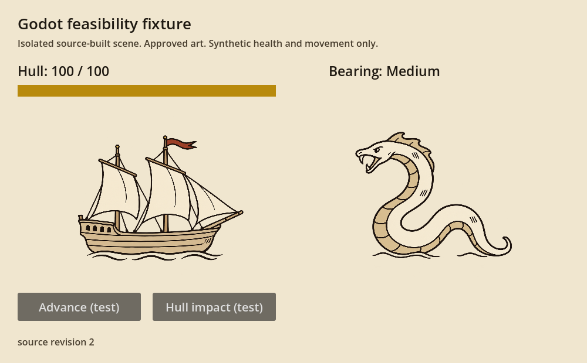
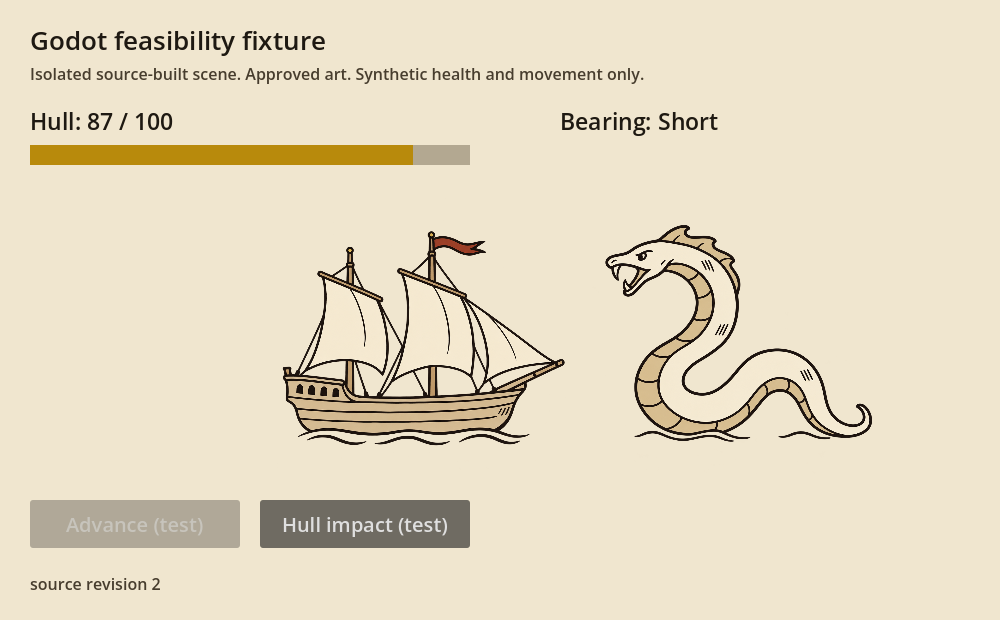

# Godot agent-workflow feasibility check

**Result: the four feasibility requirements passed. A bounded head-to-head comparison is worth pursuing; this is not evidence for migration yet.** No comparative Flutter prototype, combat redesign or rules port was started.

## Scope and timing

- Goal began **26 October 2026, 22:40:25 America/Denver** (`2026-10-27T04:40:25Z`).
- Deadline: 23:25:25 local, 45 minutes including setup.
- Download provenance recorded at 22:41:41 local. First successful isolated graphical verification finished at 22:44:24; the changed scene and subsequent relaunch passed at 22:45:37 and 22:45:40.
- The final completion audit and elapsed duration are recorded in `completion.json` beside this report. Work ended well before the deadline; unused time was not spent adding scope.
- **Godot:** official portable Windows x86_64 **4.7.2**, executable version `4.7.2.stable.official.ed1daf0bf`.
- **Language:** GDScript. Selected to evaluate the direct source/scene workflow without installing .NET. C# suitability was not tested or decided.
- **Rendering:** native Windows display driver, OpenGL Compatibility, NVIDIA GeForce RTX 4060 Laptop GPU. Rendering was enabled; this was not a headless-image substitute.

## Requirement evidence

| Requirement | Observed evidence | Result |
| --- | --- | --- |
| Create and modify a scene through source | Authored [project settings](project/project.godot), [text scene](project/main.tscn) and [script](project/main.gd). Changed the scene's exported impact from 8 to 13, revision text from 1 to 2 and bar colors. Runtime inspection and rendered images reflected the changes after relaunch. | Pass |
| Launch reproducibly | Python launched the portable executable, waited for a fresh readiness file, collected logs, exercised the live scene and checked exit code 0. Successful revision-2 runs took 2.250 and 2.141 seconds for this tiny verification sequence; these are not comparative performance benchmarks. | Pass |
| Capture actual rendered appearance | Godot's real viewport was captured after `RenderingServer.frame_post_draw`. Both 1000×620 PNGs were inspected visually; art, labels, bar fill and changed ship position are visible. | Pass |
| Inspect runtime state and verify change | A fixture-specific loopback JSON endpoint was queried by an external Python process. It observed x=270 → intermediate tween samples → x=420, Medium → Short, hull 100 → 87, matching bar value and label. | Pass |

Successful machine-readable receipts: [initial isolated run](evidence/isolated/verified.json), [modified scene](evidence/modified-shortpath/verified.json), [repeat launch](evidence/relaunch-shortpath/verified.json). Full commands, stdout/stderr and readiness snapshots are beside each receipt. Stale readiness files are rejected rather than reused.

## Rendered evidence

Before movement/damage, source revision 2:



After movement and 13 test damage:



These are a deliberately plain feasibility fixture, not a proposed combat UI or art direction. They use byte-identical copies of the existing approved ship and serpent PNGs.

## Reproduce from the repository root

Python 3.12 was used; no Python packages or engine plugins were installed.

```powershell
python tools/evaluations/godot-feasibility-2026-10-26/setup.py

& './tools/evaluations/godot-feasibility-2026-10-26/runtime/Godot_v4.7.2-stable_win64_console.exe' --headless --editor --path './tools/evaluations/godot-feasibility-2026-10-26/project' --import

python tools/evaluations/godot-feasibility-2026-10-26/verify.py
```

The last command uses a fresh evidence directory by default. It launches actual rendering, inspects the scene, captures before/after images, verifies movement and health, checks error logs and exits the process. `--run <fresh-label>` names a specific run. This workspace's command sandbox required execution/network escalations; no human editor operations or scene adjustments were needed.

The viewport capture and state endpoint are custom evaluation code, not an installed Godot MCP or an out-of-the-box autonomous visual testing system. The commands target the actual runtime and scene properties; OS mouse/keyboard behavior was not tested. The visible buttons share the fixture handlers, but the verifier invokes those handlers through the endpoint rather than clicking them.

## One-time setup friction and repairs

1. Godot was not found on PATH or in the small set of installation locations checked. Downloaded the 86,013,866-byte official portable archive into `runtime/`, following the [official Windows download](https://godotengine.org/download/windows/). Its SHA512 matched the official published checksum. [Download URL, resolved URL and hashes](download.json) are retained. No system-wide installation was made.
2. The first graphical run failed the strict isolation assertion: editor self-contained mode did not redirect this launched game's `user://` location. It created a uniquely named Godot fixture cache in Roaming AppData. The harness now supplies process-local `APPDATA` and `LOCALAPPDATA`; inspection confirms the game's user data is inside this evaluation. The initial cache's creation times and exact target were verified, then only that cache was removed. [Cleanup record](evidence/initial-cache-cleanup.json).
3. Two subsequent launches completed their movement/health checks but failed the clean-error-log gate with GLES shader-cache initialization errors. Shortening the evaluation-only custom user-directory name to `g` eliminated the errors on the next cold and warm runs, with shader caching still enabled. Windows path length is a plausible explanation, not an established root cause. Failed-run logs remain in `evidence/modified/` and `evidence/relaunch/`.

## Recurring workflow observed

Edit text scene/script → launch helper → query live state → capture rendered frame → verify → exit. No scene dragging, editor clicking, manually timed screenshots, model switching or subagent work was required. The source change and repeat launch succeeded without syntax repairs. Time was spent on setup/isolation and one environment/cache issue rather than gameplay implementation.

The external inspection helper is an ongoing maintenance obligation. It is small and useful for this check, but does not establish broad scene introspection, semantic UI automation or automated judgments about readability.

## Preservation and limits

- [Baseline](baseline.json) hashes 574 pre-existing tracked/untracked repository files. The verifier checks them after successful runs; the completion audit checks them again. Existing changes to `docs/BACKLOG.md`, `docs/README.md`, `docs/design/` and `trait_lore.dart` are retained. Only this new evaluation directory was added.
- No production app was launched, and no production save path was opened by the fixture or test harness. This is code/path isolation, not a full operating-system filesystem trace.
- Downloaded runtime/editor data, process-local profiles and generated import cache are ignored within this directory. Original art files are unchanged.
- No claim is made about complex combat clarity, large UI layouts, accessibility, 115–130% scaling, sound, particles, exported standalone packaging, C#, web, persistence, Dart interoperability, large-project performance or superiority to Flutter.
- A static capture cannot demonstrate motion quality. Intermediate runtime coordinates establish that a tween ran; evaluating its perceived quality belongs in the later comparison.

## Recommendation

**Proceed to the separately agreed comparative experiment if desired.** Godot cleared the practical source-edit / native-render / capture / runtime-inspection gate quickly, with no manual editor dependence. That makes it a feasible agent-development candidate on this machine. The setup/path repairs are concrete costs to retain in the comparison.

The next experiment still needs to establish whether creating and changing meaningful combat feedback is easier than in Flutter/Flame. This check supplies no evidence that would justify a full migration, and it authorizes no automatic continuation into that work.
